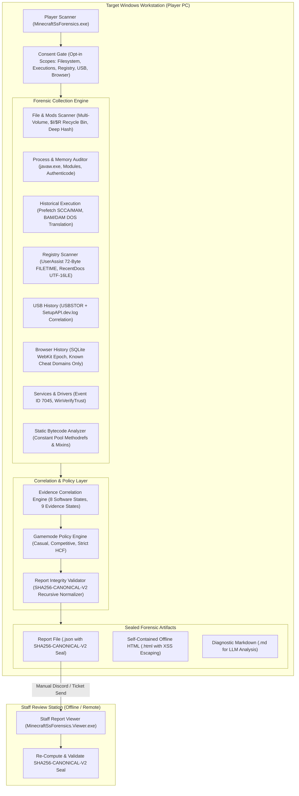

# Architecture — Standalone Windows Minecraft Forensic Suite

## 1. System Overview

**Minecraft SS Forensics** is a standalone, offline-first forensic investigation tool for Windows 10 and 11. Built to audit competitive Minecraft players during screenshare (SS) investigations, it operates with strict consent gates, non-invasive read-only data collection, and cryptographic integrity protection.

The suite consists of two specialized binaries:
1. **`MinecraftSsForensics.exe` (Scanner)**: Player-facing application that collects consented local forensic evidence, correlates multiple telemetry layers, and produces an immutable, cryptographically sealed report.
2. **`MinecraftSsForensics.Viewer.exe` (Viewer)**: Staff-facing forensic workstation that opens, verifies the seal, searches, filters, and renders complete audit findings without internet access.

---

## 2. Core Architectural Principles

### 2.1 100% Standalone & Offline-First
- **Zero Remote Dependencies**: No backend web APIs, cloud endpoints, hosted databases, or remote authentication services.
- **Zero Central Telemetry**: No background reporting, telemetry tracking, or user data exfiltration.
- **Local Policy Evaluation**: Policies are bundled and sealed as local JSON configuration packs (`PolicyPack`).

### 2.2 Strict Non-Invasive Read-Only Execution
- **Zero Drivers / Services**: Operates entirely in user mode (`Standard User` or `Elevated User`). No kernel drivers or persistent services are installed.
- **Non-Invasive Access**: Files and registry entries are opened with shared read locks (`FileShare.ReadWrite | FileShare.Delete`). No temporary files are dropped into target scan directories.
- **Zero Code Injection**: The scanner never injects DLLs, writes to remote process memory, or alters running game processes.

### 2.3 Explicit Player Consent & Sensitive Opt-Ins
- **Scope-Gated Execution**: Players must review and accept the scan scope before any forensic data collection begins.
- **Sensitive Categories Opt-In**: Browser history auditing is strictly unchecked by default and requires explicit affirmative opt-in.
- **Narrow Filtering**: When browser history scanning is enabled, only queries matching known cheat distribution domains (`vape.gg`, `drip.gg`, etc.) are captured. General web traffic, cookies, passwords, and form entries are never read.

---

## 3. Forensic Engine Architecture

### 3.1 Authenticode Digital Signature Verification (`WinVerifyTrust`)
Rather than relying on file extensions or self-reported metadata, binary modules and executables are verified against the Windows Cryptographic Architecture via Win32 P/Invoke:
- Action GUID: `WINTRUST_ACTION_GENERIC_VERIFY_V2` (`{00AAC56B-CD44-11d0-8CC2-00C04FC295EE}`).
- Checks catalog signing and embedded PKCS#7 digital signatures.
- Extracts signer certificate subject names and timestamps via `CryptQueryObject` and `CertGetNameString`.

### 3.2 Historical Execution Engine
- **Windows Prefetch (Win 10/11 MAM Decompression)**:
  - Decompresses native Windows 10/11 compressed prefetch files (`MAM\x04` header) using `ntdll.dll!RtlDecompressBufferEx` with `COMPRESSION_FORMAT_XPRESS_HUFF`.
  - Parses SCCA format headers (Version 30/31), extracting the executable name, file hash, run count, all 8 execution timestamps, and loaded DLL module lists.
- **Background Activity Moderator (BAM) & Device Path Translation**:
  - Audits `SYSTEM\CurrentControlSet\Services\bam\State\UserSettings\{SID}` for 8-byte `FILETIME` execution entries.
  - Translates NT device paths (`\Device\HarddiskVolume3\Games\...`) into standard drive letters (`C:\Games\...`) via `kernel32.dll!QueryDosDevice`.

### 3.3 Multi-Volume & Recycle Bin Recovery
- **Multi-Drive Enumeration**: Automatically discovers all ready fixed drives (`DriveInfo.GetDrives()`), scanning mod locations across non-C: installations.
- **Recycle Bin Parsing**:
  - Scans `\$Recycle.Bin\{SID}\` for paired `$I` (metadata index) and `$R` (content) artifacts.
  - Supports both Version 1 (Windows Vista/7/8 - 544 bytes) and Version 2 (Windows 10/11 - variable length UTF-16LE path with character length header).
  - Recovers original deleted filename, file size, deletion timestamp, and hashes the deleted `$R` payload.

### 3.4 In-Memory Static Bytecode Analyzer
Inspects Java `.jar` and `.class` archives in memory without JVM execution:
- Parses constant pool structures (`Methodref`, `InterfaceMethodref`, `Fieldref`, `Utf8`).
- Scans method bytecode instructions (`invokevirtual`, `invokestatic`, `invokeinterface`) for cheat-associated APIs (`java/awt/Robot`, `glfwSetCursorPos`, `interactBlock`, `autoCrystal`, `sendPacket`).
- Maps Fabric/Forge `@Mixin` target classes to detect bytecode hooks into Minecraft rendering or combat pipelines.
- Enforces strict Zip-Bomb limits (max entries: 10,000; max uncompressed size: 250 MB; max ratio: 100:1).

---

## 4. Cryptographic Report Sealing (`SHA256-CANONICAL-V2`)

To prevent offline report tampering (e.g., players editing JSON to delete detected cheats), every report is sealed with a cryptographic digest:

1. **Envelope Architecture**:
   - `ReportMetadata`: Contains scan ID, timestamps, target OS, and `IntegritySeal`.
   - `ReportIntegritySeal`: Stores `Algorithm` (`"SHA256-CANONICAL-V2"`), `CanonicalDigest`, and `Signature`.
   - `ReportPayload`: The entire body of forensic data (Findings, Summary, DiscoveredMods, ProcessTelemetry, HistoricalEvidence, Diagnostics).
2. **Canonical Normalization**:
   - Serialized via `ReportIntegrityValidator` using a deterministic recursive property sort (case-sensitive ordinal ordering).
   - Floats/doubles formatted with invariant decimal representation.
   - ISO 8601 UTC timestamps formatted to `yyyy-MM-ddTHH:mm:ss.fffffffZ`.
   - White-space stripped to zero indentation.
3. **Verification**:
   - The Staff Viewer strips the seal container, reconstructs the canonical normalized string, recomputes the SHA-256 hash, and compares digests in constant time (`CryptographicOperations.FixedTimeEquals`).
