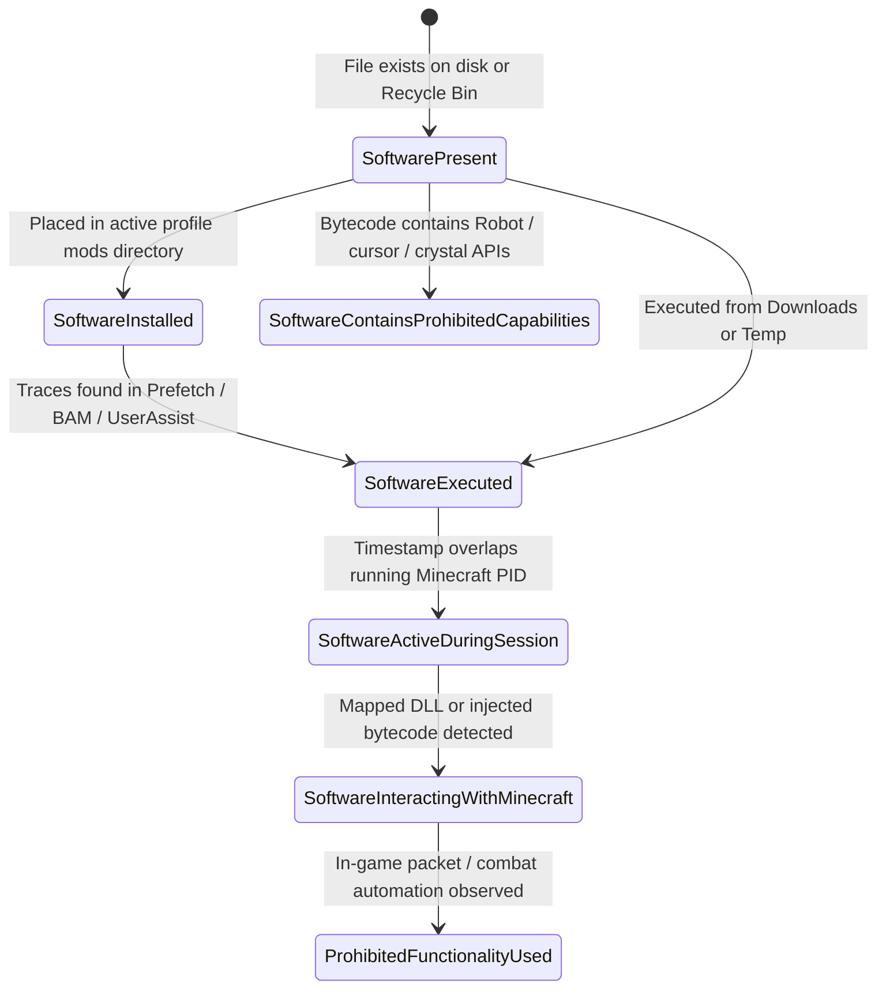

# Evidence Confidence & Correlation Methodology

This document outlines the scoring methodology, evidence state definitions, and correlation algorithms used by **Minecraft SS Forensics** to evaluate findings without subjective guesswork.

---

## 1. The 8 Correlated Software States

Forensic evidence is categorized into 8 distinct software states to eliminate false positives:

1. **`SoftwarePresent`**: File identified in storage (Downloads, Desktop, staging folder, or Recycle Bin). No evidence of installation in Minecraft or execution.
2. **`SoftwareInstalled`**: File identified inside an active Minecraft profile `mods/` directory.
3. **`SoftwareExecuted`**: File recorded as having been executed on the host system via Prefetch, BAM/DAM, or UserAssist.
4. **`SoftwareActiveDuringSession`**: Execution timestamp overlaps directly with the running `javaw.exe` session timestamp.
5. **`SoftwareInteractingWithMinecraft`**: Unsigned DLL or module mapped into the Minecraft process address space, or explicit runtime injection detected.
6. **`ProhibitedFunctionalityUsed`**: In-game packet, crystal automation, or synthetic input corroborated during the active match.
7. **`SoftwareContainsProhibitedCapabilities`**: In-memory bytecode analysis revealed prohibited capabilities (e.g. `java/awt/Robot`, `glfwSetCursorPos`, `autoCrystal`), regardless of current execution state.
8. **`Clean / Permitted`**: Mod matches official repository release and is permitted under server policy.

---

## 2. The 9 Standard Evidence States

Every collected forensic artifact is assigned an explicit evidentiary status:

| Evidence State | Description | Typical Score Impact |
| :--- | :--- | :--- |
| **`CONFIRMED`** | Directly verified by deterministic forensic proof (e.g. exact cryptographic hash match, Prefetch run record). | `1.00` |
| **`STRONG_INDICATOR`** | High-probability evidence supported by corroborated system artifacts (e.g. BAM execution record + matching name). | `0.85` |
| **`WEAK_INDICATOR`** | Suggestive artifact lacking direct corroboration (e.g. loose filename in recent files without hash). | `0.50` |
| **`INCONCLUSIVE`** | Conflicting or ambiguous evidence requiring manual staff review. | `0.30` |
| **`NOT_CONFIGURED`** | Check was not configured or skipped by policy settings. | `0.00` |
| **`NOT_AVAILABLE`** | Subsystem unavailable (e.g. Prefetch disabled on host OS). | `0.00` |
| **`DATA_EXPIRED_OR_OVERWRITTEN`** | Event log or registry MRU history truncated or rolled over by Windows. | `0.00` |
| **`COLLECTION_FAILED`** | Access denied or file locked by another process during collection. | `0.00` |
| **`NOT_COLLECTED_BY_USER_CHOICE`** | Player opted out of optional sensitive category (e.g. Browser History). | `0.00` |

---

## 3. Confidence Level Scoring & Corroboration

Each finding calculates a normalized confidence score between `0.00` and `1.00`:

$$\text{Confidence Score} = \min\left(1.0, \sum_{i=1}^n w_i \times c_i + \text{Corroboration Bonus}\right)$$

Where:
- $w_i$ is the source reliability weight (e.g. Authenticode: `0.40`, Prefetch: `0.35`, Bytecode: `0.35`, BAM: `0.25`).
- $c_i$ is the individual source confidence (`0.0 - 1.0`).
- **Corroboration Bonus**: $+0.15$ added when two independent forensic categories corroborate the same artifact (e.g. File on disk + Prefetch execution trace).

### Confidence Levels:
- **`High`**: Score $\ge 0.85$. Conclusive evidence; sufficient for automated policy enforcement.
- **`Medium`**: Score between $0.65$ and $0.84$. Reliable indicator; staff review recommended.
- **`Low`**: Score $< 0.65$. Preliminary trace; requires corroborating evidence before taking action.
- **`Corroborated`**: Explicitly set when multiple independent subsystems (e.g., Disk + Prefetch + Event Log) confirm the finding.
