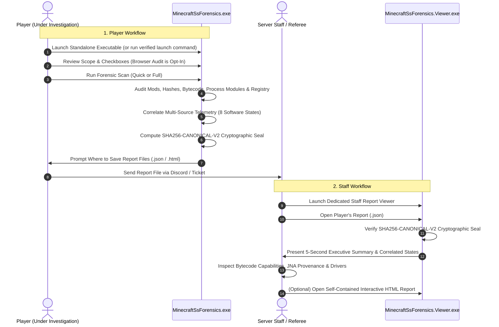

# Minecraft SS Forensics — Standalone Windows Forensic Scanner & Staff Viewer

[](backend/tests/MinecraftSsForensics.Scanner.Tests)
[](https://dotnet.microsoft.com/)
[](https://microsoft.com/windows)
[](ARCHITECTURE.md)
[](LICENSE)

An open-source, consent-based, high-integrity Minecraft screenshare (SS) forensic investigation suite for Windows 10 and Windows 11. Built specifically for Minecraft server staff, anti-cheat teams, and competitive leagues.

**100% Standalone & Serverless**: Operates with zero reliance on backend web APIs, databases, cloud storage, or user accounts. Everything runs locally on Windows.

---

## 1. Dual Standalone Workflows



---

## 2. Key Forensic & Architectural Features

### A. Dedicated Applications
- **Player Scanner (`MinecraftSsForensics.exe`)**: Guided workflow with explicit consent scopes, gamemode policy selection, real-time progress updates, and explicit save file prompts.
- **Dedicated Staff Viewer (`MinecraftSsForensics.Viewer.exe`)**: Standalone forensic workstation with automatic cryptographic seal verification, multi-axis search and filtering, deep evidence correlation viewers, and instant HTML/Markdown export.

### B. Evidentiary Standards & 8 Correlated Software States
Never collapses evidence into a simplistic "cheating detected" flag. Strictly distinguishes:
1. `SoftwarePresent`: File located in user staging folders (`Downloads`, `Desktop`, `$Recycle.Bin`).
2. `SoftwareInstalled`: Mod located in the active profile's `mods/` directory.
3. `SoftwareExecuted`: Recorded in Windows Prefetch, BAM/DAM, or UserAssist execution history.
4. `SoftwareActiveDuringSession`: Recorded running simultaneously with an active `javaw.exe` process.
5. `SoftwareInteractingWithMinecraft`: Unsigned module mapped into game process address space.
6. `ProhibitedFunctionalityUsed`: Corroborated in-game feature or packet automation.
7. `SoftwareContainsProhibitedCapabilities`: Bytecode contains Robot / cursor / crystal APIs.
8. `Clean / Permitted`: Verified legitimate release matching server rules.

### C. Possession-Based vs Execution-Based Policy Engine
Configurable server gamemode policies evaluate findings under distinct enforcement standards:
- **`PROHIBITED_POSSESSION`**: Confirmed presence or installation is sufficient for a policy violation (e.g. hacked client JAR on disk or Recycle Bin).
- **`PROHIBITED_EXECUTION`**: Requires verified execution traces before flagging a violation.
- **`PROHIBITED_GAMEPLAY_USE`**: Requires corroborating in-game match session telemetry.
- **`ALLOWED`**, **`RESTRICTED`**, **`NEEDS_REVIEW`**, **`UNKNOWN`**.

### D. Native Win32 P/Invoke & Deep System Inspection
- **Authenticode Verification (`WinVerifyTrust`)**: Validates embedded PKCS#7 and catalog digital signatures using `WINTRUST_ACTION_GENERIC_VERIFY_V2`.
- **Windows Prefetch Decompression (`RtlDecompressBufferEx`)**: Decompresses native Windows 10/11 MAM-compressed `.pf` files, extracting run counts, timestamps, and loaded DLLs.
- **BAM Device Path Translation (`QueryDosDevice`)**: Maps NT volume paths (`\Device\HarddiskVolumeX`) to standard DOS drive letters (`C:\`, `D:\`).
- **Recycle Bin Reconstruction**: Parses Version 1 and Version 2 `$I` index headers, recovering deleted filenames, deletion timestamps, and paired `$R` file hashes.
- **Chromium History Reading**: Sandboxed SQLite parser extracting domain visit timestamps using real WebKit microsecond conversion without timestamp fabrication.

### E. Java Bytecode Constant Pool Analysis
Analyzes Java class file constant pools in memory without execution (`StaticBytecodeAnalyzer`), detecting structural capabilities:
- Crystal placement and breaking automation (`EndCrystalEntity`, `autoCrystal`, `interactBlock`).
- Combat automation and reach extensions (`killAura`, `triggerBot`, `extendedReach`).
- Packet manipulation and spoofing (`PlayerMoveC2SPacket`, `C03PacketPlayer`, `sendPacket`).
- Synthetic hardware input simulation (`java/awt/Robot`, `setKeyBindState`, `glfwSetCursorPos`).
- Dynamic native library loading and Mixin injection targets.

### F. Cryptographic Report Sealing (`SHA256-CANONICAL-V2`)
Every report is sealed with a deterministic SHA-256 digest computed across its canonical recursive JSON payload. Any modification to a single field, count, or character in the report will fail verification in the Staff Viewer.

---

## 3. Quick Start

### Secure One-Line Launcher for Players
Run in Windows PowerShell (Administrator recommended for full prefetch access):
```powershell
& { [Net.ServicePointManager]::SecurityProtocol = [Net.SecurityProtocolType]::Tls12; $repo = "TanmayGarg2009/minecraft-ss-forensics"; $dir = "$env:TEMP\MinecraftForensics"; New-Item -ItemType Directory -Path $dir -Force | Out-Null; $exe = "$dir\MinecraftSsForensics.exe"; Invoke-WebRequest -Uri "https://github.com/$repo/releases/latest/download/MinecraftSsForensics.exe" -OutFile $exe -UseBasicParsing; $expected = ((Invoke-WebRequest -Uri "https://github.com/$repo/releases/latest/download/MinecraftSsForensics.exe.sha256" -UseBasicParsing).Content -split '\s+')[0].ToLowerInvariant(); if ((Get-FileHash -Path $exe -Algorithm SHA256).Hash.ToLowerInvariant() -eq $expected) { Start-Process -FilePath $exe } else { Write-Error "SHA-256 verification failed!" } }
```
*(Notice: Never pipes remote scripts directly into `iex`. Downloads the binary, verifies the SHA-256 hash against the published release manifest, and launches safely).*

### For Staff
1. Launch `MinecraftSsForensics.Viewer.exe`.
2. Click **Open Report File (.json)** and select the player's report.
3. Review the verified cryptographic seal, verdict summary, and correlated evidence tabs.

---

## 4. Documentation Index

- [Architecture Guide](ARCHITECTURE.md): Full system architecture, offline-first design, and component interaction.
- [Player Guide](PLAYER_GUIDE.md): Step-by-step instructions for running scans, granting consent, and exporting reports.
- [Staff Guide](STAFF_GUIDE.md): Step-by-step instructions for opening reports, verifying seals, and evaluating evidence.
- [Evidence Sources](EVIDENCE_SOURCES.md): Technical breakdown of every evidence source and limitation.
- [Evidence Confidence](EVIDENCE_CONFIDENCE.md): 8 software states, 9 evidence states, and confidence calculation.
- [Policy Packs Guide](POLICY_PACKS.md): Reference policies, rule schemas, and customization.
- [Report Schema](REPORT_SCHEMA.md): Complete JSON schema and cryptographic seal algorithm.
- [Privacy Policy](PRIVACY.md): Data collection guarantees, redactions, and opt-in mechanics.
- [Security Model](SECURITY.md): Least privilege, Authenticode, safe extraction, and XSS defense.
- [Limitations](LIMITATIONS.md): Transparent disclosure of kernel-mode and anti-forensic limits.
- [Developer Build Guide](BUILD.md): SDK requirements, compilation, test commands, and packaging.
- [Troubleshooting & FAQ](TROUBLESHOOTING.md): Common solutions for players and staff.
- [Changelog](CHANGELOG.md): Complete release history.

---

## 5. Development & Testing

### Build Solution from Source
```powershell
$env:DOTNET_ROOT = "$env:USERPROFILE\.dotnet"; $env:PATH = "$env:DOTNET_ROOT;$env:PATH"
dotnet build backend/MinecraftSsForensics.sln
```

### Run Automated Forensic Test Suite (79 Tests)
```powershell
$env:DOTNET_ROOT = "$env:USERPROFILE\.dotnet"; $env:PATH = "$env:DOTNET_ROOT;$env:PATH"
dotnet test backend/MinecraftSsForensics.sln -c Release
```

### Publish Single-File Executables
```powershell
# 1. Scanner App
dotnet publish backend/src/MinecraftSsForensics.Scanner.App/MinecraftSsForensics.Scanner.App.csproj `
  -c Release -r win-x64 --self-contained true `
  -p:PublishSingleFile=true -p:IncludeNativeLibrariesForSelfExtract=true `
  -o release/win-x64

# 2. Staff Viewer App
dotnet publish backend/src/MinecraftSsForensics.Viewer.App/MinecraftSsForensics.Viewer.App.csproj `
  -c Release -r win-x64 --self-contained true `
  -p:PublishSingleFile=true -p:IncludeNativeLibrariesForSelfExtract=true `
  -o release/win-x64
```

---

## 6. License

Distributed under the [MIT License](LICENSE).
