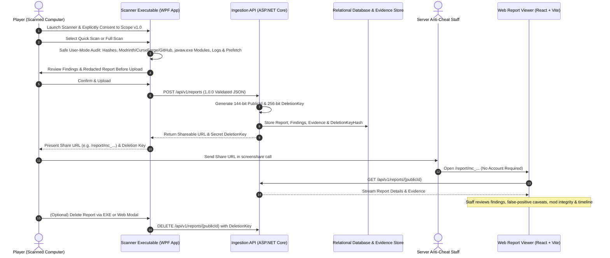

# Minecraft SS Forensics — Stages 1 & 2: Backend, Web Dashboard & Windows Scanner

[](backend/tests)
[](https://dotnet.microsoft.com/)
[](frontend/)
[](LICENSE)

An open-source, consent-based Minecraft screenshare (SS) forensic investigation platform for Windows 10 and Windows 11. Designed for Minecraft server staff, anti-cheat teams, and competitive verification.

> [!NOTE]
> **Stages 1 & 2 Fully Implemented**:
> - **Stage 1**: Production-grade Ingestion Backend API, PostgreSQL/SQLite relational database models, cryptographic bearer-link engine, abstract raw evidence store, and interactive browser-based forensic report viewer.
> - **Stage 2**: Native Windows forensic scanner application (`MinecraftSsForensics.Scanner.App`) with safe user-mode collection, streaming SHA-256/SHA-512 hashing, multi-source mod verification (Modrinth, CurseForge, GitHub), lookalike detection, command-line secret redaction, and bearer-link submission.

---

## 1. Product Workflow



---

## 2. Key Features

### A. Native Windows Forensic Scanner (Stage 2)
- **Normal User Mode Only**: Operates entirely in standard user mode without requiring administrator privileges, kernel drivers, persistence mechanisms, or security-software bypasses.
- **Explicit Player Consent**: Presents an upfront, transparent collection scope disclosure detailing what is collected, what is never collected (browser data, personal files, passwords), 7-day retention, and the player's deletion rights.
- **Quick Scan & Full Scan Modes**:
  - *Quick Scan*: Active Minecraft game directories, mod inventory, loader metadata, latest session logs, running `javaw.exe` process modules, and mod release verification.
  - *Full Scan*: All Quick Scan checks plus Windows Prefetch execution history, BAM/DAM background execution artifacts, and Temp directory inspection.
- **Cryptographic File Hashing**: Streaming SHA-256, SHA-512, and CurseForge-normalized Murmur2 hashing with pre-read and post-read mutation detection to catch files swapped during analysis.
- **Safe Archive Inspection**: Memory-bounded ZIP inspector for `.jar` files with zip bomb guards (max 10,000 entries, 250MB uncompressed limit, 100:1 ratio abort), path traversal prevention (`../`), and metadata parsing for Fabric (`fabric.mod.json`), Quilt (`quilt.mod.json`), Forge/NeoForge (`mods.toml`, `neoforge.mods.toml`), Legacy Forge (`mcmod.info`), and Java Agent manifests (`Premain-Class`, `Agent-Class`).
- **Multi-Source Mod Verification**:
  - Queries Modrinth v2 API, CurseForge fingerprint API, and curated official GitHub release repositories.
  - Implements 9 rigorous verification states: `VERIFIED_EXACT_RELEASE`, `VERIFIED_TRUSTED_SIGNATURE`, `KNOWN_PROJECT_UNVERIFIED_ARTIFACT`, `KNOWN_ARTIFACT_HASH_MISMATCH`, `KNOWN_MODIFIED_OR_REPACKAGED`, `UNKNOWN_OR_UNLISTED`, `METADATA_CONFLICT`, `VERIFICATION_UNAVAILABLE`, `INVALID_OR_UNREADABLE_ARCHIVE`.
  - Local caching with TTL prevents redundant network queries.
- **Lookalike & Anomaly Engine**:
  - Flags files impersonating popular mods (e.g. `OptiFine`, `Sodium`, `Essential`, `Lunar`) with incorrect internal Mod IDs or mismatched cryptographic digests.
  - Detects duplicate Mod IDs across different JAR files.
  - Identifies embedded Java Agents (`Premain-Class`) intended to dynamically instrument bytecode.
- **Strict Process & Secret Redaction**:
  - Scoped exclusively to active `javaw.exe` / `java.exe` instances.
  - Automatically redacts sensitive authentication parameters (`--accessToken`, `--uuid`, `--session`, passwords) before any data leaves the host.
  - Audits memory-mapped DLLs for unverified digital signatures and suspicious locations (e.g. `%TEMP%`, `%APPDATA%`).
- **Pre-Upload Review**: Lets the player inspect the complete generated findings summary and raw JSON before deciding whether to submit.

### B. Ingestion Backend & Bearer-Link Access (Stage 1)
- **Unguessable Bearer-Link Access**: Reports are addressed via 144-bit cryptographically secure identifiers (e.g. `mc_fddy1tJ6mEK4IxfFRv`). Completely eliminates login walls, staff account registration, and session hijacking risks.
- **Cryptographic Deletion Credential**: The uploader receives a 256-bit secret `DeletionKey` upon report creation. The backend stores exclusively an HMAC-SHA256 hash using a server-side salt. Neither the key nor its hash is ever exposed in public reports or URLs. Deletion comparisons use constant-time byte comparisons (`FixedTimeEquals`).
- **Rate Limiting & Safety**: Enforces local 15 MB payload limits, anti-XSS sanitization, and structured validation.
- **Automated Retention Purge**: Background `ReportCleanupBackgroundService` runs hourly to delete expired database entities and disk evidence (default 7-day TTL).

### C. Interactive Investigation Dashboard (Frontend)
- **Verdict Engine**: Transparent, deterministic 5-level assessment (`NO SUSPICIOUS INDICATORS FOUND`, `SUSPICIOUS INDICATORS FOUND`, `STRONG EVIDENCE FOUND`, `INCONCLUSIVE`, `INCOMPLETE SCAN`) based strictly on evidence corroboration and coverage.
- **Key Evidence Highlights**: Top 3 actionable findings with direct jump-to-evidence inspection.
- **Comprehensive Sections**:
  1. **Overview & Verdict**: Scan mode, OS architecture, check coverage counters, and severity distribution.
  2. **Findings**: Multi-axis category and severity filters, full-text search, and explicit limitations/false-positive callouts.
  3. **Minecraft Environment**: Game versions, active mod loaders, JVM argument categorization (Memory, GC, System Properties), and mod inventory table with verification badges.
  4. **Process & Runtime**: Game process metadata, redacted command line, and loaded DLL modules with signature status.
  5. **Historical Artifacts**: Windows Prefetch, NTFS USN Journal deletions, and BAM/DAM registry activity.
  6. **Chronological Timeline**: Ordered event timeline distinguishing observed vs. inferred timestamps.
  7. **Diagnostics**: Audit trail of completed checks, permission denials, and user-mode limitation recommendations.

---

## 3. Technology Stack

- **Backend**: ASP.NET Core 8 Web API (C#)
- **Scanner Library & App**: C# / .NET 8 targeting `net8.0-windows` (WPF Desktop UI)
- **Database & ORM**: PostgreSQL via Entity Framework Core (`Npgsql.EntityFrameworkCore.PostgreSQL`) with SQLite zero-dependency fallback for local development.
- **Frontend Dashboard**: React 18, TypeScript, Vite, Tailwind CSS, Lucide Icons
- **Automated Testing**:
  - Backend & Scanner: xUnit, FluentAssertions, `WebApplicationFactory<Program>`, In-Memory EF Core (50 tests)
  - Frontend: Vitest, React Testing Library, JSDOM (24 tests)

---

## 4. Local Development & Setup

### Prerequisites
- [.NET 8.0 SDK](https://dotnet.microsoft.com/download/dotnet/8.0)
- [Node.js](https://nodejs.org/) v18+ and npm
- Windows 10 or 11 (for running the scanner desktop application)

### 1. Backend Setup
```powershell
# Navigate to backend directory
cd backend/src/MinecraftSsForensics.Api

# Restore and run the Web API (starts on http://localhost:5000)
dotnet run
```
Swagger UI documentation is hosted at: 👉 **`http://localhost:5000/swagger`**

### 2. Frontend Setup
```powershell
# In a new terminal, navigate to frontend directory
cd frontend

# Install dependencies and start development server (http://localhost:3000)
npm install
npm run dev
```

### 3. Windows Native Scanner Setup
```powershell
# In a new terminal, launch the desktop scanner application
cd backend/src/MinecraftSsForensics.Scanner.App
dotnet run
```
- Accepts player consent.
- Performs Quick Scan or Full Scan on installed Minecraft launchers or a custom directory.
- Displays pre-upload review and submits to `http://localhost:5000/api/v1/reports`.
- Returns copyable share URL and secret deletion key.

---

## 5. Automated Test Results

The project contains **74 automated tests** passing across all layers of the architecture.

### Run All Backend and Scanner Tests (xUnit)
```powershell
dotnet test backend/MinecraftSsForensics.sln
```
**Results (50 of 50 Passed)**:
- `MinecraftSsForensics.Tests` (26 tests):
  - Ingestion validation, consent enforcement, XSS prevention.
  - Cryptographic ID uniqueness, bearer-link secrecy, HMAC verification.
  - Secure report deletion via secret deletion key, 401 unauthorized handling.
  - Security headers, rate limiting, and retention expiration.
- `MinecraftSsForensics.Scanner.Tests` (24 tests):
  - Streaming file hashing (SHA-256, SHA-512, Murmur2) and mutation checks.
  - Safe archive inspection (zip bomb guards, path traversal, mod metadata extraction).
  - Multi-tier mod verification (Modrinth, CurseForge, GitHub, cache).
  - Lookalike detector (disguised popular mods, duplicate mod IDs, Java agent entrypoints).
  - Command-line sensitive token and UUID redaction.
  - HTTP backend client submission and deletion calls.
  - **Complete End-to-End lifecycle integration**: Scan -> Submittal -> Ingestion -> GET retrieval -> Deletion -> 404 confirmation.

### Run Frontend Tests (Vitest)
```powershell
cd frontend
npm run test
```
**Results (24 of 24 Passed)**:
- `verdictEngine.test.ts`: Deterministic verdict evaluation, evidence corroboration logic, incomplete scan handling.
- `VerdictCard.test.tsx`: Top highlights rendering, category filtering, jump-to-evidence handler.
- `DeletedFileInvestigation.test.tsx`: Prefetch vs. USN journal correlation, non-existence in mod folder.
- `DiagnosticsSection.test.tsx`: Issues and hurdles filtering, user-mode permission guidance.
- `FindingsSection.test.tsx`: Severity and category filtering, search, false-positive disclosure.
- `TimelineSection.test.tsx`: Chronological sorting and inferred event markers.
- `OverviewSection.test.tsx`: Metadata rendering and privacy notice display.
- `Badge.test.tsx`: Severity and confidence badges.

---

## 6. Solution Structure

```
├── backend/
│   ├── MinecraftSsForensics.sln
│   ├── src/
│   │   ├── MinecraftSsForensics.Api/           # Ingestion REST API
│   │   │   ├── Controllers/                    # Health & Reports endpoints
│   │   │   ├── Data/                           # EF Core PostgreSQL & SQLite
│   │   │   ├── Models/                         # Domain & DTO schemas
│   │   │   ├── Services/                       # Report, Storage, Cryptographic IDs
│   │   │   └── Validation/                     # Ingestion schema & anti-XSS rules
│   │   ├── MinecraftSsForensics.Scanner/       # Core Forensic Scanner Library
│   │   │   ├── Archive/                        # SafeArchiveInspector, zip bomb guards
│   │   │   ├── Client/                         # BackendApiClient (submit/delete)
│   │   │   ├── Engine/                         # ScannerEngine coordinator
│   │   │   ├── Hashing/                        # StreamingFileHasher (SHA-256, Murmur2)
│   │   │   ├── LogsAndHistory/                 # Locator, LogAuditor, HistoricalScanner
│   │   │   ├── Lookalike/                      # LookalikeDetector & anomaly rules
│   │   │   ├── Process/                        # ProcessScanner, CommandLineRedactor
│   │   │   └── Verification/                   # Modrinth, CurseForge, GitHub verifiers
│   │   └── MinecraftSsForensics.Scanner.App/   # WPF Desktop Application
│   │       ├── MainWindow.xaml                 # 5-panel state machine UI
│   │       └── MainWindow.xaml.cs              # Consent, progress, review, share URL
│   └── tests/
│       ├── MinecraftSsForensics.Tests/         # 26 API integration & unit tests
│       └── MinecraftSsForensics.Scanner.Tests/ # 24 Scanner unit & E2E integration tests
├── frontend/
│   ├── src/
│   │   ├── components/                         # VerdictCard, Findings, Env, Process, etc.
│   │   ├── services/                           # API client & synthetic presets
│   │   ├── types/                              # ReportDetail TypeScript definitions
│   │   └── test/                               # 24 Vitest tests
├── docs/
│   ├── architecture.md                         # Architectural patterns & boundaries
│   ├── api.md                                  # API endpoint reference
│   ├── report-schema.md                        # Schema 1.0.0 specification
│   ├── security.md                             # Threat model & crypto primitives
│   └── stage-2-agent-contract.md               # Scanner integration contract
├── LICENSE
└── README.md
```

---

## 7. License

This project is licensed under the [MIT License](LICENSE).
