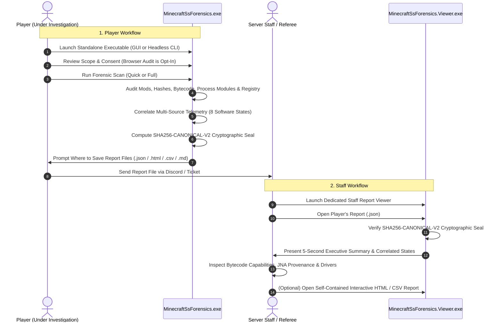

# Minecraft SS Forensics — Standalone Windows Forensic Scanner & Staff Viewer

[](backend/tests/MinecraftSsForensics.Scanner.Tests)
[](https://dotnet.microsoft.com/)
[](https://microsoft.com/windows)
[](ARCHITECTURE.md)
[](LICENSE)

An open-source, consent-based, high-integrity Minecraft screenshare (SS) forensic investigation suite for Windows 10 and Windows 11. Built specifically for Minecraft server staff, anti-cheat teams, and competitive leagues.

**100% Standalone & Serverless**: Operates with zero reliance on backend web APIs, databases, cloud storage, or user accounts. Everything runs locally on Windows.

---

## 1. Dual Standalone Workflows



---

## 2. Key Forensic & Architectural Features

### A. Dedicated Applications & CLI Modes
- **Player Scanner (`MinecraftSsForensics.exe`)**: Guided graphical interface with explicit consent scopes, gamemode policy selection, real-time progress updates, and multi-format report exports.
- **Headless CLI Scanner (`MinecraftSsForensics.exe scan`)**: Automated non-interactive console mode supporting scriptable headless execution in tournament and screenshare scenarios.
- **Dedicated Staff Viewer (`MinecraftSsForensics.Viewer.exe`)**: Standalone forensic workstation with automatic cryptographic seal verification, multi-axis search and filtering, deep evidence correlation viewers, and instant HTML/CSV/Markdown export.

### B. Evidentiary Standards & 8 Correlated Software States
Never collapses evidence into a simplistic "cheating detected" flag. Strictly distinguishes:
1. `SoftwarePresent`: File located in user staging folders (`Downloads`, `Desktop`, `$Recycle.Bin`).
2. `SoftwareInstalled`: Mod located in the active profile's `mods/` directory.
3. `SoftwareExecuted`: Recorded in Windows Prefetch, BAM/DAM, or UserAssist execution history.
4. `SoftwareActiveDuringSession`: Recorded running simultaneously with an active `javaw.exe` process.
5. `SoftwareInteractingWithMinecraft`: Unsigned module mapped into game process address space.
6. `ProhibitedFunctionalityUsed`: Corroborated in-game feature or packet automation.
7. `SoftwareContainsProhibitedCapabilities`: Bytecode contains Robot / cursor / crystal APIs.
8. `Clean / Permitted`: Verified legitimate release matching server rules.

### C. Possession-Based vs Execution-Based Policy Engine
Configurable server gamemode policies evaluate findings under distinct enforcement standards:
- **`PROHIBITED_POSSESSION`**: Confirmed presence or installation is sufficient for a policy violation (e.g. hacked client JAR on disk or Recycle Bin).
- **`PROHIBITED_EXECUTION`**: Requires verified execution traces before flagging a violation.
- **`PROHIBITED_GAMEPLAY_USE`**: Requires corroborating in-game match session telemetry.
- **`ALLOWED`**, **`RESTRICTED`**, **`NEEDS_REVIEW`**, **`UNKNOWN`**.

### D. Native Win32 P/Invoke & Deep System Inspection
- **Process Working Directory Resolution**: Reads remote `PEB.ProcessParameters.CurrentDirectory` via `NtQueryInformationProcess` to establish true Minecraft working directories.
- **Reflective Memory Injection Detection**: Audits unbacked private executable memory pages (`MEM_COMMIT | MEM_PRIVATE | PAGE_EXECUTE_READWRITE`) while strictly distinguishing true native PE headers (`MZ`) from benign JVM HotSpot JIT code cache.
- **Authenticode Verification (`WinVerifyTrust`)**: Validates embedded PKCS#7 and catalog digital signatures using `WINTRUST_ACTION_GENERIC_VERIFY_V2`.
- **Windows Prefetch Decompression (`RtlDecompressBufferEx`)**: Decompresses native Windows 10/11 MAM-compressed `.pf` files, extracting run counts, timestamps, and loaded DLLs.
- **NTFS ADS Provenance**: Parses `:Zone.Identifier` alternate data streams to verify original download URLs and domains (Modrinth, CurseForge, Discord, GitHub, or file lockers).
- **Concealed Attribute Detection**: Flags executable and archive files in user staging directories marked with `Hidden` or `System` attributes.
- **Unicode Evasion Normalization**: Converts full-width homoglyphs (`0xFF01..0xFF5E`) to standard ASCII to defeat visual string evasion in cheat filenames and packages.
- **BAM Device Path Translation (`QueryDosDevice`)**: Maps NT volume paths (`\Device\HarddiskVolumeX`) to standard DOS drive letters (`C:\`, `D:\`).
- **Recycle Bin Reconstruction**: Parses Version 1 and Version 2 `$I` index headers, recovering deleted filenames, deletion timestamps, and paired `$R` file hashes.
- **Chromium History Reading**: Sandboxed SQLite parser extracting domain visit timestamps using real WebKit microsecond conversion without timestamp fabrication.

### E. Java Bytecode Constant Pool Analysis
Analyzes Java class file constant pools in memory without execution (`StaticBytecodeAnalyzer`), detecting structural capabilities:
- Crystal placement and breaking automation (`EndCrystalEntity`, `autoCrystal`, `interactBlock`).
- Combat automation and reach extensions (`killAura`, `triggerBot`, `extendedReach`).
- Packet manipulation and spoofing (`PlayerMoveC2SPacket`, `C03PacketPlayer`, `sendPacket`).
- Synthetic hardware input simulation (`java/awt/Robot`, `setKeyBindState`, `glfwSetCursorPos`).
- Dynamic native library loading and Mixin injection targets.

### F. Cryptographic Report Sealing (`SHA256-CANONICAL-V2`)
Every report is sealed with a deterministic SHA-256 digest computed across its canonical recursive JSON payload. Any modification to a single field, count, or character in the report will fail verification in the Staff Viewer.

---

## 3. Forensic Detection Coverage Matrix

| Category | Data Source / Mechanism | Observable Artifacts | Forensics Proves | What It Does NOT Prove | Limitations & Caveats | Required Permissions |
| :--- | :--- | :--- | :--- | :--- | :--- | :--- |
| **Active Minecraft Process** | Win32 Toolhelp32 & PEB Inspection | PID, command line, JVM args, CWD, creation time | Genuine game process identity and working directory | Does not prove absence of external injected threads | Process termination or PID reuse requires timestamp correlation | Standard User |
| **Loaded Native Modules** | `EnumProcessModulesEx` + Authenticode | Mapped DLLs, digital signatures, module paths | DLLs physically mapped into `javaw.exe` memory | Does not prove malicious intent if signed/standard | Does not detect unmapped manual syscall injectors | Standard User |
| **Memory Injections** | `VirtualQueryEx` + Memory Scanning | Unbacked executable pages with PE `MZ` headers | Direct reflective DLL / manual PE injection | Does not confuse benign HotSpot JIT code cache | ReadProcessMemory boundaries apply; protected processes | Standard User (own PID) |
| **Mod Verification** | ZIP manifest + Modrinth/CurseForge Hashes | Fabric/Forge metadata, file SHA-256 | Exact integrity and origin of mod binaries | Does not prove execution in the current match | Unlisted custom private mods flagged for review | Standard User |
| **Download Provenance** | NTFS `:Zone.Identifier` (ADS) | `HostUrl`, `ReferrerUrl`, ZoneId | Origin URL where mod was downloaded from | Does not prove mod was not altered post-download | Absent on FAT32/exFAT or files downloaded via CLI tools | Standard User |
| **Disk Artifacts** | User staging search + Recycle Bin | Staged cheats, `$I`/`$R` deleted files, hashes | Physical file presence or prior deletion | Does not prove execution without Prefetch/BAM | Shift+Delete and secure file wipers leave no index | Standard User |
| **Concealed Files** | Filesystem attribute inspection | Files with `Hidden` or `System` attributes | Attempt to conceal executables from Explorer | Does not prove malicious code without binary inspection | Some archive extraction tools preserve attributes | Standard User |
| **Execution History** | Windows Prefetch (`RtlDecompressBufferEx`) | Execution run count, first/last run timestamps | Program was launched on the Windows operating system | Does not prove in-game advantage without timeline match | Administrator required to read `C:\Windows\Prefetch` | Administrator |
| **Registry History** | BAM / DAM (`SYSTEM\CurrentControlSet\Services\bam`) | Program execution path and timestamp | Program executed on host system | Does not capture command-line arguments | Timestamps only reflect execution start/stop | Administrator |
| **Evasion Defenses** | Full-width Unicode & ZipBomb guards | Homoglyphs, high compression ratios, traversal | Obfuscated strings, evasion patterns | Does not prove intention if corrupted archive | Static analysis only; cannot evaluate runtime unpackers | Standard User |

---

## 4. Quick Start

### Option A: Secure One-Line Launcher for Players (GUI)
Run in Windows PowerShell (Administrator recommended for full prefetch access):
```powershell
& { [Net.ServicePointManager]::SecurityProtocol = [Net.SecurityProtocolType]::Tls12; $repo = "TanmayGarg2009/minecraft-ss-forensics"; $dir = "$env:TEMP\MinecraftForensics"; New-Item -ItemType Directory -Path $dir -Force | Out-Null; $exe = "$dir\MinecraftSsForensics.exe"; $shaUrl = "https://github.com/$repo/releases/latest/download/MinecraftSsForensics.exe.sha256"; $exeUrl = "https://github.com/$repo/releases/latest/download/MinecraftSsForensics.exe"; Write-Host "Fetching integrity manifest..." -ForegroundColor Cyan; $expected = ([regex]'[0-9a-fA-F]{64}').Match((New-Object System.Net.WebClient).DownloadString($shaUrl)).Value.ToLowerInvariant(); Write-Host "Connecting to download stream..." -ForegroundColor Cyan; $req = [System.Net.HttpWebRequest]::Create($exeUrl); $res = $req.GetResponse(); $total = $res.ContentLength; $stream = $res.GetResponseStream(); $fs = [System.IO.File]::Create($exe); $buffer = New-Object byte[] 131072; $downloaded = 0; $sw = [System.Diagnostics.Stopwatch]::StartNew(); $lastUpdate = 0; while (($read = $stream.Read($buffer, 0, $buffer.Length)) -gt 0) { $fs.Write($buffer, 0, $read); $downloaded += $read; if ($sw.ElapsedMilliseconds - $lastUpdate -gt 250) { $lastUpdate = $sw.ElapsedMilliseconds; $pct = [math]::Round(($downloaded / $total) * 100, 1); $speed = if ($sw.Elapsed.TotalSeconds -gt 0) { ($downloaded / 1MB) / $sw.Elapsed.TotalSeconds } else { 0 }; $eta = if ($speed -gt 0) { [math]::Round((($total - $downloaded) / 1MB) / $speed) } else { 0 }; $curMb = [math]::Round($downloaded / 1MB, 1); $totMb = [math]::Round($total / 1MB, 1); $spdMb = [math]::Round($speed, 1); Write-Progress -Activity "Downloading Minecraft SS Forensics ($totMb MB)" -Status "$pct% ($curMb MB / $totMb MB) at $spdMb MB/s - ETA: ${eta}s" -PercentComplete $pct } }; $fs.Close(); $stream.Close(); $res.Close(); Write-Progress -Activity "Downloading Minecraft SS Forensics" -Completed; Write-Host "Verifying SHA-256 integrity..." -ForegroundColor Cyan; if ((Get-FileHash -Path $exe -Algorithm SHA256).Hash.ToLowerInvariant() -eq $expected) { Write-Host "SHA-256 Verified Authentic! Launching scanner..." -ForegroundColor Green; Start-Process -FilePath $exe } else { Write-Error "SHA-256 verification failed!" } }
```
*(Notice: Never pipes remote scripts into `iex`. Downloads the binary, verifies the SHA-256 hash against the published release manifest, and launches safely).*

### Option B: Headless CLI Scanner
For automated, scriptable, or tournament operations:
```cmd
MinecraftSsForensics.exe scan --output C:\SS_Reports --mode FULL --gamemode "Crystal PvP" --format all
```

#### CLI Command Reference:
| Option | Shorthand | Description | Default |
| :--- | :--- | :--- | :--- |
| `--output <dir>` | `-o` | Output directory for report files | `./reports` |
| `--mode <QUICK\|FULL>` | `-m` | Scan mode depth | `FULL` |
| `--gamemode <name>` | `-g` | Gamemode policy (`Crystal PvP`, `Sword PvP`, `UHC`, `Default`) | `Crystal PvP` |
| `--dir <path>` | `-d` | Custom Minecraft installation path | Auto-detected |
| `--format <types>` | `-f` | Export format(s): `json`, `html`, `csv`, `markdown`, or `all` | `all` |
| `--browser` | | Include sensitive browser history audit | `false` |
| `--help` | `-h` | Display command-line help | |

### Option C: For Staff Reviewers
1. Launch `MinecraftSsForensics.Viewer.exe`.
2. Click **Open Report File (.json)** and select the player's report.
3. Review the verified cryptographic seal, verdict summary, and correlated evidence tabs.

---

## 5. Documentation Index

- [Architecture Guide](ARCHITECTURE.md): Full system architecture, offline-first design, and component interaction.
- [Player Guide](PLAYER_GUIDE.md): Step-by-step instructions for running scans, granting consent, and exporting reports.
- [Staff Guide](STAFF_GUIDE.md): Step-by-step instructions for opening reports, verifying seals, and evaluating evidence.
- [Evidence Sources](EVIDENCE_SOURCES.md): Technical breakdown of every evidence source and limitation.
- [Evidence Confidence](EVIDENCE_CONFIDENCE.md): 8 software states, 9 evidence states, and confidence calculation.
- [Policy Packs Guide](POLICY_PACKS.md): Reference policies, rule schemas, and customization.
- [Report Schema](REPORT_SCHEMA.md): Complete JSON schema and cryptographic seal algorithm.
- [Privacy Policy](PRIVACY.md): Data collection guarantees, redactions, and opt-in mechanics.
- [Security Model](SECURITY.md): Least privilege, Authenticode, safe extraction, and XSS defense.
- [Limitations](LIMITATIONS.md): Transparent disclosure of kernel-mode and anti-forensic limits.
- [Developer Build Guide](BUILD.md): SDK requirements, compilation, test commands, and packaging.
- [Troubleshooting & FAQ](TROUBLESHOOTING.md): Common solutions for players and staff.
- [Changelog](CHANGELOG.md): Complete release history.

---

## 6. Development & Testing

### Build Solution from Source
```powershell
$env:DOTNET_ROOT = "$env:USERPROFILE\.dotnet"; $env:PATH = "$env:DOTNET_ROOT;$env:PATH"
dotnet build backend/MinecraftSsForensics.sln -c Release
```

### Run Automated Forensic Test Suite (196 Tests)
```powershell
$env:DOTNET_ROOT = "$env:USERPROFILE\.dotnet"; $env:PATH = "$env:DOTNET_ROOT;$env:PATH"
dotnet test backend/MinecraftSsForensics.sln -c Release
```

### Automated Release Pipeline
```powershell
.\build.ps1
```

---

## 7. License

Distributed under the [MIT License](LICENSE).
