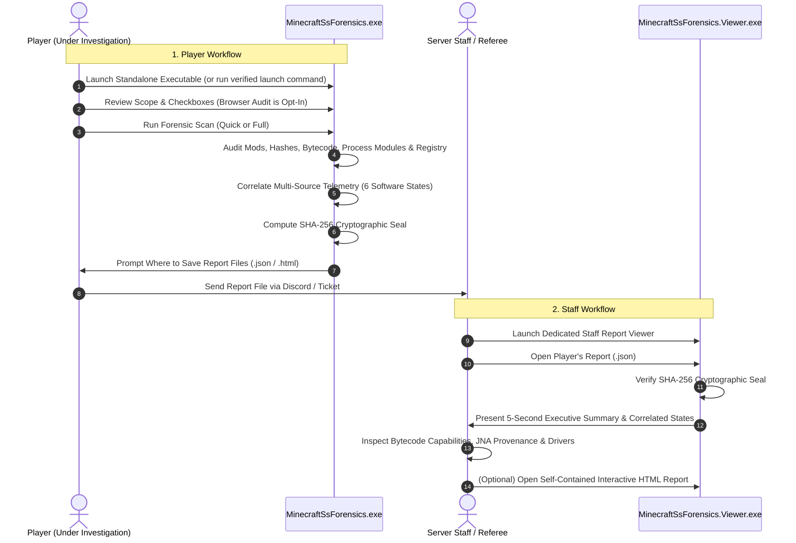

# Minecraft SS Forensics — Standalone Windows Scanner & Staff Viewer

[](backend/tests/MinecraftSsForensics.Scanner.Tests)
[](https://dotnet.microsoft.com/)
[](https://microsoft.com/windows)
[](docs/architecture.md)
[](LICENSE)

An open-source, consent-based Minecraft screenshare (SS) forensic investigation suite for Windows 10 and Windows 11. Built for Minecraft server staff, anti-cheat teams, and competitive leagues.

**100% Standalone & Serverless**: Operates without any backend web API, database, cloud storage, or user accounts. Everything runs locally on Windows.

---

## 1. Workflows



---

## 2. Key Features

### A. Dedicated Applications
- **Player Scanner (`MinecraftSsForensics.exe`)**: Guided workflow with explicit consent scopes, gamemode policy selection, real-time progress updates, and explicit save file prompts.
- **Dedicated Staff Viewer (`MinecraftSsForensics.Viewer.exe`)**: Standalone forensic workstation with automatic cryptographic seal verification, multi-axis search and filtering, deep evidence correlation viewers, and instant HTML export.

### B. Evidentiary Standards & 6 Correlated Software States
Never collapses evidence into a simplistic "cheating detected" flag. Strictly distinguishes:
1. `SoftwarePresent`: File located in user staging folders (`Downloads`, `Desktop`, `$Recycle.Bin`).
2. `SoftwareInstalled`: Mod located in the active profile's `mods/` directory.
3. `SoftwareExecuted`: Recorded in Windows Prefetch, BAM/DAM, or PCA execution history.
4. `SoftwareActiveDuringSession`: Recorded running simultaneously with an active `javaw.exe` process.
5. `SoftwareInteractingWithMinecraft`: Unsigned module mapped into game process address space.
6. `ProhibitedFunctionalityUsed`: Corroborated in-game feature activation.

### C. Possession-Based vs Execution-Based Policy Engine
Configurable server gamemode policies evaluate findings under distinct enforcement standards:
- **`PROHIBITED_POSSESSION`**: Confirmed presence or installation is sufficient for a policy violation (e.g. hacked client JAR on disk).
- **`PROHIBITED_EXECUTION`**: Requires verified execution traces before flagging a violation.
- **`PROHIBITED_GAMEPLAY_USE`**: Requires corroborating in-game match session telemetry.
- **`ALLOWED`**, **`RESTRICTED`**, **`NEEDS_REVIEW`**, **`UNKNOWN`**.

### D. Java Bytecode Constant Pool Analysis
Analyzes Java class file constant pools in memory without execution (`StaticBytecodeAnalyzer`), detecting structural capabilities:
- Crystal placement and breaking automation (`EndCrystalEntity`, `autoCrystal`, `interactBlock`).
- Combat automation and reach extensions (`killAura`, `triggerBot`, `extendedReach`).
- Packet manipulation and spoofing (`PlayerMoveC2SPacket`, `C03PacketPlayer`, `sendPacket`).
- Synthetic hardware input simulation (`java/awt/Robot`, `setKeyBindState`, `glfwSetCursorPos`).
- Dynamic native library loading and Mixin injection targets.

### E. Services & Third-Party Driver Auditing
Audits `HKLM\SYSTEM\CurrentControlSet\Services`, Windows Event ID 7045, and `setupapi.dev.log` for non-standard services, user-writable image paths (`%TEMP%`, `%APPDATA%`), and unsigned kernel drivers with transparent disclosure of user-mode limitations.

---

## 3. Quick Start

### Secure One-Line Launcher for Players
Run in Windows PowerShell:
```powershell
& { [Net.ServicePointManager]::SecurityProtocol = [Net.SecurityProtocolType]::Tls12; $dir = "$env:TEMP\MinecraftForensics"; New-Item -ItemType Directory -Path $dir -Force | Out-Null; $exe = "$dir\MinecraftSsForensics.exe"; Invoke-WebRequest -Uri "https://github.com/minecraft-ss-forensics/minecraft-ss-forensics/releases/latest/download/MinecraftSsForensics.exe" -OutFile $exe; $expected = ((Invoke-WebRequest -Uri "https://github.com/minecraft-ss-forensics/minecraft-ss-forensics/releases/latest/download/MinecraftSsForensics.exe.sha256").Content -split '\s+')[0].ToLowerInvariant(); if ((Get-FileHash -Path $exe -Algorithm SHA256).Hash.ToLowerInvariant() -eq $expected) { Start-Process -FilePath $exe } else { Write-Error "SHA-256 verification failed!" } }
```
*(Notice: Never pipes remote scripts directly into `iex`. Downloads the binary, verifies the SHA-256 hash against the published release manifest, and launches safely).*

### For Staff
1. Launch `MinecraftSsForensics.Viewer.exe`.
2. Click **Open Report File (.json)** and select the player's report.
3. Review the verified cryptographic seal, verdict summary, and correlated evidence tabs.

---

## 4. Documentation

- [Evidence Sources Reference](docs/evidence-sources-reference.md): Technical matrix of all evidence sources, execution proof, retention, permissions, and false positives.
- [Evidence Confidence & Correlation Methodology](docs/evidence-confidence-methodology.md): The 6 software states, 9 evidence states, and confidence tiers.
- [Policy Packs Guide](docs/policy-packs.md): How to create, customize, seal, and import server gamemode policies.
- [Player Guide](docs/player-guide.md): How to run the scan, review consent, and save reports.
- [Staff Guide](docs/staff-guide.md): How to interpret findings, verify seals, and make defensible decisions.
- [Detection Categories](docs/detection-categories.md): In-depth documentation of all 7 classification tiers.
- [Troubleshooting & FAQ](docs/troubleshooting.md): Windows SmartScreen, SSD Prefetch, JNA provenance, and antivirus tips.
- [Developer Build & Release Guide](docs/build-and-release.md): Local compilation, test suite execution, and single-file binary publishing.
- [Changelog](CHANGELOG.md): Complete release history.

---

## 5. Development & Testing

### Build Solution from Source
```powershell
$env:DOTNET_ROOT = "$env:USERPROFILE\.dotnet"; $env:PATH = "$env:DOTNET_ROOT;$env:PATH"
dotnet build backend/MinecraftSsForensics.sln
```

### Run Automated Forensic Test Suite (56 Tests)
```powershell
$env:DOTNET_ROOT = "$env:USERPROFILE\.dotnet"; $env:PATH = "$env:DOTNET_ROOT;$env:PATH"
dotnet test backend/MinecraftSsForensics.sln
```

### Publish Single-File Executables
```powershell
# 1. Scanner App
dotnet publish backend/src/MinecraftSsForensics.Scanner.App/MinecraftSsForensics.Scanner.App.csproj `
  -c Release -r win-x64 --self-contained true `
  -p:PublishSingleFile=true -p:IncludeNativeLibrariesForSelfExtract=true `
  -o release/win-x64

# 2. Staff Viewer App
dotnet publish backend/src/MinecraftSsForensics.Viewer.App/MinecraftSsForensics.Viewer.App.csproj `
  -c Release -r win-x64 --self-contained true `
  -p:PublishSingleFile=true -p:IncludeNativeLibrariesForSelfExtract=true `
  -o release/win-x64
```

---

## 6. License

Distributed under the [MIT License](LICENSE).
