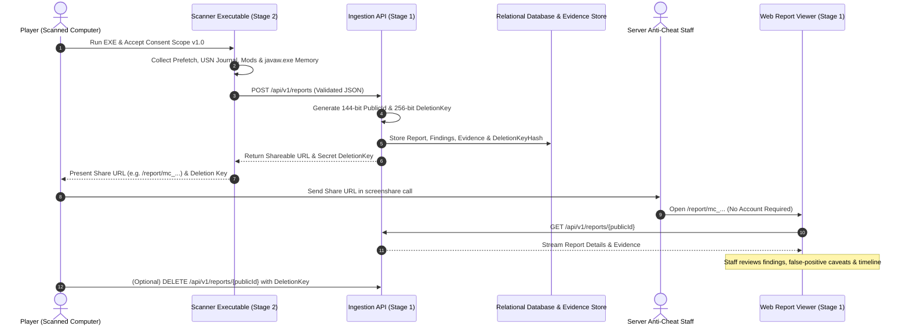

# Minecraft SS Forensics — Stage 1: Ingestion Backend & Web Dashboard

[](backend/tests)
[](https://dotnet.microsoft.com/)
[](frontend/)
[](LICENSE)

An open-source, consent-based Minecraft screenshare (SS) forensic investigation platform for Windows 10 and Windows 11. Designed for Minecraft server staff, anti-cheat teams, and competitive verification.

> [!NOTE]
> **Stage 1 Scope**: Implements the production-grade Ingestion Backend API, PostgreSQL/SQLite relational database models, cryptographic bearer-link engine, abstract raw evidence store, and the browser-based forensic report viewer. Stage 1 does not include the Windows native EXE scanner; it defines the stable API contract for Stage 2.

---

## 1. Product Workflow



---

## 2. Key Features

- **Unguessable Bearer-Link Access**:
  - Reports are addressed via 144-bit cryptographically secure identifiers (e.g. `mc_fddy1tJ6mEK4IxfFRv`).
  - Completely eliminates login walls, staff account registration, and session hijacking risks.
  - Non-sequential, un-enumerable IDs generated via `System.Security.Cryptography.RandomNumberGenerator`.
- **Cryptographic Deletion Credential**:
  - The uploader receives a 256-bit secret `DeletionKey` upon report creation.
  - The backend stores exclusively an HMAC-SHA256 hash using a server-side salt.
  - Neither the key nor its hash is ever exposed in the public report or URL.
  - Deletion comparisons use constant-time byte comparisons (`FixedTimeEquals`) to eliminate timing side channels.
- **Transparent Anti-Slop Forensic Viewer**:
  - Separates raw observations from indicators and correlations.
  - Prominently displays **limitations and potential false positives** alongside each finding.
  - Explicitly avoids arbitrary or misleading global scores (e.g. no "98% chance of cheating" pseudoscience).
  - Reports with zero detections are never mislabeled as "guaranteed clean".
- **Multi-Section Report Dashboard**:
  1. **Overview**: Scan mode, OS build, check coverage (Passed / Flagged / Skipped), and severity summary.
  2. **Findings**: Multi-axis search, severity and category filtering, sorting, expandable file and process metadata with copy buttons.
  3. **Minecraft Environment**: Game versions, active mod loaders, and installed JAR inventory with SHA-256 hashes.
  4. **Process & Runtime**: Minecraft JVM arguments, process IDs, and loaded DLL modules in `javaw.exe`.
  5. **Historical Artifacts**: Windows Prefetch headers, NTFS USN journal deletions, and BAM/DAM registry activity.
  6. **Chronological Timeline**: Ordered event timeline distinguishing observed vs. inferred timestamps.
  7. **Diagnostics**: Audit trail of completed checks, permission denials, and skipped modules.
  8. **Export & Print**: Full JSON export and print-optimized PDF layout.
- **Embedded Ingestion Laboratory**:
  - Built-in test sandbox with 3 realistic synthetic presets:
    - *Clean Competitive Player* (Zero detections, valid Forge 1.8.9 + OptiFine)
    - *Autoclicker & USN Deletion Traces* (High-confidence Prefetch execution + NTFS deleted JAR)
    - *Process Injection & Native DLL Hook* (Critical unsigned library mapped into `javaw.exe`)
  - Live JSON editor to test custom scanner payloads directly against the live backend API.
- **Automated Retention Purge**:
  - Configurable report retention window (1 - 30 days, default 7 days).
  - Background `ReportCleanupBackgroundService` runs hourly to delete expired database entities and disk evidence.

---

## 3. Technology Stack

- **Backend**: ASP.NET Core 8 Web API (C#)
- **Database & ORM**: PostgreSQL via Entity Framework Core (`Npgsql.EntityFrameworkCore.PostgreSQL`) with SQLite zero-dependency fallback for local development.
- **API Documentation**: OpenAPI / Swagger UI
- **Frontend Dashboard**: React 18, TypeScript, Vite, Tailwind CSS, Lucide Icons
- **Automated Testing**:
  - Backend: xUnit, FluentAssertions, `WebApplicationFactory<Program>`, In-Memory EF Core
  - Frontend: Vitest, React Testing Library, JSDOM

---

## 4. Local Development & Setup

### Prerequisites
- [.NET 8.0 SDK](https://dotnet.microsoft.com/download/dotnet/8.0)
- [Node.js](https://nodejs.org/) v18+ and npm

### 1. Backend Setup
```powershell
# Navigate to backend directory
cd backend/src/MinecraftSsForensics.Api

# Restore and run the Web API (starts on http://localhost:5000)
dotnet run
```
The API automatically ensures the database schema is initialized and Swagger documentation is hosted at:
👉 **`http://localhost:5000/swagger`**

### 2. Frontend Setup
```powershell
# In a new terminal, navigate to frontend directory
cd frontend

# Install dependencies
npm install

# Start development server (runs on http://localhost:3000)
npm run dev
```
Open **`http://localhost:3000`** in your browser to view the dashboard!

---

## 5. Automated Test Results

The project includes 34 comprehensive automated tests covering all functional and security requirements.

### Run Backend Tests (xUnit)
```powershell
dotnet test backend/MinecraftSsForensics.sln
```
**Results (26 of 26 Passed)**:
- `IdentifierGeneratorTests`: Uniqueness, 144-bit entropy format, HMAC verification, tampered key rejection.
- `ValidatorTests`: Valid reports, unsupported schema version rejection, consent requirement enforcement, invalid enum rejection, XSS script injection blocking.
- `ReportIngestionTests`: 201 Created response, share URL generation, deletion key issuance, malformed JSON rejection.
- `ReportViewingTests`: Bearer-link retrieval, secrecy of deletion key (confirmed NOT exposed in GET response), cache control headers, evidence payload retrieval, unrelated evidence isolation.
- `ReportDeletionTests`: Successful deletion with valid key, 401 Unauthorized with invalid key, 400 Bad Request when key omitted, 404 verification after deletion.
- `SecurityAndExpirationTests`: Health check status, security headers (`CSP`, `nosniff`, `DENY`), XSS script tag rejection, 404 on expired reports.

### Run Frontend Tests (Vitest)
```powershell
cd frontend
npm run test
```
**Results (8 of 8 Passed)**:
- `FindingsSection.test.tsx`: Search filtering, category filtering, initial rendering, prominent false-positive disclosure.
- `OverviewSection.test.tsx`: Metadata rendering, privacy notice display, clean report handling without misleading "guaranteed clean" claim.
- `Badge.test.tsx`: Critical severity pulse styling, confidence badges.

---

## 6. Project Structure

```
├── backend/
│   ├── src/MinecraftSsForensics.Api/
│   │   ├── Controllers/
│   │   │   ├── HealthController.cs          # GET /api/v1/health
│   │   │   └── ReportsController.cs         # Report ingestion, viewing, deletion
│   │   ├── Data/
│   │   │   ├── ForensicsDbContext.cs        # EF Core PostgreSQL / SQLite DbContext
│   │   │   └── Migrations/                  # EF Core database migrations
│   │   ├── Middleware/
│   │   │   ├── SecurityHeadersMiddleware.cs # CSP, nosniff, DENY headers
│   │   │   └── ExceptionHandlingMiddleware.cs # Safe error details
│   │   ├── Models/
│   │   │   ├── Domain/                      # Report, Finding, Evidence, Timeline
│   │   │   └── Dtos/                        # Ingestion & Presentation models
│   │   ├── Services/
│   │   │   ├── IReportService.cs            # Ingestion, viewing & deletion logic
│   │   │   ├── IStorageService.cs           # Raw evidence file abstraction
│   │   │   ├── IIdentifierGenerator.cs      # Cryptographic token generator
│   │   │   └── ReportCleanupBackgroundService.cs # Hourly retention purge
│   │   ├── Validation/
│   │   │   └── ReportSubmissionValidator.cs # FluentValidation schema & XSS rules
│   │   └── Program.cs
│   └── tests/MinecraftSsForensics.Tests/    # 26 xUnit automated tests
├── frontend/
│   ├── src/
│   │   ├── components/
│   │   │   ├── Layout/                      # Navbar, Footer
│   │   │   ├── ReportViewer/                # Overview, Findings, Timeline, Env, etc.
│   │   │   └── UI/                          # Badges, Modals
│   │   ├── pages/
│   │   │   ├── HomePage.tsx                 # Search & Quick launch presets
│   │   │   ├── ReportPage.tsx               # Main report viewer
│   │   │   └── UploadDemoPage.tsx           # Ingestion simulator & JSON lab
│   │   ├── services/
│   │   │   ├── api.ts                       # Typed REST client
│   │   │   └── syntheticPresets.ts          # 3 realistic synthetic scenarios
│   │   └── types/report.ts                  # TypeScript definitions
│   └── src/test/                            # 8 Vitest tests
├── docs/
│   ├── architecture.md                      # System architecture & boundaries
│   ├── api.md                               # REST API endpoint documentation
│   ├── report-schema.md                     # Schema v1.0.0 field reference
│   ├── security.md                          # Threat model, bearer links, XSS defense
│   └── stage-2-agent-contract.md            # Windows Native Scanner EXE contract
├── .env.example
├── LICENSE
└── README.md
```

---

## 7. Stage 2 Integration

The Windows native scanner executable (Stage 2) will consume this API without any backend modifications. For detailed payload specifications, consent dialog requirements, and retry policies, see:
👉 [Stage 2 Agent Contract](docs/stage-2-agent-contract.md)

---

## 8. License

This project is licensed under the [MIT License](LICENSE).
