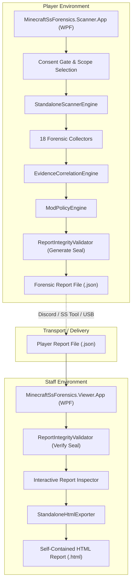
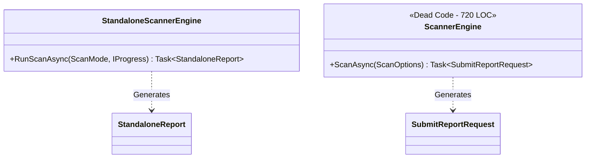

# Architecture Audit — Minecraft Forensic Scanner

**Date of Audit:** October 30, 2026  
**Repository:** Minecraft Screenshare Forensics (Standalone Windows Edition)  
**Target Solution:** `backend/MinecraftSsForensics.sln`  
**Inspected Projects:**
- `MinecraftSsForensics.Scanner` (Core Class Library)
- `MinecraftSsForensics.Scanner.App` (WPF Scanner Desktop Application)
- `MinecraftSsForensics.Viewer.App` (WPF Report Viewer Desktop Application)
- `MinecraftSsForensics.Scanner.Tests` (xUnit Test Suite)

---

## 1. System Architecture Overview

The system was migrated from a distributed web architecture (ASP.NET Web API + PostgreSQL + React frontend) into an offline-first, standalone Windows desktop application suite. 

The architecture is designed around two standalone execution environments communicating exclusively through a standardized, cryptographically sealed JSON report file (`StandaloneReport`).

---

## 2. Component Analysis & Boundaries

### 2.1 Core Library (`MinecraftSsForensics.Scanner`)
- **Location:** `backend/src/MinecraftSsForensics.Scanner/`
- **Target Framework:** `net8.0-windows`
- **Dependencies:**
  - `System.Management` (WMI queries for process command lines and Win32 services)
  - `Microsoft.Win32.Registry` (Registry inspection: Run, UserAssist, RecentDocs, BAM/DAM)
  - `System.Diagnostics.EventLog` (Windows Event Log queries for Event ID 7045)
- **Primary Subsystems:**
  1. `Scanners/`: 18 distinct forensic evidence gathering classes.
  2. `Engine/`: Orchestration (`StandaloneScannerEngine`), correlation (`EvidenceCorrelationEngine`), integrity verification (`ReportIntegrityValidator`), and database matching (`CheatDetectionDatabase`).
  3. `Models/`: Data transfer objects representing forensic artifacts, findings, and metadata.
  4. `Policy/`: Server rule configuration and compliance checking (`ModPolicyEngine`).
  5. `Export/`: Self-contained HTML report generation with embedded CSS/JS (`StandaloneHtmlExporter`).

### 2.2 Player Scanner Application (`MinecraftSsForensics.Scanner.App`)
- **Location:** `backend/src/MinecraftSsForensics.Scanner.App/`
- **Technology:** WPF (.NET 8.0 Windows desktop)
- **Window:** Single-window wizard (`MainWindow.xaml`) transitioning between 4 screens:
  - Screen 1: Welcome & Explicit Consent Agreement.
  - Screen 2: Real-time scan progress bar and live log view.
  - Screen 3: High-level scan summary and local report saving (`SaveFileDialog`).
  - Screen 4: Self-audit details view allowing players to verify findings before sharing.

### 2.3 Staff Viewer Application (`MinecraftSsForensics.Viewer.App`)
- **Location:** `backend/src/MinecraftSsForensics.Viewer.App/`
- **Technology:** WPF (.NET 8.0 Windows desktop)
- **Window:** Single-window forensic inspection tool (`MainWindow.xaml`):
  - File picker (`OpenFileDialog`) to open `.json` reports.
  - Cryptographic badge displaying report seal validity.
  - Summary stats: Findings count, Verified Mods, Suspicious Artifacts, Policy Violations.
  - Categorized tabbed inspection views: Overview, Mod Inventory, Process & Memory, Registry & History, File Discoveries, Correlated Assessments.
  - HTML Exporter button to generate self-contained, standalone HTML reports for offline archival or submission to secondary AI analysis.

---

## 3. Critical Architectural Anti-Patterns & Code Duplication

### 3.1 Dead Legacy Code: Parallel Scanner Engines
The repository currently contains **two independent, parallel scanning engines** in the core library:
1. `StandaloneScannerEngine.cs` (651 lines) — Used by `MinecraftSsForensics.Scanner.App`. Produces `StandaloneReport`.
2. `ScannerEngine.cs` (720 lines) — **DEAD CODE**. Remaining from Stage 1 client-server architecture. Produces `SubmitReportRequest` (legacy model designed for HTTP POST to ASP.NET).

**Risk & Impact:**
- Maintaining `ScannerEngine.cs` duplicates scanning logic across 1,400+ lines of code.
- Bug fixes or security patches made to one engine are not reflected in the other.
- New developers or automated tools may invoke or reference the legacy engine by mistake.

### 3.2 Dead Legacy Code: Parallel Report Exporters
Similarly, the repository contains two parallel report exporters:
1. `StandaloneHtmlExporter.cs` (490 lines) — Used by `MinecraftSsForensics.Viewer.App`. Takes a `StandaloneReport` and outputs HTML.
2. `ReportExporter.cs` (705 lines) — **DEAD CODE**. Takes legacy models (`SubmitReportRequest`) and generates HTML reports containing mock backend URLs and API upload endpoints.

### 3.3 Redundant Models: `LegacyModels.cs`
`backend/src/MinecraftSsForensics.Scanner/Models/LegacyModels.cs` (110 lines) contains:
- `SubmitReportRequest`
- `ReportMetadataDto`
- `SystemInformationDto`
- `ModEntryDto`
- `EvidenceItemDto`
- `ScanDiagnosticDto`

None of these types are referenced by either the Scanner App or Viewer App. They exist solely to satisfy the unreferenced legacy `ScannerEngine.cs` and `ReportExporter.cs`.

---

## 4. Coupling and Dependency Analysis

### 4.1 Direct OS API Binding (Absence of Abstraction Layers)
All 18 forensic scanners in `MinecraftSsForensics.Scanner/Scanners/` make direct, unabstracted calls to Windows OS APIs:
- Direct P/Invoke calls to `kernel32.dll` (`QueryFullProcessImageName`, `OpenProcess`).
- Direct WMI queries via `ManagementObjectSearcher`.
- Direct Registry calls via `Microsoft.Win32.RegistryKey`.
- Direct file I/O to `C:\Windows\Prefetch`, `C:\$Recycle.Bin`, and AppData directories.

**Consequence:**
- Core forensic business logic cannot be unit-tested without mocking the entire Windows operating system.
- The test suite (`MinecraftSsForensics.Scanner.Tests`) is forced to bypass real scanner execution and instead instantiate hardcoded `StandaloneReport` objects, leading to shallow, brittle test coverage.

### 4.2 Threading & Cancellation Deficiencies
- `StandaloneScannerEngine.RunScanAsync` accepts an `IProgress<ScanProgressUpdate>`, but **does not accept or propagate a `CancellationToken`**.
- If a user cancels a scan in the UI or closes the window, background threads running WMI queries or large directory traversals continue executing until completion, consuming CPU and memory.
- Several registry and file access routines perform synchronous I/O directly within async methods without `ConfigureAwait(false)`.

---

## 5. Architectural Quality Metrics

| Architectural Metric | Rating | Observation |
| :--- | :---: | :--- |
| **Separation of Concerns** | **B** | Standalone UI, Viewer UI, and Core Library are separated, but dead Stage 1 code remains in Core. |
| **Data Flow Predictability** | **A-** | Single linear data flow: Scan -> Report DTO -> Integrity Hash -> JSON -> Viewer. |
| **Testability** | **C** | Lack of OS abstraction interfaces (`IFileSystem`, `IRegistryProvider`, `IProcessProvider`) prevents isolated testing. |
| **Resilience & Fault Isolation** | **B+** | Every scanner class wraps its execution in individual `try/catch` blocks and appends to `ScanDiagnostics`. |
| **Code Hygiene** | **C+** | ~1,535 lines of dead legacy code (`ScannerEngine.cs`, `ReportExporter.cs`, `LegacyModels.cs`). |

---

## 6. Recommendations for Architecture Remediation

1. **Purge Dead Stage 1 Code:** Delete `ScannerEngine.cs`, `ReportExporter.cs`, and `LegacyModels.cs`. Verify solution compilation.
2. **Introduce Forensic Abstraction Interfaces:**
   - Define `IWindowsRegistry`, `IProcessManager`, and `IFileSystemAccessor` in the Scanner project.
   - Refactor forensic collectors to depend on these interfaces.
   - Implement real Windows adapters and mock test adapters to enable comprehensive unit testing.
3. **Propagate `CancellationToken`:** Add cancellation token support to `StandaloneScannerEngine` and all scanner subclasses.
4. **Standardize JSON Serialization:** Consolidate `System.Text.Json` settings across Scanner and Viewer to ensure byte-exact deterministic serialization.
