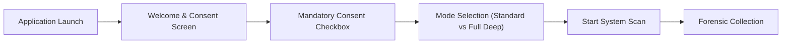

# Privacy and Consent Audit — Minecraft Forensic Scanner

**Date of Audit:** October 30, 2026  
**Auditor:** Senior Security & Privacy Reviewer  
**Scope:** Evaluation of personally identifiable information (PII), consent mechanisms, data retention, and privacy leak risks across `backend/src/MinecraftSsForensics.Scanner` and `MinecraftSsForensics.Scanner.App`.

---

## 1. Inventory of Collected Data & PII Exposure

The scanner collects extensive host machine telemetry and stores it in unencrypted, portable JSON reports (`StandaloneReport`). The following table catalogs all collected data fields and their privacy impact:

| Data Category | Specific Fields Collected | Storage Location in Report | Privacy Risk Level | Potential Privacy Harm |
| :--- | :--- | :--- | :---: | :--- |
| **System Identity** | Machine Name, OS Version, Architecture, Processor Count | `report.SystemInfo` | **Low** | Machine fingerprinting. |
| **User Identity** | Windows Username, User Domain, User SID | `report.SystemInfo`, `report.HistoricalEvidence` | **Medium** | Exposes real full name if user profile is named after the player. |
| **Active Processes** | All running process names, PIDs, memory usage, start times | `report.RunningProcesses` | **Medium-High** | Reveals what software the user runs (banking apps, messaging apps, private work tools). |
| **Process Command Lines** | Full CLI arguments for Java processes | `report.RunningProcesses[].CommandLine` | **High** | May leak session tokens, private server IPs, or personal directory structures. |
| **File System Paths** | Full file paths in Downloads, Desktop, Temp, Minecraft | `report.FileDiscoveries`, `report.ModInventory` | **High** | Leaks personal directory naming, personal projects, documents, or sensitive downloads. |
| **USB Device History** | Hardware IDs, Friendly Names, Vendor/Product IDs | `report.UsbEvidence` | **Medium** | Reveals all external drives, phones, or storage devices ever connected to the PC. |
| **PowerShell History** | Command-line history lines from `ConsoleHost_history.txt` | `report.HistoricalEvidence` | **CRITICAL** | Often contains pasted passwords, API keys, private tokens, git credentials, or personal scripts. |
| **Browser History** | Browser names, matched URLs, titles, visit times | `report.BrowserEvidence` | **CRITICAL** | Incurs severe false positive privacy leaks due to blind substring searches on SQLite history. |

---

## 2. Deep Dive: Privacy Risks in Evidence Collection

### 2.1 The Browser History Problem: Indiscriminate String Matching
In `BrowserHistoryScanner.cs`, the scanner copies the Chromium `History` database and searches the raw binary file for string matches against cheat domain keywords (`vape.gg`, `badlion.net`, etc.).

**Privacy Violation:**
1. **Collateral Search Extraction:** If a user searched Google for *"why do players use vape.gg on hypixel?"* or read a Reddit discussion regarding cheating scandals, the entire URL containing the search query is matched.
2. **Fabricated Visit Evidence:** The scanner marks this as an active visit with `VisitTime = UtcNow` ([BUG-P0-03]), converting benign research or web searches into fabricated evidence of illicit cheat usage presented to Minecraft server staff.
3. **No Domain Isolation:** Staff are shown private browser artifacts without the player having the ability to omit specific non-cheat URLs.

### 2.2 PowerShell Console Host History Leakage
In `HistoricalEvidenceScanner.cs:134-162`, the scanner reads the last 100 lines of `ConsoleHost_history.txt`.
While the code checks `CheatDetectionDatabase.MatchCommandLine(line)` to only report lines matching cheat terms, any generic keyword match (such as a developer running a script with `--reach`, `inject`, or `bypass`) will capture the entire command line, potentially exposing internal repository URLs, personal environment variables, or auth headers.

### 2.3 User Directory File Enumeration
`FileDiscoveryScanner.cs` scans `Downloads`, `Desktop`, and `%TEMP%`.
Even though results are filtered through `CheatDetectionDatabase.MatchFileName(file.Name)`, when a match occurs, the **full absolute path** is published to the report (e.g., `C:\Users\JaneDoe\Desktop\SecretWork\Client\vape.jar`). This directly discloses private folder structures and real names to volunteer server staff members.

---

## 3. Evaluation of User Consent & Transparency

### 3.1 Scanner App Consent Dialog (`MainWindow.xaml`)
The scanner application implements a mandatory consent screen before initiating any system audit.

### 3.2 Strengths of the Current Consent Flow:
1. **Explicit Acknowledgment:** The "Start Scan" button remains disabled until the user explicitly checks the consent agreement.
2. **Pre-Sharing Review Screen:** The application does not automatically send reports over the network. The player is presented with a full "Self-Audit" review screen showing exactly what was found before saving or sharing.
3. **Local Storage Only:** Reports are saved only to the player's local drive (`SaveFileDialog`); no covert telemetry or background cloud uploads occur.

### 3.3 Critical Weaknesses in the Consent Flow:
1. **Vague Consent Notice:** The consent text states:
   > *"I consent to a read-only forensic scan of Minecraft directories, running processes, and historical execution artifacts on this computer."*
   It **does NOT explicitly warn the user** that:
   - Their web browser history (Chrome, Edge, Brave, Opera) will be scanned.
   - Their PowerShell terminal command history will be inspected.
   - Their USB hardware connection history will be cataloged.
2. **All-or-Nothing Scope:** The user cannot toggle off sensitive collectors (e.g., opting out of Browser History or PowerShell History while consenting to Mod and Process scanning).
3. **Lack of In-App Redaction:** The player cannot select a specific finding (such as their personal username or a false positive browser match) and redact it before saving the report.

---

## 4. Privacy & Forensic Ethics Standards Compliance

| Privacy Principle | Status | Evaluation |
| :--- | :---: | :--- |
| **Data Minimization** | **FAIL** | Raw SQLite history and full file paths are read indiscriminately. |
| **Purpose Limitation** | **PASS** | Data collection is strictly scoped to anti-cheat verification. |
| **Informed Consent** | **PARTIAL** | Consent is required, but details regarding browser and terminal inspection are concealed. |
| **Storage Limitation** | **PASS** | Local-first offline storage; no remote server retention. |
| **Confidentiality / Integrity**| **FAIL** | JSON reports are unencrypted; seal does not prevent tampering. |

---

## 5. Remediation Recommendations for Privacy Hardening

1. **Granular Consent Toggles:**
   - Update the UI to include collapsible checkboxes allowing players to explicitly authorize or exclude:
     - `[x] Minecraft Game Directories and JAR Hashes (Required)`
     - `[x] Running Processes and Active Injections`
     - `[ ] Web Browser History Inspection`
     - `[ ] Terminal / PowerShell Execution History`
     - `[ ] USB Connection History`
2. **Username Path Anonymization:**
   - Implement an automated path sanitizer in `StandaloneReport` serialization that replaces the active user's home path (`C:\Users\JohnSmith\`) with `%USERPROFILE%\` across all evidence collections.
3. **Structured SQLite Querying with Strict Domain Whitelisting:**
   - Never perform substring searches on the raw SQLite database. Query only the `urls` table with an exact `WHERE url LIKE '%domain%'` clause, extracting only the sanitized domain and authentic timestamp.
4. **Interactive Evidence Redaction:**
   - On the Self-Audit screen, allow the player to click a "Redact Finding" button. Redacted findings will appear in the staff viewer as `[REDACTED BY USER]` with a cryptographic note that the player opted out of disclosing that specific artifact.
