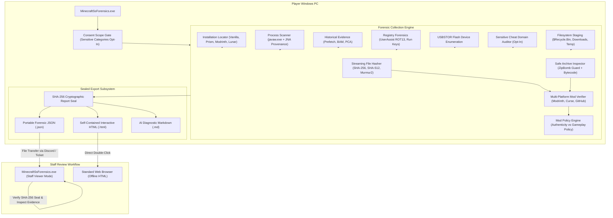

# System Architecture — Standalone Windows Forensic Suite

## Overview
Minecraft Screenshare (SS) Forensics is a consent-based, high-integrity forensic investigation suite designed for Minecraft anti-cheat investigations and competitive verification. The suite is engineered as a **100% standalone Windows application**, eliminating all reliance on backend web servers, hosted databases, cloud APIs, and user accounts.

---

## Architectural Principles & Boundaries

### 1. Offline-First & Zero-Server Dependency
- The application executes completely offline. Network connectivity is optional and utilized strictly for querying official mod repositories (Modrinth, CurseForge, GitHub) if the player consents to online mod verification.
- No telemetry, analytics, crash reports, or user information are ever transmitted to any third-party server.

### 2. Explicit Player Consent Scope
- The scanner requires affirmative player consent before collecting forensic artifacts.
- Sensitive categories—specifically local web browser history—are **explicitly optional** and require active player opt-in.
- Search queries, cookies, session credentials, passwords, and personal web history are strictly excluded by architectural design.

### 3. Read-Only Safety Standard
- The scanner operates in non-invasive, read-only mode.
- The tool never alters files, registers startup hooks, injects code into target processes, or modifies registry settings.

### 4. Mathematical Cryptographic Seal
- Every report generated by the engine includes an embedded SHA-256 cryptographic seal calculated over normalized report properties.
- When staff imports a `.json` report into the viewer, the integrity seal is recalculated and validated. If any finding, mod entry, or metric was edited in a text editor, the viewer immediately flags the file as tampered.

### 5. False-Positive Mitigation by Design
- **Java Native Extraction**: Distinguishes legitimate native library extractions (JNA, LWJGL, OpenAL, JInput) from unauthorized DLL injection into `javaw.exe`.
- **Authenticity vs. Policy**: Strictly separates whether an artifact is authentic (signed/published) from whether it is permissible under the server's gamemode ruleset.
- **Contextual Transparency**: Findings provide both `WhatIsProven` and `WhatIsNotProven`, as well as plausible alternative legitimate explanations.
