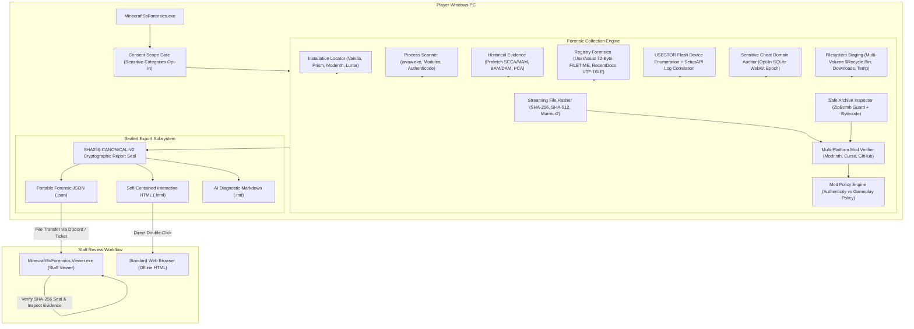

# System Architecture — Standalone Windows Forensic Suite

## 1. System Overview

**Minecraft SS Forensics** is an offline-first, standalone forensic investigation suite designed for Windows 10 and Windows 11. It eliminates all reliance on remote servers, web APIs, cloud report hosting, or user accounts.

---

## 2. Forensic Subsystems & Win32 Integration

1. **Authenticode Verification (`WinVerifyTrust`)**: Uses native P/Invoke with `WINTRUST_ACTION_GENERIC_VERIFY_V2` to check embedded PKCS#7 and catalog signatures, extracting subject names.
2. **Prefetch MAM Decompression (`RtlDecompressBufferEx`)**: Decompresses Windows 10/11 compressed prefetch files (`XPRESS_HUFF`), parsing SCCA format headers to extract run counts, execution timestamps, and loaded DLL modules.
3. **BAM/DAM Volume Path Translation (`QueryDosDevice`)**: Maps NT device paths (`\Device\HarddiskVolumeX`) to DOS drive letters (`C:\`, `D:\`).
4. **Recycle Bin Reconstruction**: Parses Version 1 and Version 2 `$I` index files across all fixed drives, recovering deleted filenames, deletion timestamps, and hashing paired `$R` payloads.
5. **Static Bytecode Constant Pool Parsing**: Analyzes Java class file constant pools in memory without execution, resolving method references (`Robot`, `cursor`, `packet`, `autoCrystal`) and `@Mixin` targets.
6. **Report Sealing (`SHA256-CANONICAL-V2`)**: Canonicalizes recursive JSON properties ordinally and computes a SHA-256 digest verified via constant-time comparison.
