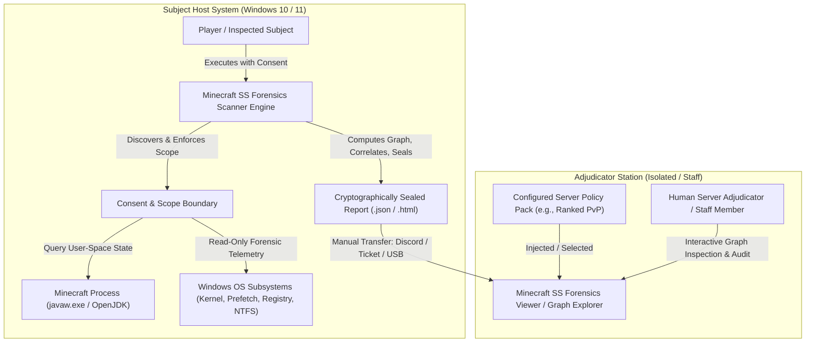

# 00 — Executive Architecture & System Foundation

**Platform Name**: Minecraft SS Forensics (Next-Generation Adversarial Forensic Detection Platform)  
**Document Status**: Authoritative Architecture Specification  
**Architecture Version**: v3.0.0-PROPOSED  
**Author**: Principal Software Architect, Windows Forensics Engineer, JVM Internals Specialist  
**Classification**: Public Engineering Architecture  

---

## 1. Executive Summary & Core Mission

### 1.1 The Problem Space
In competitive Minecraft environments (e.g., ranked PvP, tournament servers, esports leagues, and private communities), players frequently undergo technical inspections—traditionally called "screenshares" (SS). Historical practice has relied upon rudimentary batch scripts, closed-source blackbox scanners, or ad-hoc manual probing using Sysinternals tools. 

These legacy approaches exhibit severe deficiencies:
1. **Unprincipled Conflation of Facts**: Conflating static presence of a file on a multi-terabyte disk with active in-game cheating during an official match.
2. **Fragile Signature Reliance**: Depending exclusively on plaintext file names or public SHA-256 hashes, trivial to defeat by renaming or recompiling.
3. **Blackbox "Magic Scores"**: Presenting synthetic percentage probabilities (e.g., "98.7% cheat probability") devoid of empirical statistical calibration, confusing human adjudicators.
4. **Intrusive and Insecure Practices**: Demanding administrative execution of remote management tools (AnyDesk, TeamViewer), probing unrelated personal files, and exfiltrating unredacted user telemetry.
5. **False Positives on Modern Mod Ecosystems**: Misclassifying legitimate Fabric/Forge runtime behavior—such as Java Native Access (JNA) unpacking temporary `.dll` binaries into `%TEMP%`—as malicious dynamic code injection.

### 1.2 Mission Statement
The next-generation **Minecraft SS Forensics Platform** is an **offline-first, evidence-driven, explainable forensic assessment platform**. It assists human adjudicators in determining whether prohibited Minecraft modifications or auxiliary automation utilities were **present, executed, or active** in association with a Minecraft process during a defined inspection window.

The platform is explicitly **not**:
- A conventional antivirus.
- A real-time gameplay anti-cheat.
- A simple mod-list checker.
- A filename-based cheat detector.
- A tool that automatically declares someone guilty.
- A system that claims to detect every possible cheat.

Its purpose is to collect, identify, correlate, and explain forensic evidence relating to prohibited software and capabilities in a Minecraft environment.

The architecture is designed for technically sophisticated subjects while remaining technically honest about what can and cannot be observed.

**Central Design Principle**:
> **Detect architectural evidence, identify capabilities, establish temporal relationships, and explain conclusions. Do not confuse indicators with proof.**

---

## 2. Core Architectural Principles

All architectural choices across the platform are governed by foundational principles:

| Principle ID | Principle Name | Formal Architectural Rule |
| :--- | :--- | :--- |
| **AP-01** | **Strict Evidentiary Separation** | The platform must *never* collapse the distinct states: (1) Artifact Exists, (2) Artifact Identified, (3) Artifact Historically Executed, (4) Process Currently Running, (5) Module Mapped in Memory, (6) Process Associated with Minecraft, (7) Active in Inspection Window, and (8) Prohibited Action Committed. |
| **AP-02** | **Zero Synthetic Probabilities** | The platform shall not output pseudo-scientific percentage likelihoods. Every finding must state concrete facts, explicit confidence in the *observation*, verifiable provenance, known limitations, and contradictory evidence. |
| **AP-03** | **Immutable Raw Observations** | Raw telemetry collected from the operating system is stored as an immutable evidence record. Derived assessments are fully reproducible by applying versioned rules to raw observations. |
| **AP-04** | **Correlated Evidence Graph** | Evidence is modeled as an interconnected graph (processes, files, JVM instances, modules, network handles, historical traces), not a flat list of strings. Correlation engines traverse graph paths to establish relationships. |
| **AP-05** | **Bounded, Transparent Collection** | All telemetry collectors run in user-space with bounded timeouts, explicit memory/CPU quotas, and deterministic failure modes. The platform uses **no kernel drivers**, no stealth hooks, no system persistence, and zero automatic remote network transmission. |
| **AP-06** | **Privacy by Design & Data Minimization** | Personal paths (`C:\Users\<username>\`), authentication tokens, JVM session parameters, browser session secrets, and unrelated personal documents are strictly redacted prior to serialization. |
| **AP-07** | **Adversarial Resilience** | The architecture assumes the subject may rename files, modify timestamps (timestomp), leverage external processes, use memory injection, or attempt to tamper with output files. The engine corroborates evidence across independent OS and JVM subsystems. |
| **AP-08** | **Explicit Uncertainty & Negative Proof** | A missing observation shall never be treated as evidence of concealment without corroborating anti-forensic traces. When telemetry is unavailable (e.g., non-admin privilege or disabled OS logging), the platform explicitly reports `INCONCLUSIVE` for that check. |

---

## 3. System Context & Operational Boundaries

The platform operates across two distinct operational environments: the **Subject Host (Player Environment)** and the **Adjudicator Station (Staff Environment)**.

### 3.1 Non-Objectives (Explicit Boundaries)
To maintain defensibility, legality, and stability, the following capabilities are explicitly outside the system scope:
- **NO Kernel-Mode Drivers**: The scanner will not install `.sys` drivers (`OUT OF SCOPE`).
- **NO Anti-Tamper DRM or Hostile Hooking**: The scanner will not attempt to hook system APIs or prevent user debugger attachment (`OUT OF SCOPE`).
- **NO Remote Code Execution**: The scanner will not accept incoming network connections or execute remote commands (`OUT OF SCOPE`).
- **NO Automated Banning**: The platform generates forensic intelligence for human reviewers; it does not issue automated administrative sanctions (`OUT OF SCOPE`).
- **NO Arbitrary Drive Indexing**: The scanner will not perform blind full-disk scans of non-gaming user directories (`OUT OF SCOPE`).
- **NO DMA Hardware Reading Detection**: Direct memory access via physical PCIe bus without host CPU/OS invocation is physically outside the scope of passive user-mode software (`OUT OF SCOPE`).

---

## 4. High-Level Component Architecture

The platform architecture is divided into six decoupled subsystems:

---

## 5. Architectural Status Taxonomy (Four Disjoint Dimensions)

To eliminate ambiguity between source code implementation, test validation, architectural design decisions, and administrative governance approvals, the platform strictly segregates status into four orthogonal dimensions:

### 5.1 Implementation Status (Source Code Reality)
*Reflects whether actual, executable C# code exists in `backend/src/`*:
- **`IMPLEMENTED`**: Fully present, implemented, and operational in the current v2.1.0 codebase.
- **`PARTIALLY IMPLEMENTED`**: Core code exists in v2.1.0, but lacks specific capabilities described in the target architecture.
- **`PROPOSED`**: Formally specified target architecture not yet present in the C# codebase.
- **`DEFERRED`**: Architecturally defined feature intentionally postponed to a future milestone beyond v3.0.0.
- **`RESEARCH REQUIRED`**: Unresolved technical inquiry requiring synthetic experimentation before engineering commitment.
- **`OUT OF SCOPE`**: Deliberately excluded from the application (e.g., kernel-mode drivers, physical DMA hardware detection).
- **`NOT VERIFIED`**: Implementation claim that has not yet been audited against actual source code.

> [!WARNING]
> The term `VERIFIED` must **NEVER** be used as a synonym for `IMPLEMENTED`. A claim or concept being verified does not mean it exists in production code.

### 5.2 Test-Validation Status (Executable Test Reality)
*Reflects whether automated, passing tests exist in `backend/tests/`*:
- **`AUTOMATED_TEST_PASSING`**: Supported by an active, reproducible automated test in the existing test suite (e.g. passing xUnit test).
- **`MANUALLY_VALIDATED`**: Verified via controlled manual testing, but lacking an automated regression test.
- **`NO_AUTOMATED_TEST`**: Feature is implemented or partially implemented, but lacks automated test coverage.
- **`TEST_PENDING_IMPLEMENTATION`**: Test specification exists (e.g. Scenarios 13–25 in Doc 28), pending feature implementation.

### 5.3 Architecture-Decision Status (ADR Governance)
*Reflects the architectural decision state in [`ARCHITECTURE-DECISION-REGISTER.md`](./ARCHITECTURE-DECISION-REGISTER.md)*:
- **`ADR_ACCEPTED`**: Formally approved architecture decision.
- **`ADR_PROPOSED`**: Decision drafted and submitted for architectural review.
- **`ADR_REJECTED`**: Formally rejected design path (e.g. uncalibrated Bayesian scoring).
- **`ADR_SUPERSEDED`**: Replaced by a newer architectural decision.

### 5.4 Governance-Approval Status (Administrative Sign-Off)
*Reflects human administrative authority*:
- **`GOVERNANCE_APPROVED`**: Formally ratified and signed off by human server/tournament administration.
- **`GOVERNANCE_PENDING`**: Awaiting review by human server leadership.
- **`GOVERNANCE_NOT_SUBMITTED`**: Not yet submitted to server leadership.

---

## 6. Authoritative Document Map & Inventory

The complete architectural specification comprises the following 29 numbered specifications, plus the 5 governance registers in `docs/architecture/` (34 total documents):

| Document ID | Title | Key Architectural Focus | Primary Impl. Status | Test Status |
| :---: | :--- | :--- | :---: | :---: |
| **00** | [Executive Architecture](./00-EXECUTIVE-ARCHITECTURE.md) | Vision, principles, system boundaries, and 4-dimension status taxonomy. | `IMPLEMENTED` (Baseline) / `PROPOSED` (v3) | `AUTOMATED_TEST_PASSING` |
| **01** | [Existing System Audit](./01-EXISTING-SYSTEM-AUDIT.md) | Audited code inventory, data flow, capabilities, and identified technical debt. | `IMPLEMENTED` (Audit of v2.1) | `AUTOMATED_TEST_PASSING` |
| **02** | [Adversarial Threat Model](./02-THREAT-MODEL.md) | Threat assumptions, Minecraft vectors, Windows artifacts, 9-tier cheat taxonomy. | `PROPOSED` (Threat Model) | `AUTOMATED_TEST_PASSING` |
| **03** | [Evidence Philosophy](./03-EVIDENCE-PHILOSOPHY.md) | 8 distinct claims, proposition states (`PROVEN`, `UNKNOWN`), negative axioms. | `PARTIALLY IMPLEMENTED` | `AUTOMATED_TEST_PASSING` |
| **04** | [Evidence Schema](./04-EVIDENCE-SCHEMA.md) | Canonical 12-column findings schema, stable IDs, JSON Draft 2020-12, custom JCS. | `PARTIALLY IMPLEMENTED` (v2) / `PROPOSED` (v3) | `AUTOMATED_TEST_PASSING` |
| **05** | [Evidence Graph](./05-EVIDENCE-GRAPH.md) | Directed Attributed Evidence Graph ($\mathcal{G}=(\mathcal{V},\mathcal{E})$), 13 entities, 11 edges. | `PROPOSED` | `TEST_PENDING_IMPLEMENTATION` |
| **06** | [Collection Architecture](./06-COLLECTION-ARCHITECTURE.md) | 10 collector families, `CollectionStatus` state machine, bounded budgets. | `PARTIALLY IMPLEMENTED` (v2 collectors) | `AUTOMATED_TEST_PASSING` |
| **07** | [Identification Engine](./07-IDENTIFICATION-ENGINE.md) | 7-layer multi-modal identity, signed reference packs (`.refpack`), unknown handling. | `PARTIALLY IMPLEMENTED` (Compiled DB) | `AUTOMATED_TEST_PASSING` |
| **08** | [Correlation Engine](./08-CORRELATION-ENGINE.md) | Topological clustering (`EvidenceClusterId`), anti-double-counting, explainable trace. | `PARTIALLY IMPLEMENTED` (EvidenceCorrelator) | `AUTOMATED_TEST_PASSING` |
| **09** | [Severity & Assessment](./09-SEVERITY-AND-ASSESSMENT.md) | Orthogonal Severity vs Evidence Strength matrix, 9 assessment categories, 5 verdicts. | `IMPLEMENTED` (Verdict Logic) | `AUTOMATED_TEST_PASSING` |
| **10** | [Reporting Architecture](./10-REPORTING-ARCHITECTURE.md) | Dual-audience reporting (investigator vs staff), runtime timeline, SVG graph view. | `PARTIALLY IMPLEMENTED` (HTML/JSON) | `AUTOMATED_TEST_PASSING` |
| **11** | [Validation & Test Strategy](./11-VALIDATION-AND-TEST-STRATEGY.md) | 5-tier test pyramid, testing methodology, acceptance criteria. | `IMPLEMENTED` (Tiers 1-4 baseline) | `AUTOMATED_TEST_PASSING` |
| **12** | [Privacy & Integrity](./12-PRIVACY-AND-INTEGRITY.md) | Privacy by design, token/path redaction, `SHA256-CANONICAL-V2` content digest. | `IMPLEMENTED` (Redaction/Seal) | `AUTOMATED_TEST_PASSING` |
| **13** | [Performance & Reliability](./13-PERFORMANCE-AND-RELIABILITY.md) | Resource budgets ($\le 250\text{ MB}$ RAM, $\le 45\text{s}$ scan), streaming 64 KB buffers. | `IMPLEMENTED` (Budgets/Buffers) | `AUTOMATED_TEST_PASSING` |
| **14** | [Technology & Dependencies](./14-TECHNOLOGY-AND-DEPENDENCY-DECISIONS.md) | Technology choices (.NET 8, in-memory graph, single-file bundles), supply chain. | `IMPLEMENTED` (.NET 8 Win-x64) | `AUTOMATED_TEST_PASSING` |
| **15** | [Implementation Roadmap](./15-IMPLEMENTATION-ROADMAP.md) | 12-phase topological implementation roadmap, entry/exit criteria, milestones. | `PROPOSED` (Roadmap) | `TEST_PENDING_IMPLEMENTATION` |
| **16** | [Open Questions & Research](./16-OPEN-QUESTIONS-AND-RESEARCH.md) | Technical research inquiries (HotSpot attach, DMA limits), 4 policy governance questions. | `RESEARCH REQUIRED` | `TEST_PENDING_IMPLEMENTATION` |
| **17** | [Glossary](./17-GLOSSARY.md) | Authoritative lexicon defining all forensic, Windows, JVM, and Minecraft terms. | `IMPLEMENTED` (Lexicon) | `AUTOMATED_TEST_PASSING` |
| **18** | [Cheat Architecture Taxonomy](./18-CHEAT-ARCHITECTURE-TAXONOMY.md) | The 9 operational cheat architectures (Internal, External, Ghost, Native, Netty, Drivers, DMA, Macros, Packs). | `PARTIALLY IMPLEMENTED` (Detection scope) | `AUTOMATED_TEST_PASSING` |
| **19** | [Forensic Evidence Source Catalog](./19-FORENSIC-EVIDENCE-SOURCE-CATALOG.md) | Catalog of 11 Minecraft/JVM sources and 16 Windows sources across 14 attributes; 5 myths debunked. | `PARTIALLY IMPLEMENTED` (v2 sources) | `AUTOMATED_TEST_PASSING` |
| **20** | [Layered Detection Architecture](./20-LAYERED-DETECTION-ARCHITECTURE.md) | The 6 conceptual detection layers (A: Discovery, B: Capability, C: Runtime, D: History, E: Correlation, F: Policy). | `PARTIALLY IMPLEMENTED` (v2 pipeline) | `AUTOMATED_TEST_PASSING` |
| **21** | [Cheat-to-Evidence Coverage](./21-CHEAT-TO-EVIDENCE-COVERAGE.md) | Observability states mapping all 9 categories across static, runtime, and historical opportunities. | `PARTIALLY IMPLEMENTED` | `AUTOMATED_TEST_PASSING` |
| **22** | [Capability Intelligence](./22-CAPABILITY-INTELLIGENCE.md) | Capability taxonomy (Combat, Movement, Info, Network, Automation), classifications (`CAPABILITY_*`). | `PARTIALLY IMPLEMENTED` (Bytecode Analyzer) | `AUTOMATED_TEST_PASSING` |
| **23** | [Temporal Correlation & Session Reconstruction](./23-TEMPORAL-CORRELATION-AND-SESSION-RECONSTRUCTION.md) | 9 concurrent timelines, session reconstruction model, schema, 5 temporal rules. | `PARTIALLY IMPLEMENTED` (TimelineEvents) | `AUTOMATED_TEST_PASSING` |
| **24** | [Server-Side Evidence Correlation](./24-SERVER-SIDE-EVIDENCE-CORRELATION.md) | Asymmetric boundary, offline manual server evidence schema (`.mcsec`), trust anchors. | `PROPOSED` | `TEST_PENDING_IMPLEMENTATION` |
| **25** | [Server Policy Intelligence](./25-SERVER-POLICY-INTELLIGENCE.md) | Policy decoupling axiom, 5 policy tiers, `.polpack` schema, ambiguous tool evaluations (Litematica). | `PARTIALLY IMPLEMENTED` (ModPolicyEngine) | `AUTOMATED_TEST_PASSING` |
| **26** | [Forensic Conclusion Model](./26-FORENSIC-CONCLUSION-MODEL.md) | The 10 forensic questions, required evidence, disqualifying contradictions, permitted/forbidden language. | `PARTIALLY IMPLEMENTED` (WhatIsProven) | `AUTOMATED_TEST_PASSING` |
| **27** | [Research Validation & Claim Register](./27-RESEARCH-VALIDATION-AND-CLAIM-REGISTER.md) | Empirical claim register auditing 12 technical propositions with primary documentation. | `IMPLEMENTED` (Register) | `AUTOMATED_TEST_PASSING` |
| **28** | [Adversarial Validation Matrix](./28-ADVERSARIAL-VALIDATION-MATRIX.md) | The canonical 25-scenario validation matrix with explicit validation status for each scenario. | `PARTIALLY IMPLEMENTED` (01-12 passing) | `AUTOMATED_TEST_PASSING` (12/25) |
| **ADR**| [Architecture Decision Register](./ARCHITECTURE-DECISION-REGISTER.md) | Formal records of all key architectural decisions (ADR-001 through ADR-015). | `IMPLEMENTED` (ADR Register) | `AUTOMATED_TEST_PASSING` |
| **LOG**| [Architecture Changelog](./ARCHITECTURE-CHANGELOG.md) | Systematic log of all audit corrections, rationale, and impact. | `IMPLEMENTED` (Changelog) | `AUTOMATED_TEST_PASSING` |
| **RDY**| [Implementation Readiness Assessment](./ARCHITECTURE-IMPLEMENTATION-READINESS.md) | Subsystem-by-subsystem evaluation of implementation readiness. | `IMPLEMENTED` (Readiness Matrix) | `AUTOMATED_TEST_PASSING` |
| **REV**| [Architecture Review](./ARCHITECTURE-REVIEW.md) | Comprehensive review and audit cross-reference. | `IMPLEMENTED` (Review Doc) | `AUTOMATED_TEST_PASSING` |
| **GATE**| [Architecture Lock Review](./ARCHITECTURE-LOCK-REVIEW.md) | Governance gate with checklist of remaining conditions; status: NOT READY. | `IMPLEMENTED` (Gate Doc) | `GOVERNANCE_PENDING` |
