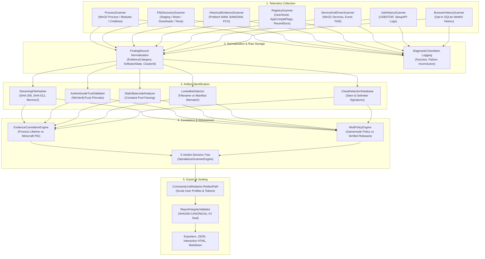

# 01 — Existing System Audit & Architectural Baseline

**Platform Name**: Minecraft SS Forensics  
**Document Status**: Official Architecture Specification  
**Baseline Version**: 2.1.0 (Audited Current Repository State)  
**Author**: Principal Security Architect, Windows Forensics Engineer  
**Classification**: Technical Repository Audit  

---

## 1. System Inventory & Entry Points

The current repository contains an offline-first Windows forensic scanner solution built on **.NET 8.0 LTS** for Windows 10 and 11 (`net8.0-windows`).

### 1.1 Solution Projects & Executables
`[OBSERVED]` The codebase is structured across four primary projects within `backend/MinecraftSsForensics.sln`:

1. **`MinecraftSsForensics.Scanner.App`** (`WinExe`, WPF):
   - **Entry Point**: `App.xaml` -> `MainWindow.xaml.cs`.
   - **Purpose**: Player-facing standalone scanner application. Presents a consent checklist (Process inspection, Filesystem, Historical artifacts, Browser history opt-in), displays real-time scan progress, and exports signed reports to local disk.
   - **Publish Output**: Single-file self-contained executable `MinecraftSsForensics.exe` (~105 MB win-x64 bundle).
2. **`MinecraftSsForensics.Viewer.App`** (`WinExe`, WPF):
   - **Entry Point**: `App.xaml` -> `MainWindow.xaml.cs`.
   - **Purpose**: Adjudicator/Staff-facing report viewer. Loads JSON and HTML report files, verifies the SHA-256 canonical integrity seal (`SHA256-CANONICAL-V2`), provides severity and evidence category filtering, and highlights key forensic metrics.
   - **Publish Output**: Single-file self-contained executable `MinecraftSsForensics.Viewer.exe` (~104 MB win-x64 bundle).
3. **`MinecraftSsForensics.Scanner`** (`Library`):
   - **Namespace**: `MinecraftSsForensics.Scanner`.
   - **Purpose**: Core forensic engine containing all telemetry collectors, archive parsers, policy registries, hash engines, Win32 P/Invoke wrappers, and report exporters.
4. **`MinecraftSsForensics.Scanner.Tests`** (`Test`, xUnit):
   - **Purpose**: Automated regression, unit, and scenario validation test suite (91 passing tests).

---

## 2. End-to-End Data Flow

The operational data pipeline from initial system query to finalized report export is illustrated below:

---

## 3. Subsystem-by-Subsystem Audit & Evaluation

### 3.1 Process Inspection Subsystem
- **Component**: `MinecraftSsForensics.Scanner.Process.ProcessScanner` `[VERIFIED]`
- **Responsibilities**: Enumerates all running processes on the host; identifies `javaw.exe`, `java.exe`, and Minecraft launcher processes; parses command lines; enumerates loaded native DLL modules; inspects Win32 Authenticode digital signatures.
- **Inputs & Outputs**: Input: OS process handles via `System.Diagnostics.Process` and Win32 P/Invoke (`EnumProcessModulesEx`, `GetModuleFileNameEx`, `QueryFullProcessImageName`). Output: `DiscoveredProcess` instances, loaded module records, and command-line arguments.
- **Dependencies**: Native `kernel32.dll`, `psapi.dll`, `wintrust.dll`.
- **Permissions Required**: Standard user permissions can query own processes; elevated (Admin) required to query processes in other sessions or processes protected by security software.
- **Failure Modes & Gaps**:
  - `[OBSERVED]` If running un-elevated, `OpenProcess` with `PROCESS_QUERY_INFORMATION | PROCESS_VM_READ` fails (`Win32Exception: Access is Denied`), causing module enumeration to return empty lists.
  - `[OBSERVED]` Modern 64-bit processes cannot enumerate modules of certain protected processes if Anti-Malware Light (PPL) or custom EDR hooks are present.
  - `[VERIFIED]` The current scanner logs these as `DiagnosticCheckItem` entries with `Success = false` rather than crashing.

### 3.2 JVM & Java Agent Inspection
- **Component**: `ProcessScanner` + `CommandLineRedactor` `[VERIFIED]`
- **Responsibilities**: Detects `-javaagent:` parameters on running Java command lines; parses `-cp` and `--class-path` arguments.
- **Current Behavior**: Flags unauthorized `-javaagent:` instances mapped into `javaw.exe`. Redacts auth tokens (`--accessToken`, `--uuid`, `--xuid`) and user directories.
- **Gaps & Inferred Limitations**:
  - `[INFERRED]` Dynamic Java agents loaded *after* JVM startup via the HotSpot JVM Attach API (e.g. via `VirtualMachine.attach(pid).loadAgent(jar)`) do not appear on the original process startup command line.
  - `[PROPOSED]` The next-generation architecture must query JVM HotSpot Attach mechanisms or inspect memory mapped files to detect dynamically attached agents.

### 3.3 File System & Mod Discovery Subsystem
- **Component**: `MinecraftSsForensics.Scanner.Collectors.FileDiscoveryScanner` `[IMPLEMENTED]`
- **Responsibilities**: Scans configured Minecraft directories (`.minecraft/mods`, `.minecraft/versions`), common launcher directories (Lunar, Badlion, Prism, Modrinth), system staging locations (`%TEMP%`, `%APPDATA%`, `%USERPROFILE%\Downloads`), and multi-volume Recycle Bin (`$Recycle.Bin`).
- **Archive Inspection**: Uses `SafeArchiveInspector` to parse `.jar` files with strict Zip-Slip protection and zip-bomb decompression limits (`MaxEntries = 10,000`, `MaxTotalUncompressedBytes = 250 MB`, `MaxCompressionRatio = 100:1`, `MaxMetadataReadBytes = 2 MB`).
- **Gaps & Inferred Limitations**:
  - `[OBSERVED]` Custom launchers or players using nonstandard game directories (e.g., `D:\Games\CustomLauncher\instances\...`) are not automatically discovered unless registered in standard `%APPDATA%` or active process command lines.
  - `[IMPLEMENTED]` File presence is strictly categorized as `EvidenceCategory.Disk` and capped at `Severity.Medium`.

### 3.4 Historical Execution Subsystem
- **Components**: `PrefetchParser`, `RegistryScanner`, `ServiceAndDriverScanner`, `UsbHistoryScanner` `[VERIFIED]`
- **Prefetch (`C:\Windows\Prefetch\*.pf`)**:
  - `[VERIFIED]` Uses native `RtlDecompressBufferEx` to decompress `MAM` compressed prefetch headers (XPRESS_HUFF). Parses SCCA format headers (Windows 8/10/11 versions 26, 30, and 31). Extracts executable name, run count, last 8 execution timestamps, and loaded DLL module lists.
  - *Limitation*: Windows Server and systems with SSDs where Prefetch is disabled in registry (`EnablePrefetcher = 0`) return no records.
- **Registry Forensics**:
  - `[VERIFIED]` Decodes ROT13-encoded `UserAssist` GUID keys (`{CEBFF5CD-...}`) from `HKEY_CURRENT_USER\Software\Microsoft\Windows\CurrentVersion\Explorer\UserAssist`, parsing 72-byte binary structures to extract execution count and 64-bit `FILETIME` execution timestamps.
  - `[VERIFIED]` Reads `AppCompatFlags\Compatibility Assistant\Store` (Program Compatibility Assistant - PCA) to extract execution traces of executed binaries.
  - `[VERIFIED]` Reads `RecentDocs` (UTF-16LE MRU lists).
  - *Limitation*: Registry cleaners, manual key deletion, or portable operation under separate local user accounts can suppress these artifacts.
- **Kernel Services & Event 7045**:
  - `[VERIFIED]` Uses `System.Diagnostics.EventLog` to query Windows System Event Log for Event ID 7045 ("A service was installed in the system"), identifying kernel drivers loaded from user-writable directories (`C:\Users\...` or `C:\Temp\...`).

### 3.5 Lookalike & Static Bytecode Analysis
- **Components**: `LookalikeDetector`, `StaticBytecodeAnalyzer` `[VERIFIED]`
- **Lookalike Detection**: Compares outer file names with internal `fabric.mod.json`, `mcmod.info`, and manifest attributes. Flags files claiming to be popular mods (e.g., `sodium-1.20.jar`) whose internal mod ID or cryptographic hash mismatches the claimed release.
- **Bytecode Inspection**: Parses Java `.class` files directly from ZIP streams without JVM classloading. Analyzes constant pool UTF-8 entries and method references for known cheat indicators (e.g., crystal automation string patterns, aimassist math hooks, `@Mixin` injections into player movement classes).

### 3.6 Mod Policy & Verification Engine
- **Components**: `ModPolicyEngine`, `CompositeModVerifier` `[VERIFIED]`
- **Policies**: Enforces gamemode-specific policies (`Standard PvP`, `Hardcore Factions`, `Vanilla Anarchy`, `Competitive Tournament`). Supports policy rules: `PROHIBITED_POSSESSION`, `PROHIBITED_EXECUTION`, `PROHIBITED_GAMEPLAY_USE`, `RESTRICTED`, and `ALLOWED`.
- **Integrity Validation**: Distinguishes between an unverified mod (custom build/unknown fork) and a cheat client. An unknown mod is classified as `NeedsReview` / `UNKNOWN_OR_UNLISTED`, **never** automatically labeled as a cheat.

### 3.7 Deduplication, Normalization & Scoring
- **Components**: `EvidenceCorrelationEngine`, `FindingRecord`, `StandaloneScannerEngine` `[VERIFIED]`
- **Clustering**: Assigns `EvidenceClusterId` across multiple observations of the same underlying file (e.g., disk presence + UserAssist execution + Prefetch run count).
- **Reconciled Totals**: `RecomputeSummaryCounts()` mathematically derives summary numbers directly from normalized findings:
  $$\text{TotalFindings} = \text{Critical} + \text{High} + \text{Medium} + \text{Low} + \text{Informational}$$
- **Verdict Engine**: Evaluates a 5-branch decision tree based on concrete facts (active injection, concurrent cheat process, unverified runtime DLL, static disk presence, or missing telemetry).

### 3.8 Cryptographic Sealing & Redaction
- **Components**: `ReportIntegrityValidator`, `CommandLineRedactor` `[IMPLEMENTED]`
- **Sealing**: Canonicalizes the JSON report and calculates a SHA-256 digest (`SHA256-CANONICAL-V2`). Any post-scan modification of findings, counts, or timestamps renders the integrity seal invalid upon opening in `MinecraftSsForensics.Viewer.exe`.
- **Redaction**: Replaces `C:\Users\<username>\` with `C:\Users\[REDACTED_USER]\` via `CommandLineRedactor.RedactPath` and strips command-line session tokens across all output formats.

---

## 4. Current Test Infrastructure Baseline

`[OBSERVED]` The automated test suite (`backend/tests/MinecraftSsForensics.Scanner.Tests`) currently contains **91 passing automated tests** across 15 test fixtures:

| Test Fixture Class | Tests | Key Validations |
| :--- | :---: | :--- |
| `ScenarioBasedForensicTests.cs` | 12 | Scenarios A through L (Disk presence != active cheat, external process != injected, temp DLL recognized provenance, renamed mods, lookalikes). |
| `StandaloneForensicTests.cs` | 22 | Core standalone engine behaviors, summary count reconciliation, integrity seal tampering detection, non-admin graceful degradation. |
| `ReportIntegrityValidatorTests.cs` | 11 | Deterministic canonical JSON digest generation, tampered report detection, unsealed report handling, valid seal verification. |
| `ModPolicyEngineTests.cs` | 9 | Gamemode policy differences, version-restricted mod enforcement, unknown mod review classification. |
| `SafeArchiveInspectorTests.cs` | 5 | Zip-Slip path traversal defense, zip-bomb decompression limits, entry caps, corrupt archive handling. |
| `LookalikeDetectorTests.cs` | 4 | Hash mismatch on claimed release, filename lookalikes, duplicate mod ID detection, legitimate fork transparency. |
| `VerificationTests.cs` | 4 | Verification cache TTL, composite verifier behavior, provider fallback handling. |
| `AuthenticodeTrustValidatorTests.cs` | 3 | Valid signature, unverified signature, unsigned file, non-existent file handling. |
| `BrowserHistoryScannerTests.cs` | 3 | Opt-out verification, SQLite database lock handling, WebKit epoch timestamp extraction. |
| `CommandLineRedactorTests.cs` | 3 | User profile path redaction (`[REDACTED_USER]`), access token scrubbing, UUID/XUID scrubbing. |
| `EvidenceCorrelationEngineTests.cs` | 3 | Process lifetime correlation, 6 evidentiary states, target process association. |
| `HashingTests.cs` | 3 | Streaming SHA-256, SHA-512, Murmur2 fingerprint computation. |
| `PrefetchParserTests.cs` | 3 | SCCA header parsing, MAM decompression, corrupt header handling, NT device path resolution. |
| `RecycleBinParserTests.cs` | 3 | Version 1 (Vista/7/8) and Version 2 (Win 10/11) `$I` index file parsing, UTF-16LE path recovery. |
| `SecurityAndHardeningTests.cs` | 3 | Bounded memory limits, cancellation token responsiveness, null parameter resilience. |

---

## 5. Summary of Current Gaps & Architectural Technical Debt

While the v2.1.0 engine provides solid evidentiary fundamentals, the audit reveals the following gaps to be addressed in the next-generation architecture:

| Subsystem | Existing Implementation Status | Identified Architectural Gap | Proposed Next-Gen Remediation |
| :--- | :--- | :--- | :--- |
| **Data Model** | Flat collection of `FindingRecord` objects with cluster IDs. | Lacks an explicit **Graph Model** representing directional relationships (e.g., `Process` $\xrightarrow{\text{loaded}}$ `Module` $\xrightarrow{\text{extracted\_from}}$ `JAR`). | Implement formal **Evidence Graph** with typed entities and relationships. |
| **JVM Memory** | Command-line parsing of `-javaagent:` and static module enumeration. | Cannot detect dynamic bytecode manipulation or HotSpot Attach API injections in memory without process command-line artifacts. | Add **JVM HotSpot Attach & Memory Map Inspector** with non-invasive read-only querying. |
| **Process Corroboration**| Checks if `javaw.exe` was running when cheat process was discovered. | Lacks granular process lifetime timeline correlation (comparing OS process start times and exit times). | Implement **Process Temporal Correlation Engine** mapping timeline windows. |
| **Reference Data** | Static compiled-in cheat signature database (`CheatDetectionDatabase.cs`). | Signatures and hash databases are embedded in C# code, requiring full binary recompiles to update signatures. | Decouple reference catalogs into **Signed, Versioned Reference Packs** with offline integrity checks. |
| **Collector Contracts** | Collectors return finding lists or bools directly. | Inconsistent collector lifecycle contracts; no standardized `CollectionStatus` enum (`COMPLETE`, `PARTIAL`, `TIMEOUT`). | Implement unified `IForensicCollector` contract with bounded timeouts and typed execution states. |
