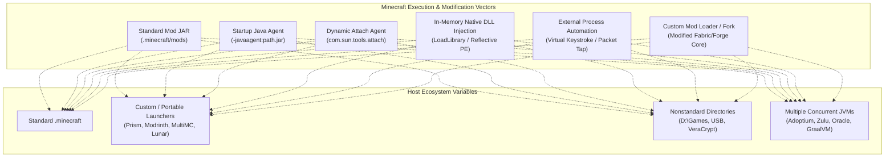
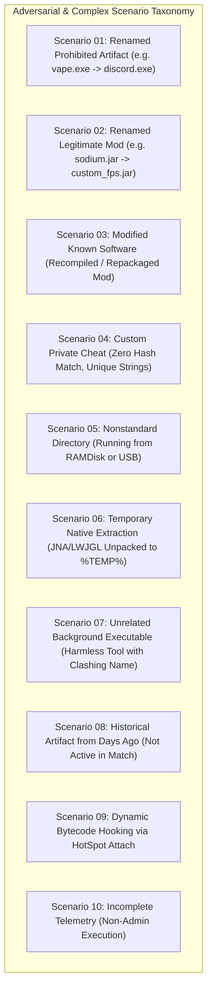

# 02 — Adversarial Threat Model & Operating Environment

**Platform Name**: Minecraft SS Forensics  
**Document Status**: Official Architecture Specification  
**Version**: 3.0.0-DRAFT  
**Author**: Principal Security Architect, Adversarial Threat Analyst  
**Classification**: Threat Modeling & Defensive Security Architecture  

---

## 1. Adversarial Persona & Threat Assumptions

In high-stakes competitive Minecraft environments, the inspected subject (the "player") cannot be assumed to be a naive user who simply leaves a folder named `Hacks` on their desktop. 

### 1.1 The Sophisticated Adversary Persona
The threat model explicitly considers an adversary possessing:
- **Deep Windows Operating System Knowledge**: Understands how Windows Prefetch, UserAssist, AppCompatCache (ShimCache), BAM/DAM, and the USN Journal operate, as well as methods to clear, bypass, or spoof them.
- **JVM & Bytecode Fluency**: Understands Java classloading hierarchies, `-javaagent:` instrumentation, bytecode manipulation libraries (ASM, ByteBuddy), and the Java Native Interface (JNI).
- **Native Architecture & Process Injection Skills**: Understands manual DLL mapping, process hollowing, thread hijacking, reflective DLL injection, and Windows memory protection primitives (`VirtualAllocEx`, `WriteProcessMemory`).
- **Forensic Tool Awareness**: Understands how common screening tools (e.g., Echo, Ocean, Paladin, legacy batch scripts) operate and actively designs workflows to exploit their heuristic assumptions.

### 1.2 Core Defensive Axiom
`[PROPOSED]` **Sophistication is not proof of guilt.** An advanced user may run custom developer builds, utilize nonstandard launcher paths, execute software from RAM disks, or disable Windows telemetry for privacy reasons. The platform must never flag non-standard system configurations as cheating. It must demand **direct, positive, corroborated evidence** before establishing a policy violation.

---

## 2. Domain A: Minecraft Ecosystem Threat Analysis

The Minecraft client and modding ecosystem is uniquely modular and extensible. The threat model covers the following vectors:

### 2.1 Mod Loaders & Client Environments
1. **Fabric & Quilt (`net.fabricmc`)**:
   - `[VERIFIED]` Lightweight mod loader utilizing the Spoon / Fabric Loader engine and Mixin transformation at runtime.
   - *Adversarial Surface*: Mod JARs can dynamically alter any Minecraft bytecode via `@Mixin` hooks in memory without changing the game's static assets. Malicious mods can disguise their metadata inside `fabric.mod.json`.
2. **Forge & NeoForge (`net.minecraftforge` / `net.neoforged`)**:
   - `[VERIFIED]` Comprehensive modding ecosystem with coremods and runtime transformer pipelines.
   - *Adversarial Surface*: Can hook directly into deep Minecraft server-client networking pipelines, packet serializers, and player capability containers.
3. **Modified Launchers & Custom Clients**:
   - `[VERIFIED]` Proprietary PvP clients (e.g., Lunar Client, Badlion, Feather) provide custom native wrappers, custom JVM runtimes, and proprietary mod bundles.
   - *Adversarial Surface*: External cheat clients frequently disguise themselves as add-ons, texture pack installers, or FPS optimization forks.
4. **Portable & Isolated Directories**:
   - `[VERIFIED]` Launchers such as Prism Launcher or MultiMC allow instances to reside anywhere (e.g. `D:\MinecraftPortable\instances\...`).
   - *Defensive Requirement*: The scanner must **never assume** `.minecraft` is the only active directory. It must extract the active game directory directly from the running JVM's `--gameDir` command-line argument and system properties.

### 2.2 In-Memory and Dynamic Injection Techniques
1. **Startup Java Agents (`-javaagent:jarpath`)**:
   - `[VERIFIED]` Java agents loaded at JVM launch via command line can register a `ClassFileTransformer` to inspect and modify any bytecode loaded by the JVM.
   - *Detection Strategy*: Captured via `ProcessScanner` command-line tokenization, with automated token redaction.
2. **Dynamic HotSpot Attach API Agents**:
   - `[INFERRED]` A separate native or Java process can invoke `com.sun.tools.attach.VirtualMachine.attach(targetPid)` to dynamically inject a `.jar` agent into an already running `javaw.exe`.
   - *Adversarial Advantage*: Leaves **no trace** in the JVM's original command-line arguments.
   - *Detection Strategy*: Inspecting JVM temporary socket files (`%TEMP%\.java_pid<pid>`) and memory-mapped files.
3. **Native PE Injection (DLL Injections)**:
   - `[VERIFIED]` External cheat binaries (e.g., Vape V4 native loader, internal ghost clients) inject a native 64-bit DLL into `javaw.exe`. The native DLL uses the JVM Tool Interface (JVMTI) or JNI to acquire a `JNIEnv*` pointer and manipulate Java classes directly from native C++.
   - *Detection Strategy*: In-process module enumeration (`EnumProcessModulesEx`), memory allocation scanning, and Authenticode certificate auditing.
4. **External Memory-Reading & Virtual Input Helpers**:
   - `[VERIFIED]` External executables (e.g., autoclickers, AimAssist helpers, reach modifiers) running as standalone processes outside Java.
   - *Adversarial Advantage*: Does not modify Java bytecode or inject DLLs. Uses Win32 `SendInput`, `mouse_event`, or raw HID driver packets to automate player actions.
   - *Detection Strategy*: Correlating external process lifetimes, window titles, and input-hook DLLs.

---

## 3. Domain B: Windows Forensic Evidence Sources & Limitations

Every Windows forensic telemetry source has specific capabilities and critical failure boundaries. The scanner must never overstate what an artifact establishes.

| Telemetry Source | What It Reliably Establishes | What It Cannot Establish | Reliability & Tamper Resistance | Permissions Required |
| :--- | :--- | :--- | :--- | :--- |
| **Process Enumeration** (`EnumProcesses`, `Toolhelp32`) | `[VERIFIED]` Active running processes and their PIDs at the exact moment of sampling. | `[VERIFIED]` Does not prove whether a process injected code into another process or executed malicious actions. | **High** for unhooked processes; however, short-lived processes (e.g. self-deleting injectors) may exit before the scan runs. | Standard User (queries own session). |
| **Loaded Modules** (`EnumProcessModulesEx`) | `[VERIFIED]` Every native DLL mapped into the target process's virtual address space with its base address. | `[VERIFIED]` Does not distinguish between a benign unpack (e.g. JNA) and a malicious DLL without signature/provenance analysis. | **High** for standard PE loaders. Manual memory mapping (reflective DLL injection) bypasses the PEB module list (`InLoadOrderModuleList`). | Standard User (for own processes). |
| **Process Command Lines** (`WMI` / `PEB`) | `[VERIFIED]` Startup parameters, `-javaagent:` arguments, classpath, `--gameDir`. | `[VERIFIED]` Does not record arguments modified in-memory post-startup or dynamic Attach API events. | **Medium**. Sophisticated malware can overwrite the command-line buffer in its own Process Environment Block (PEB). | Standard User. |
| **Windows Prefetch** (`C:\Windows\Prefetch\*.pf`) | `[VERIFIED]` Historical execution of an executable: run count, last 8 execution timestamps, loaded DLL paths. | `[VERIFIED]` **Does not prove concurrency** with Minecraft. Does not establish which user ran it or what command-line flags were passed. | **High** if enabled; but disabled on Windows Server, disabled by users on some SSDs, and can be cleared by administrators. | Administrator required to read `C:\Windows\Prefetch\`. |
| **UserAssist Registry** (`HKCU\...\UserAssist`) | `[VERIFIED]` Historical execution of GUI applications launched via Windows Explorer, run count, last launch timestamp. | `[VERIFIED]` Does not record console applications, services, or programs executed programmatically via script. | **Medium**. Can be disabled in registry or cleared by standard users without admin rights. | Standard User (reads own `HKCU`). |
| **Program Compatibility Assistant (PCA)** | `[VERIFIED]` Execution traces of setup programs, utilities, and unsigned binaries stored in registry and PCA log files. | `[VERIFIED]` Selective logging; not every executed program triggers a PCA entry. | **Medium**. Managed automatically by the OS. | Standard User. |
| **Background Activity Moderator (BAM/DAM)** | `[VERIFIED]` Records paths and timestamps of programs managed by Windows power management (`SYSTEM\CurrentControlSet\Services\bam`). | `[VERIFIED]` Timestamp reflects last state change, not duration or in-game activity. | **High**, but requires administrative privileges to query the system BAM registry key. | Administrator required. |
| **USN Journal ($UsnJrnl)** | `[VERIFIED]` File system creation, renaming, modification, and deletion events on NTFS volumes. | `[VERIFIED]` High volume of record churn; entries are rapidly overwritten on active systems. | **High** integrity (maintained by NTFS driver), but ephemeral. | Administrator required. |
| **Authenticode Signatures** (`WinVerifyTrust`) | `[VERIFIED]` Cryptographic integrity of the PE file and identity of the signing organization. | `[VERIFIED]` Does not prove an unsigned file is malicious; thousands of open-source tools and Minecraft mods are completely unsigned. | **Absolute** cryptographic proof of signing, verified against Windows Trusted Root Certification Authorities. | Standard User. |
| **File Hashes** (SHA-256 / SHA-512) | `[VERIFIED]` Bit-for-bit exact identity match against known catalog references. | `[VERIFIED]` Trivial to defeat: adding a single comment, space, or metadata byte changes the hash completely. | **Absolute** for identical files; zero utility against modified or recompiled custom builds. | Standard User. |

---

## 4. Domain C: Adversarial Scenario Taxonomy

To prevent evasion and eliminate false positives, the platform defines 20 explicit scenario classifications:

### Detailed Scenario Breakdowns

#### Scenario 01: Renamed Prohibited Artifact
- **Adversarial Action**: A player renames `vape-v4.exe` to `discord-rpc.exe` or `optifine.jar`.
- **Expected Evidence**: Outer filename appears legitimate; however, PE headers, internal JAR manifests, constant pool class paths (e.g. `me.vape...`), or embedded icon resources reveal the authentic identity.
- **Evidentiary Boundary**: Lookalike detector flags discrepancy between filename and internal metadata. Categorized as `LookalikeDisguise` or `BytecodeStructure`, not mere filename match.

#### Scenario 02: Renamed Legitimate Mod
- **Adversarial Action**: A player renames `sodium-fabric-mc1.20.1-0.5.8.jar` to `my_fps_mod.jar`.
- **Expected Evidence**: Filename does not match catalog; however, internal `fabric.mod.json` declares `id: sodium`, and class bytecodes match the official upstream release.
- **Evidentiary Boundary**: Classified as `Informational` (`LegitimateRenamedMod`). **Never** classified as suspicious.

#### Scenario 03: Legitimate Native Library in Temporary Directory
- **Normal System Behavior**: When Minecraft starts, `jna.jar` extracts `jnidispatch.dll` into `C:\Users\<user>\AppData\Local\Temp\` and loads it via `System.load()`.
- **Legacy Scanner Defect**: Legacy tools flag any unsigned DLL loaded from `%TEMP%` as "Code Injection".
- **Evidentiary Boundary**: Engine checks internal PE export table and Authenticode metadata. If the export table contains known JNA dispatch symbols (`Java_com_sun_jna_...`), it is classified as `EvidenceCategory.LoadedModule`, `Severity.Informational`, with verified runtime unpack provenance.

#### Scenario 04: Historical Artifact Outside Inspection Window
- **Adversarial Context**: A player executed a cheat utility three weeks ago; the file remains in Prefetch or Recycle Bin, but Minecraft has been running cleanly for the past two hours.
- **Expected Evidence**: Prefetch shows execution timestamp 21 days ago; USN Journal shows no recent read; process table shows no running cheat instance.
- **Evidentiary Boundary**: Categorized strictly as `EvidenceCategory.Historical`, `IsInScanWindow = false`. Verdict evaluates to `Known prohibited artifact identified; runtime activity not established`. It **cannot** claim active in-game cheating.

#### Scenario 05: Non-Elevated Inspection (Telemetry Gaps)
- **Host Context**: The scanner is run under standard player privileges without UAC elevation.
- **Expected Evidence**: Access to `C:\Windows\Prefetch\` returns `Access Denied`; `OpenProcess` on system processes fails.
- **Evidentiary Boundary**: The scanner does **not** crash and does **not** assume the user is clean. It records `DiagnosticCheckItem` with `Status = PERMISSION_DENIED` and issues the verdict `Inconclusive because required telemetry was unavailable` if critical checks cannot complete.

---

## 5. Threat Model Summary Table

| Adversarial Threat Vector | Primary Detection Mechanism | Corroborating Source | Boundary / Limitation |
| :--- | :--- | :--- | :--- |
| **Renamed Cheat Archive** | Bytecode package scanning & ZIP manifest parsing. | Hash matching on extracted `.class` files. | Obfuscated class names (ProGuard/Zelix) require constant pool string analysis. |
| **DLL Injection into Java** | In-process module listing (`EnumProcessModulesEx`). | Authenticode verification (`WinVerifyTrust`). | Does not detect unlinked DLLs (reflective injection) without virtual memory page scanning. |
| **Startup Java Agent** | Command-line parsing of `-javaagent:` arguments. | Module list checking for `instrument.dll`. | Only captures agents present at JVM initialization. |
| **Dynamic Attach Agent** | Scanning `%TEMP%\.java_pid<pid>` and JVM memory mappings. | File system handle inspection. | Requires read access to JVM IPC sockets. |
| **External Autoclicker** | Process inventory & window title inspection. | UserAssist / Prefetch historical traces. | Standalone clickers running from USB or non-standard paths require string and heuristic inspection. |
| **File Deletion (Anti-SS)**| Multi-volume `$Recycle.Bin` index parsing & USN Journal. | Windows RecentDocs MRU lists. | Secure file shredders (wiping sectors) leave only USN deletion metadata. |
| **Timestomping (Fake Dates)**| Comparing file `$STANDARD_INFORMATION` with `$FILE_NAME`. | Prefetch execution timestamps & USN records. | Modifying NTFS metadata requires low-level volume access. |

---

## 6. Integration with the Expanded Cheat Architecture Taxonomy

`[PROPOSED]` The threat model integrates directly with the formal nine-tier operational taxonomy specified in [`18-CHEAT-ARCHITECTURE-TAXONOMY.md`](./18-CHEAT-ARCHITECTURE-TAXONOMY.md):
1. **Internal JVM / Mod-Based Clients**: Fabric, Forge, NeoForge, Quilt, standard mod JARs, Java agents (`-javaagent`), custom bytecode transformers.
2. **External Applications & Overlay Clients**: Standalone native processes, visual overlays (DirectX/GDI), virtual input automation (`SendInput`).
3. **Ghost & Concealed Clients**: Adversarial minimization objective across internal/external tools; memory unhooking, self-deletion, USN journal tampering.
4. **Native Components & DLL Injections**: JVMTI native agents, standard Win32 DLL injection, manual PE mapping (reflective DLL injection).
5. **Network & Packet Manipulation**: Internal Netty pipeline hooks, localhost SOCKS proxies (`127.0.0.1`), external packet processors.
6. **Kernel Drivers & Low-Level Components**: Bring Your Own Vulnerable Driver (BYOVD), Direct Kernel Object Manipulation (DKOM).
7. **Direct Memory Access (DMA) & External Hardware**: PCIe FPGA hardware cards (Squirrel/LeetDMA), secondary host ESP processing, USB HID microcontroller emulators.
8. **Software & Hardware Macros**: AutoHotkey scripts, OEM gaming peripheral software (Logitech G HUB, Razer Synapse), rapid click automation.
9. **Resource Packs & Configuration Advantages**: X-Ray block models, Fullbright gamma overrides (`gamma: 1000.0`), texture exploits.

For each category, the platform enforces strict evidentiary separation: **identifying software or capabilities does not prove in-game match manipulation without temporal and process corroboration.**

