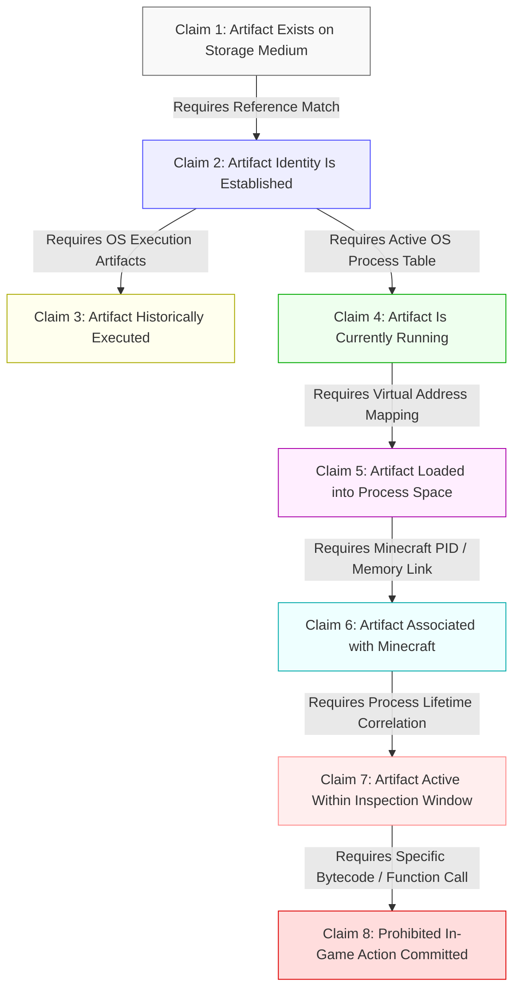
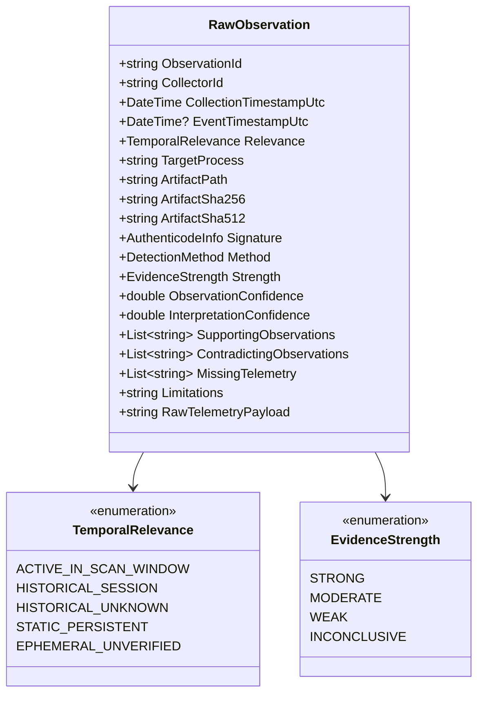
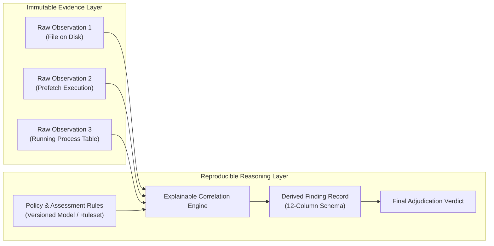

# 03 — Evidence Philosophy & Epistemic Boundaries

**Platform Name**: Minecraft SS Forensics  
**Document Status**: Official Architecture Specification  
**Version**: 3.0.0-DRAFT  
**Author**: Principal Security Architect, Forensic Standards Lead  
**Classification**: Evidentiary Standards & Epistemic Architecture  

---

## 1. The Eight Distinct Evidentiary Claims

Legacy forensic screening tools repeatedly commit the fatal error of **epistemic collapse**—treating the discovery of a static file on disk as equivalent to an active gameplay violation. 

The next-generation Minecraft SS Forensics platform establishes an uncompromising architectural boundary: **eight mutually distinct evidentiary claims**, each requiring distinct observable telemetry and independent corroboration.

### Detailed Claim Definitions & Evidentiary Burdens

| Claim ID | Formal Claim | Required Evidence | What It Proves | What It Strictly Does NOT Prove |
| :--- | :--- | :--- | :--- | :--- |
| **C-1** | **Artifact Exists** | Directory listing, file handle, NTFS MFT record, or unallocated cluster. | The bitstream exists on a physical or logical storage volume attached to the host. | Does **not** prove the file was ever opened, read, executed, or even placed there intentionally by the current user. |
| **C-2** | **Artifact Identified** | Cryptographic hash match (SHA-256), Authenticode digital certificate, or verified package manifest. | The bitstream corresponds to a specific known software package or release. | Does **not** prove intent, malicious capability, or that the file was ever executed. |
| **C-3** | **Historically Executed** | Windows Prefetch record, UserAssist ROT13 registry entry, BAM/DAM timestamp, or AppCompatCache entry. | The executable file ran on the operating system at some point in the past. | Does **not** prove it ran concurrently with Minecraft, was active during a match, or altered gameplay. |
| **C-4** | **Currently Running** | Win32 Process Identifier (PID), valid process handle, and execution state in OS kernel. | A process corresponding to the binary is actively scheduled on CPU cores. | Does **not** prove it interacts with Minecraft or modifies any memory outside its own address space. |
| **C-5** | **Loaded into Process Space** | Module base address in process PEB module list (`EnumProcessModulesEx`) or memory map. | Binary code from the module is mapped into the target process's virtual memory. | Does **not** prove malicious injection (e.g., JNA, OpenAL, and graphics drivers load legitimately). |
| **C-6** | **Associated with Minecraft** | Module mapped into `javaw.exe`, or external process possessing an open handle to `javaw.exe`, or JVM `-javaagent:`. | The artifact directly interfaces with the Minecraft runtime environment. | Does **not** prove the artifact was used during an official competitive match window. |
| **C-7** | **Active in Inspection Window** | Process start time $\le t_{\text{match\_end}}$ AND process exit time $\ge t_{\text{match\_start}}$, correlated with game logs. | The software was actively executing during the precise time window under adjudication. | Does **not** automatically prove that an unauthorized feature was enabled (e.g., toggle cheats). |
| **C-8** | **Prohibited Action Committed** | In-game action telemetry, network packet tap, or specific runtime hook invocation. | A prohibited capability (e.g., Reach, KillAura, AutoCrystal) was actively triggered in game. | *Highest burden*: Can rarely be proven by static post-match scanning alone without server-side validation. |

---

## 2. Epistemic Axioms: What Evidence Cannot Prove

To maintain legal defensibility and prevent false accusations, the platform enforces foundational negative axioms:

1. **Presence $\neq$ Execution**: Discovering a cheat file in `C:\Users\<user>\Downloads\` or in a browser cache proves only storage presence. It **never** justifies a claim of active cheating.
2. **Execution $\neq$ Maliciousness**: Executing a program with an unusual or obscure name (e.g., `cleaner.exe` or `test.jar`) proves only that a program ran. Without a verified signature or malicious behavior, it is an unknown event, not a cheat violation.
3. **Module Load $\neq$ Dynamic Injection**: Native libraries are legitimately extracted and loaded by Java runtimes from temporary directories. Classifying every unverified temporary `.dll` as a code injection is an evidentiary defect.
4. **Unknown $\neq$ Malicious**: The fact that a mod or executable is not listed in the scanner's known-good database proves only that it is uncataloged. It must be classified as `NeedsReview` / `UNKNOWN_OR_UNLISTED`, **never** automatically flagged as a cheat.
5. **Historical Trace $\neq$ Current Activity**: A Prefetch trace from three days ago is historical telemetry. Presenting it in a report without explicitly labeling it as outside the active scan window is a misrepresentation of evidence.
6. **Absence of Evidence $\neq$ Evidence of Absence**: If Prefetch is disabled on an SSD or non-admin privileges block module inspection, the scanner cannot confirm the system is clean. The correct finding is `INCONCLUSIVE`, not clean.
7. **Hash Match $\neq$ Malicious Intent**: A hash match proves identical bit contents relative to a reference database. If the reference database is flawed or out of date, the conclusion is invalid. The scanner must expose reference database versions and provenance.
8. **Missing Telemetry $\neq$ Anti-Forensic Evasion**: An empty Recycle Bin, missing Prefetch directory, or truncated log must never be assumed to represent deliberate concealment without positive evidence of wiper tools.
9. **Failed Collector $\neq$ Clean Scan**: An unhandled exception or timeout in a collector must never result in a clean verdict. The failure must be recorded as an incomplete check, and the verdict must evaluate to `INCONCLUSIVE` if the check was essential.
10. **Positive Result from One Source Does Not Mask Telemetry Gaps**: Finding a cheat file on disk does not excuse or mask the fact that process memory or module enumeration failed.

---

## 2.1 Formal Proposition Truth States

`[PROPOSED]` The reasoning engine evaluates every factual proposition under four explicit truth states:

| Proposition State | Definition | Example Scenario |
| :--- | :--- | :--- |
| **`PROVEN`** | The proposition is supported by direct, verified, and uncontradicted evidence meeting the required standard. | Process PID 8412 loaded `jnidispatch.dll` at base `0x7FFA...` verified via `EnumProcessModulesEx`. |
| **`NOT PROVEN`** | Available telemetry was gathered, but the observed facts do not satisfy the evidentiary threshold required for the proposition. | A cheat file exists on disk, but zero Prefetch or UserAssist records establish execution. Claim "Software Executed" is `NOT PROVEN`. |
| **`UNKNOWN`** | Requisite telemetry sources were inaccessible, missing, corrupted, or unsupported on the host. | Prefetch was disabled by OS configuration; claim "Historically Executed" is `UNKNOWN`. |
| **`CONTRADICTED`** | Two or more verified observations assert mutually exclusive states. | USN Journal records file deletion at 14:10, but process table records the same binary active as PID 9120 at 14:15. |

---

## 3. Formal Observation Data Model

Every raw observation generated by any collector in the platform conforms to the following formal contract:

### Observation Field Specifications
- **`ObservationId`** (`UUIDv4`): Globally unique identifier for this individual observation.
- **`CollectorId`** (`string`): Identifies the specific collector subsystem (e.g., `Collector.Prefetch.v2`, `Collector.Module.v1`).
- **`CollectionTimestampUtc`** (`DateTime`): Exact UTC timestamp when the host telemetry was collected.
- **`EventTimestampUtc`** (`DateTime?`): The timestamp recorded *inside* the artifact (e.g., Prefetch last run time, NTFS file creation time), or `null` if not applicable.
- **`TemporalRelevance`** (`enum`): Explicit categorization of the event relative to the active inspection window.
- **`ObservationConfidence`** (`double [0.0 - 1.0]`): Confidence in the *accuracy of the observation itself* (e.g., SHA-256 calculation is 1.0; heuristic regex match may be 0.6). **Explicitly not a probability of cheating.**
- **`InterpretationConfidence`** (`double [0.0 - 1.0]`): Confidence that the observation supports the specific hypothesis.
- **`SupportingObservations`** (`List<UUID>`): Pointers to other observations that corroborate this finding.
- **`ContradictingObservations`** (`List<UUID>`): Pointers to observations that challenge or limit this finding.
- **`MissingTelemetry`** (`List<string>`): Explicit enumeration of related data that could not be acquired (e.g., `Prefetch disabled`, `Process memory unreadable`).

---

## 4. Separation of Immutable Observations from Derived Conclusions

To guarantee forensic reproducibility, the platform architecture maintains a strict, one-way boundary between raw observations and derived findings:

### Reproducibility Contract
1. **Immutability**: Once a scan completes, raw observations are serialized and cryptographically sealed with the deterministic `SHA256-CANONICAL-V2` content digest seal. They cannot be modified, re-ordered, or deleted without invalidating the seal.
2. **Re-Evaluation**: If server policy changes (e.g., switching from `Standard PvP` to `Tournament Factions`), the adjudicator can re-run the correlation engine against the *original immutable observations* to produce updated findings without re-scanning the player's host.
3. **Audit Trail**: Every derived finding must record the specific `ObservationId` values that produced it. Any conclusion that cannot trace its ancestry directly to immutable raw observations is invalid.
