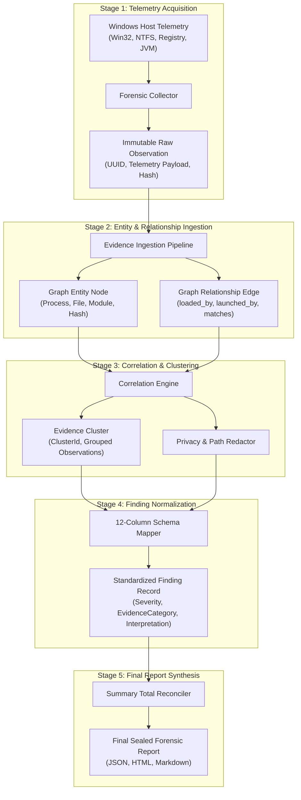
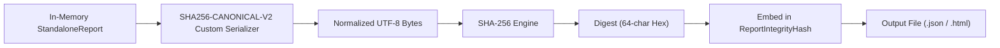

# 04 — Formal Evidence & Findings Schema Specification

**Platform Name**: Minecraft SS Forensics  
**Document Status**: Authoritative Architecture Specification  
**Architecture Version**: v3.0.0-PROPOSED  
**Author**: Principal Software Architect, Data Systems Architect  
**Classification**: Data Contract & Schema Architecture  

---

## 1. Lifecycle: From Raw Observation to Final Finding

The platform transforms raw environmental telemetry into actionable forensic intelligence through a deterministic, auditable multi-stage lifecycle:



---

## 1.1 The Nine Canonical Evidence Abstraction Layers

`[PROPOSED]` To resolve the mismatch between conceptual graph entities and flat serialized reports, the platform establishes nine formal data contracts:

1. **`RawObservation`**: Immutable record of physical or virtual telemetry emitted by a single collector at an exact instant. Contains raw byte payloads, source subsystem IDs, and collection timestamps.
2. **`NormalizedObservation`**: A typed, validated, and redacted representation of an observation mapped to standard platform types (e.g., standardizing path delimiters and normalizing timestamps to UTC).
3. **`IdentifiedArtifact`**: An entity representing recognized software, established via cryptographic hashes, manifests, digital signatures, or package structures.
4. **`EvidenceRelationship`**: A directed, typed edge linking two entities (e.g. `(ProcessInstance)-[:loaded_by]->(ModuleInstance)`).
5. **`EvidenceCluster`**: A logical aggregation grouping all observations, artifacts, and historical records that correspond to a single underlying software component (`EvidenceClusterId`).
6. **`Contradiction`**: An explicit record documenting mutually exclusive observations (e.g. file marked deleted in USN Journal but actively executing in process table).
7. **`FindingRecord`**: The canonical 12-column presentation record presented to investigators and adjudicators. **Must always maintain explicit foreign-key pointers to all contributing `RawObservationId` values.**
8. **`PolicyAssessment`**: Evaluation of an identified artifact or capability against an active Server Policy Pack (`.polpack`).
9. **`InvestigationVerdict`**: The final synthesized legal/adjudication conclusion derived deterministically from the findings collection.

---

## 1.2 Stable Entity Identity Specification

In Windows and JVM forensics, superficial identifiers like Process ID (PID) or file path are fundamentally unstable:
- **PID Reuse**: Windows rapidly recycles Process IDs. A PID observed in Prefetch or event logs 10 minutes ago may belong to a completely different process now.
- **Path Mutability**: Attackers and legitimate users move and rename files.

`[PROPOSED]` The platform defines mathematically stable, composite identity formats for every core entity:

| Entity Type | Stable Identity Format (`CompositeId`) | Components & Invariant Rationale |
| :--- | :--- | :--- |
| **Process Instance** | `proc:{HostId}:{PID}:{StartTimeTicks}:{ImageSha256}` | Binds the ephemeral PID to kernel process creation timestamp (`GetProcessTimes`) and executable binary hash. Immune to PID recycling. |
| **Loaded Module** | `mod:{ProcessInstanceId}:{BaseAddressHex}:{ModuleSha256}` | Binds module to the specific process instance, virtual base address, and on-disk or in-memory binary digest. |
| **File Instance** | `file:{VolumeSerialHex}:{FileIndexHighHex}:{FileIndexLowHex}:{Sha256}` | Utilizes NTFS Master File Table (MFT) 64-bit file identifier (`nFileIndexHigh/Low`) and volume serial, making identity robust against renames. |
| **JVM Instance** | `jvm:{ProcessInstanceId}:{JvmVersion}:{GameDirHash}` | Binds JVM to its underlying process instance, Java runtime version, and normalized game directory path. |
| **Minecraft Session**| `session:{JvmInstanceId}:{SessionStartTimeUtc}:{PlayerUuid}` | Uniquely identifies a single gameplay session from launch to termination. |
| **Historical Record**| `hist:{SourceType}:{EventTimestampTicks}:{PathHash}` | Uniquely identifies a historical event in Prefetch, UserAssist, or BAM/DAM. |
| **Policy Rule** | `pol:{PolicyPackName}:{PolicyVersion}:{RuleId}` | Authoritatively cites the specific policy pack version and rule governing an assessment. |

---

## 1.3 Correlated Evidence & Multi-Collector Deduplication

When multiple collectors discover artifacts relating to the same physical file (e.g. `FileDiscoveryScanner` finds `vape.exe`, `PrefetchParser` finds `VAPE.EXE-A1B2.pf`, and `RegistryScanner` finds a UserAssist entry):
1. **Multi-Source != Multi-Artifact**: Telemetry across multiple OS subsystems is **not independent proof of multiple offenses**.
2. **Unified Clustering**: All observations are linked to a single `EvidenceClusterId = "cluster_vape.exe"`.
3. **Lineage Preservation**: The derived `FindingRecord` exposes a list of `SupportingObservationIds` pointing to every underlying raw observation.
4. **Summary Invariant**: The cluster elevates the *evidential strength* of historical execution, but increments the `ConfirmedSignatures` count by **exactly 1**.

---

## 2. Standardized 12-Column Findings Schema

`[IMPLEMENTED in v2.1.0 FindingRecord.cs]` Every finding emitted by the engine, presented in the GUI viewer, and serialized to JSON/HTML adheres strictly to the following 12-column canonical specification:

| Col # | Field Identifier | Type / Allowed Domain | Nullable | Forensic Semantics & Operational Purpose |
| :---: | :--- | :--- | :---: | :--- |
| **1** | **`Severity`** | `enum`: `Critical`, `High`, `Medium`, `Low`, `Informational` | No | Represents the objective policy and security impact of the finding. Presence on disk alone is strictly capped at `Medium`. |
| **2** | **`Finding`** | `string` (Max 120 chars) | No | A clear, professional, neutral title describing the observation without emotional or inflammatory wording. |
| **3** | **`EvidenceCategory`** | `enum`: `Disk`, `RunningProcess`, `LoadedModule`, `Injected`, `ActiveInScanWindow`, `Historical`, `JvmEnvironment`, `ModIntegrity`, `FileDeletion`, `Diagnostic` | No | Classifies the operational context where the evidence was obtained, establishing its place in the evidentiary hierarchy. |
| **4** | **`TargetProcess`** | `string` (e.g. `"javaw.exe (PID 8412)"` or `"None"`) | No | Identifies the specific OS process directly tied to the finding. If the artifact is static on disk, this MUST be `"None"`. |
| **5** | **`FileOrModulePath`** | `string` (Sanitized / Redacted path) | No | The absolute file or module path with personal user profiles systematically redacted (`C:\Users\[REDACTED_USER]\...`). |
| **6** | **`DetectionMethod`** | `enum`: `ExactSignature`, `HashMatch`, `MetadataRule`, `RuntimeObservation`, `BytecodeStructure`, `HistoricalArtifact`, `Heuristic` | No | The exact technical mechanism utilized to discover and corroborate the artifact. |
| **7** | **`EvidenceStrength`** | `enum`: `Strong`, `Moderate`, `Weak`, `Inconclusive` | No | The evidentiary robustness of the observation (e.g., cryptographic SHA-256 is `Strong`; filename substring is `Weak`). |
| **8** | **`Confidence`** | `string` (e.g. `"High (Catalog hash match)"`) | No | Qualitative confidence in the *factual observation*. **Explicitly forbidden from expressing a percentage probability of guilt.** |
| **9** | **`Timestamp`** | `string` (ISO 8601 UTC + Window Marker) | No | Date and time of the observation, appended with explicit window status: `[IN SCAN WINDOW]` or `[HISTORICAL]`. |
| **10** | **`Interpretation`** | `string` (Detailed explanation) | No | Explicit technical statement of what the evidence supports within established limits. |
| **11** | **`Limitations`** | `string` (Boundary statement) | No | Explicit technical statement of what the evidence **does not prove** (e.g., alternative benign explanations). |
| **12** | **`RecommendedReview`**| `string` (Actionable instructions) | No | Practical step-by-step guidance for the human adjudicator inspecting the report. |

### Supplemental Corroboration Fields
In addition to the 12 primary display columns, each finding record maintains machine-readable tracking metadata:
- **`FindingId`** (`UUIDv4`): Unique primary key.
- **`EvidenceClusterId`** (`string`): Identifies the cluster grouping multiple observations of the same artifact.
- **`IsInScanWindow`** (`bool`): Direct boolean indicator of temporal concurrency with the inspection window.
- **`SoftwareState`** (`enum`): `SoftwarePresent`, `SoftwareExecuted`, `SoftwareRunning`, `SoftwareInjected`.
- **`SupportingObservationIds`** (`List<UUID>`): Pointers to contributing raw observations.

---

## 3. JSON Schema Specification (Draft 2020-12)

Below is the formal JSON Schema for the `FindingRecord`:

```json
{
  "$schema": "https://json-schema.org/draft/2020-12/schema",
  "$id": "https://minecraft-ss-forensics.org/schemas/v3/finding-record.json",
  "title": "FindingRecord",
  "type": "object",
  "required": [
    "FindingId",
    "Severity",
    "Finding",
    "EvidenceCategory",
    "TargetProcess",
    "FileOrModulePath",
    "DetectionMethod",
    "EvidenceStrength",
    "Confidence",
    "Timestamp",
    "Interpretation",
    "Limitations",
    "RecommendedReview",
    "EvidenceClusterId",
    "IsInScanWindow",
    "SoftwareState"
  ],
  "properties": {
    "FindingId": { "type": "string", "format": "uuid" },
    "Severity": {
      "type": "string",
      "enum": ["Critical", "High", "Medium", "Low", "Informational"]
    },
    "Finding": { "type": "string", "maxLength": 120 },
    "EvidenceCategory": {
      "type": "string",
      "enum": [
        "Disk",
        "RunningProcess",
        "LoadedModule",
        "Injected",
        "ActiveInScanWindow",
        "Historical",
        "JvmEnvironment",
        "ModIntegrity",
        "FileDeletion",
        "Diagnostic"
      ]
    },
    "TargetProcess": { "type": "string" },
    "FileOrModulePath": { "type": "string" },
    "DetectionMethod": {
      "type": "string",
      "enum": [
        "ExactSignature",
        "HashMatch",
        "MetadataRule",
        "RuntimeObservation",
        "BytecodeStructure",
        "HistoricalArtifact",
        "Heuristic"
      ]
    },
    "EvidenceStrength": {
      "type": "string",
      "enum": ["Strong", "Moderate", "Weak", "Inconclusive"]
    },
    "Confidence": { "type": "string" },
    "Timestamp": { "type": "string" },
    "Interpretation": { "type": "string" },
    "Limitations": { "type": "string" },
    "RecommendedReview": { "type": "string" },
    "EvidenceClusterId": { "type": "string" },
    "IsInScanWindow": { "type": "bool" },
    "SoftwareState": {
      "type": "string",
      "enum": [
        "SoftwarePresent",
        "SoftwareExecuted",
        "SoftwareRunning",
        "SoftwareInjected",
        "Unknown"
      ]
    }
  }
}
```

---

## 4. Canonical Report Serialization Rules

To ensure content integrity and deterministic hash computation across platforms, the serialization of forensic reports follows deterministic canonicalization rules:

> [!NOTE]
> **Implementation Reality vs Proposed RFC 8785**:
> - In the current v2.1.0 codebase (`IMPLEMENTED`), deterministic sealing is performed via `ReportIntegrityValidator.cs` using a **custom recursive property-sorting UTF-8 JSON serializer** (`SHA256-CANONICAL-V2`).
> - Full compliance with **RFC 8785 (JSON Canonicalization Scheme - JCS)** tested against published test vectors is categorized as `PROPOSED` for post-v2.1.0 releases. The current implementation must not be conflated with standard RFC 8785.

### Rules of `SHA256-CANONICAL-V2` (`IMPLEMENTED`)
1. **Ordinal Property Sorting**: JSON object keys are strictly sorted in lexicographical order (Ordinal) at every level of the object hierarchy.
2. **Exclusion of Seal**: The root property `reportIntegrityHash` is excluded from canonical serialization during digest generation.
3. **Escaping**: Characters requiring escaping use `JavaScriptEncoder.UnsafeRelaxedJsonEscaping`.
4. **Whitespace Elimination**: Canonical JSON contains zero insignificant whitespace (no indentations, no newlines, unspaced colon and comma delimiters).
5. **Digest Calculation**: The SHA-256 digest is computed over the normalized UTF-8 bytes. The resulting 64-character lowercase hex string is stored in `ReportIntegrityHash`.


