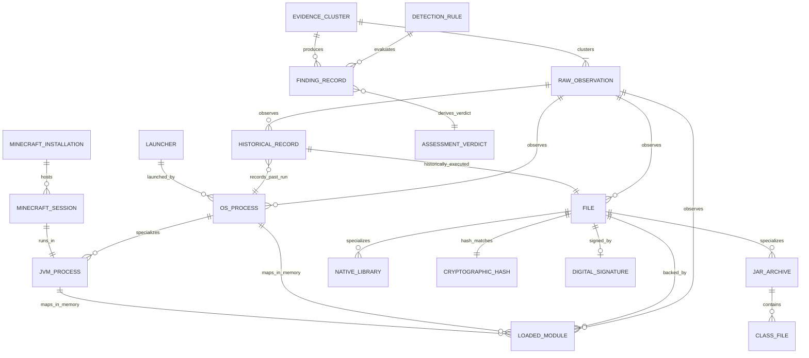
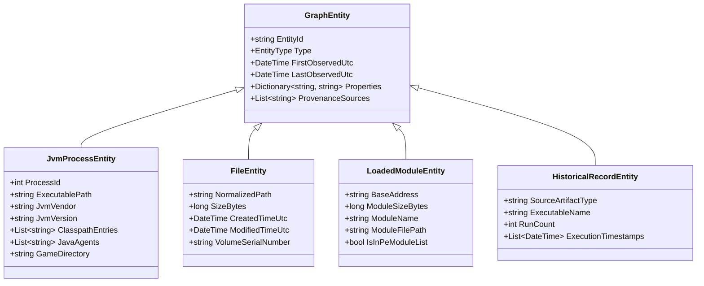
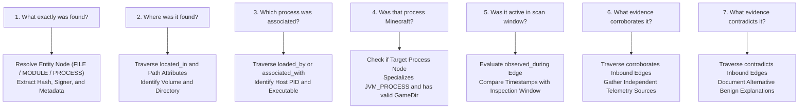

# 05 — Evidence Graph Architecture & Relational Topology

**Platform Name**: Minecraft SS Forensics  
**Document Status**: Official Architecture Specification  
**Version**: 3.0.0-DRAFT  
**Author**: Principal Security Architect, Graph Data Modeler  
**Classification**: Graph Model & Relational Architecture  

---

## 1. The Evidence Graph Philosophy

Flat forensic lists fail in adversarial environments because they isolate findings from their operational context. A file on disk, a running process, and a loaded module are not three separate disconnected threats; they are distinct nodes in an execution topology.

`[PROPOSED]` The next-generation engine models all forensic state as a **Directed Attributed Evidence Graph** $\mathcal{G} = (\mathcal{V}, \mathcal{E})$. 
- **Vertices ($\mathcal{V}$)** represent concrete forensic entities (processes, files, JVM instances, hashes, signatures, observations, rules).
- **Edges ($\mathcal{E}$)** represent verified, causal, or temporal relationships between entities, annotated with confidence weights and provenance tracking.

---

## 2. Graph Entity Relationship Diagram (ERD)

The complete ontological relationship model of the Evidence Graph is illustrated below:

---

## 3. Entity Schemas & Type System

Every vertex $v \in \mathcal{V}$ inherits from a base `GraphEntity` and declares a strongly typed schema:

### Entity Type Catalog
1. **`MINECRAFT_INSTALLATION`**: An installation instance (e.g. Vanilla `.minecraft`, Prism instance, Lunar Client directory).
2. **`MINECRAFT_SESSION`**: A single gameplay session identified by game start time, username/UUID, game version, and loader.
3. **`JVM_PROCESS`**: A specialized process executing Java bytecode (`javaw.exe`).
4. **`OS_PROCESS`**: Any running Win32 executable process on the host.
5. **`FILE`**: A file on storage, characterized by normalized path, size, and timestamps.
6. **`JAR_ARCHIVE`**: A Java ZIP archive containing manifest, assets, and `.class` bytecode files.
7. **`NATIVE_LIBRARY`**: A Win32 PE binary (`.dll`) or native shared library.
8. **`LOADED_MODULE`**: An instance of a native library loaded into an active process's virtual address space.
9. **`CRYPTOGRAPHIC_HASH`**: An immutable hash tuple (`SHA256`, `SHA512`, `Murmur2`).
10. **`DIGITAL_SIGNATURE`**: An Authenticode PKCS#7 certificate signature, signer subject name, and trust status.
11. **`HISTORICAL_RECORD`**: Telemetry from Prefetch (`.pf`), UserAssist, BAM/DAM, or PCA.
12. **`RAW_OBSERVATION`**: An individual immutable observation produced by a collector.
13. **`EVIDENCE_CLUSTER`**: A correlated group of observations regarding the same physical or logical artifact.

---

## 4. Relationship Edge Types & Formal Rules

Every directed edge $e = (u, v) \in \mathcal{E}$ represents an explicitly verified relationship. **Edges are never inferred solely because two entities share a timestamp or folder.**

| Relationship | Source Entity ($u$) | Target Entity ($v$) | Formal Relationship Invariant & Verification Rule |
| :--- | :--- | :--- | :--- |
| **`launched_by`** | `OS_PROCESS` | `LAUNCHER` | Parent Process ID (PPID) in kernel matches Launcher PID AND start timestamp is sequential. |
| **`loaded_by`** | `LOADED_MODULE` | `OS_PROCESS` | Module base address exists in target process `InLoadOrderModuleList` via `EnumProcessModulesEx`. |
| **`located_in`** | `FILE` | `MINECRAFT_INSTALLATION`| Physical path starts with installation base path AND file belongs to volume MFT. |
| **`hash_matches`** | `FILE` | `CRYPTOGRAPHIC_HASH` | Bitwise stream calculation of file contents matches recorded hash digest. |
| **`signed_by`** | `FILE` | `DIGITAL_SIGNATURE` | Win32 `WinVerifyTrust` validates signature embedded in PE or external catalog. |
| **`associated_with`**| `LOADED_MODULE` | `JVM_PROCESS` | Native library is mapped directly into memory space of `javaw.exe`. |
| **`observed_during`**| `RAW_OBSERVATION` | `MINECRAFT_SESSION` | Observation timestamp falls strictly between session start and session termination. |
| **`historically_executed`**| `HISTORICAL_RECORD` | `FILE` | Prefetch or UserAssist path correlates with file identity and volume serial. |
| **`corroborates`** | `RAW_OBSERVATION` | `RAW_OBSERVATION` | Two independent collectors confirm complementary facts of a single hypothesis. |
| **`contradicts`** | `RAW_OBSERVATION` | `RAW_OBSERVATION` | Two observations present mutually exclusive states (e.g. file present on disk vs reported deleted). |
| **`derived_from`** | `FINDING_RECORD` | `RAW_OBSERVATION` | Exact lineage pointer documenting which raw observations yielded the finding. |

---

## 5. Graph Traversal & Answering Forensic Questions

The primary value of the Evidence Graph is its ability to answer fundamental forensic questions through deterministic graph traversals.

### Concrete Traversal Example: Auditing an Unsigned DLL in `%TEMP%`
1. **Node**: `LOADED_MODULE` (`jnidispatch.dll`, Base: `0x7FFA41200000`).
2. **Traversal 1 (`loaded_by`)**: Points to `JVM_PROCESS` (`javaw.exe`, PID: 8412).
3. **Traversal 2 (`backed_by`)**: Points to `FILE` (`C:\Users\[REDACTED_USER]\AppData\Local\Temp\jna-123\jnidispatch.dll`).
3. **Traversal 3 (`contains_export`)**: Export table contains `Java_com_sun_jna_Native_initIDs`.
4. **Traversal 4 (`corroborates`)**: Parent JAR `jna.jar` located in `.minecraft/libraries` with valid Modrinth hash.
5. **Verdict Derived**: Legitimate native library extracted at runtime. **Clean provenance established.** No code injection finding generated.

---

## 6. Graph Traversal Boundaries & Serialization Bridge

### 6.1 Traversal Boundaries (Preventing False Association & Combinatorial Explosion)
To prevent incorrect causal inferences and unbounded memory usage during graph queries:
1. **Max Traversal Depth**: All investigative traversals are bounded to a maximum depth of $k=4$ hops from the seed entity node.
2. **Strict Relationship Constraints**: Edges are **never created based on coincidence**:
   - Sharing a directory does *not* create an association edge.
   - Sharing a timestamp does *not* create a causal edge.
   - Being active concurrently does *not* create an interaction edge.
3. **Directed Semantic Flow**: Traversal queries only follow explicit, typed edge semantics (e.g. from `LOADED_MODULE` upstream to `JVM_PROCESS`, never reverse-guessing process intent).

### 6.2 Bridging the In-Memory Graph to the Flat Report Model
`[PROPOSED]` In the current v2.1.0 engine, reports are serialized as flat lists of typed items (`FindingRecord`, `DiscoveredModItem`, `ProcessTelemetryItem`, `LoadedModuleItem`). In the proposed architecture:
- The **In-Memory Evidence Graph** is the working scratchpad for correlation, clustering, and contradiction resolution.
- Once correlation completes, graph clusters are projected into the canonical 12-column `FindingRecord` collection.
- Each `FindingRecord` embeds foreign key references (`SupportingObservationIds`, `EvidenceClusterId`) pointing back to the underlying graph vertices.
- The report serialization envelope retains the flat collections for universal JSON parser compatibility while supporting an optional `GraphTopology` block for interactive visual exploration in `MinecraftSsForensics.Viewer.exe`.
