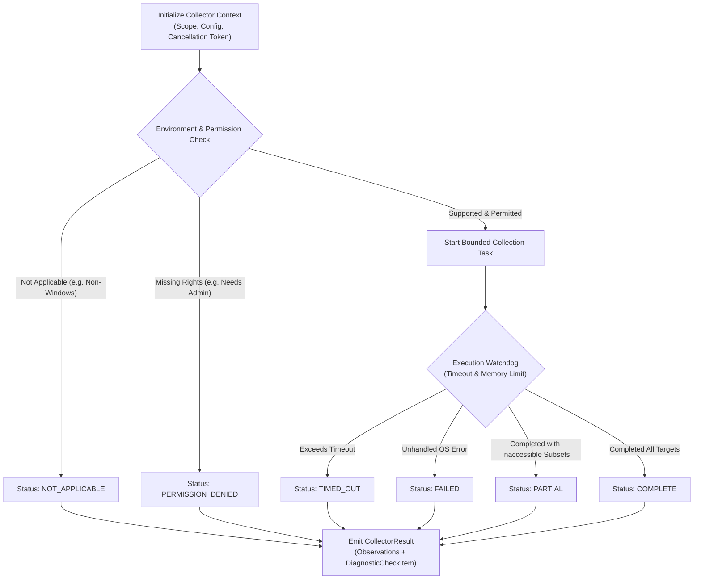
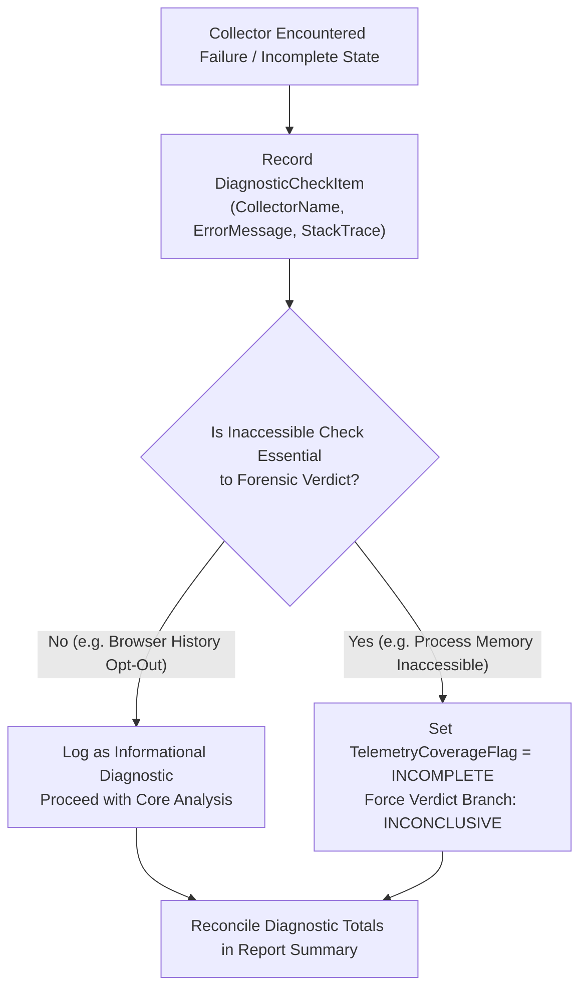

# 06 — Modular Collection Architecture & Failure Contracts

**Platform Name**: Minecraft SS Forensics  
**Document Status**: Official Architecture Specification  
**Version**: 3.0.0-DRAFT  
**Author**: Principal Security Architect, Windows Systems Engineer  
**Classification**: Collector Engineering & Interface Contracts  

---

## 1. Architectural Guardrails for Telemetry Collection

To ensure the platform remains stable, safe, transparent, and legally defensible, all collectors adhere to six absolute architectural constraints:

1. **User-Space Only**: Zero kernel-mode drivers (`.sys`), zero kernel hooking, and zero driver loading exploits (BYOVD).
2. **Read-Only Operation**: Collectors never write to the target process memory, never create persistence mechanisms, and never modify inspected files or registry keys.
3. **Strict Bounded Execution**: Every collector executes within a strict timeout budget (default: 15–30 seconds per collector). No collector may hang or block the scanning engine indefinitely.
4. **Explicit Resource Caps**: Memory allocations are capped per collector; large files are streamed without loading full contents into memory.
5. **No Stealth or Anti-Debugging**: The scanner runs openly with a visible window and provides real-time progress indicators.
6. **Zero Silent Fallback**: A failed collector must **never** silently default to a "clean" assessment. Failures and permission restrictions are explicitly reported as diagnostic findings.

---

## 2. Standardized Collector Lifecycle & Failure States

The lifecycle of every forensic collector is governed by the state machine illustrated below:

### Standardized `CollectionStatus` Enumeration
`[PROPOSED for v3.0.0]` Every collector emits a standardized `CollectorResult` containing a typed `CollectionStatus`:

> [!NOTE]
> **Existing v2.1.0 Codebase Baseline**:
> The v2.1.0 engine (`IMPLEMENTED`) uses two related enums in `Models/Enums.cs`:
> - `CheckStatus`: `PASSED`, `FLAGGED`, `SKIPPED`, `UNAVAILABLE`, `ERROR`.
> - `EvidenceState`: `CONFIRMED`, `STRONG_INDICATOR`, `WEAK_INDICATOR`, `INCONCLUSIVE`, `NOT_CONFIGURED`, `NOT_AVAILABLE`, `DATA_EXPIRED_OR_OVERWRITTEN`, `COLLECTION_FAILED`, `NOT_COLLECTED_BY_USER_CHOICE`.
> 
> The unified 7-tier `CollectionStatus` below represents the target contract for v3.0.0 collectors.

| Status Enum Value | Operational Meaning | Evidentiary Impact on Report |
| :--- | :--- | :--- |
| **`COMPLETE`** | Collector queried all target entities successfully within timeout limits. | Observations contribute with full configured weight. |
| **`PARTIAL`** | Collector gathered some data, but certain paths, keys, or processes were inaccessible. | Emitted findings are valid, but report notes coverage limitations; verdict cannot be marked fully clean if critical items were skipped. |
| **`FAILED`** | Collector encountered an unexpected exception (e.g. corrupt database, I/O bus error). | Exception details logged in diagnostic report; check is not marked clean. |
| **`UNSUPPORTED`** | The targeted telemetry mechanism is not supported by the underlying host platform (e.g. querying Windows 11 BAM keys on Windows 7). | Check marked unsupported; diagnostic item notes architectural boundary without penalizing user. |
| **`PERMISSION_DENIED`**| Collector lacked requisite OS rights (e.g., standard user attempting to read `Prefetch`). | Telemetry is marked missing; engine evaluates whether verdict must default to `INCONCLUSIVE`. |
| **`TIMED_OUT`** | Collector exceeded its maximum execution time budget and was aborted. | Collected subset is retained; diagnostic item records timeout; status flags potential anti-forensic stall. |
| **`NOT_APPLICABLE`** | Host environment intentionally lacks the targeted subsystem (e.g. Prefetch disabled on Windows Server). | Telemetry is marked omitted by design without penalizing the user. |

---

## 3. The 10 Specialized Collector Families

```mermaid
flowchart LR
    subgraph Collectors["The 10 Forensic Collector Families"]
        CF1["1. Minecraft Environment Collector"]
        CF2["2. Process Inventory Collector"]
        CF3["3. JVM Metadata Collector"]
        CF4["4. Runtime Module Collector"]
        CF5["5. Filesystem & Archive Collector"]
        CF6["6. File Identity & Integrity Collector"]
        CF7["7. Digital Signature Collector"]
        CF8["8. Historical Artifact Collector"]
        CF9["9. Reference Matching Collector"]
        CF10["10. Capability & Diagnostic Collector"]
    end
```

### Family 1: Minecraft Environment Collector
- **Scope**: Discovers all active and dormant Minecraft installations, versions, and launchers.
- **Targets**: `.minecraft`, Prism, MultiMC, Modrinth App, Lunar Client, Badlion, Feather, CurseForge instances.
- **Mechanism**: Reads launcher configuration manifests (`launcher_profiles.json`, `instances.cfg`), resolving custom game directories (`--gameDir`).
- **Failure Model**: If a custom launcher path cannot be read, falls back to inspecting active process command lines.

### Family 2: Process Inventory Collector
- **Scope**: Enumerates all running host processes.
- **Targets**: Win32 processes, parent-child process relationships, start times, user security contexts.
- **Mechanism**: Win32 Toolhelp32 API (`CreateToolhelp32Snapshot`) and `EnumProcesses`.
- **Permissions**: Standard user access. Processes in other desktop sessions return `PARTIAL`.

### Family 3: JVM Metadata Collector
- **Scope**: Audits Java Virtual Machine runtime state.
- **Targets**: JVM command-line flags, system properties, classpath entries (`-cp`, `--class-path`), `-javaagent:` parameters.
- **Mechanism**: Win32 PEB parsing and WMI command-line extraction (`Win32_Process`).
- **Privacy Rule**: Automatically feeds arguments through `CommandLineRedactor` to strip authentication tokens (`--accessToken`).

### Family 4: Runtime Module Collector
- **Scope**: Native `.dll` modules loaded into `javaw.exe` and launcher processes.
- **Targets**: Base memory addresses, module sizes, module image paths.
- **Mechanism**: `EnumProcessModulesEx` with `LIST_MODULES_ALL` (detecting 32-bit and 64-bit modules).
- **Failure Model**: If process memory cannot be read (`Access Denied`), logs `PERMISSION_DENIED` and preserves process node without module sub-nodes.

### Family 5: Filesystem & Archive Collector
- **Scope**: Scans target directories, mods folders, downloads, temp folders, and `$Recycle.Bin`.
- **Targets**: File metadata, file sizes, creation/modification timestamps.
- **Archive Handling**: Invokes `SafeArchiveInspector` to parse `.jar` files with strict safety limits (`MaxEntries = 10,000`, `MaxTotalUncompressedBytes = 250 MB`, `MaxCompressionRatio = 100:1`, `MaxMetadataReadBytes = 2 MB`).

### Family 6: File Identity & Integrity Collector
- **Scope**: Calculates cryptographic digests for discovered files.
- **Algorithms**: SHA-256 (primary catalog identity), SHA-512 (forensic verification), Murmur2 (CurseForge release matching).
- **Streaming Pipeline**: Uses `StreamingFileHasher` with 64 KB buffers, preventing large files from exhausting memory.

### Family 7: Digital Signature Collector
- **Scope**: Authenticode signatures of native executables and DLLs.
- **Mechanism**: Native P/Invoke to `WinVerifyTrust` with `WINTRUST_ACTION_GENERIC_VERIFY_V2`.
- **Outputs**: Signature validity (`Valid`, `Invalid`, `Unsigned`), signer subject name, certificate expiration, catalog vs embedded signature.

### Family 8: Historical Evidence Collector
- **Scope**: Windows operational history.
- **Sub-collectors**:
  - *Prefetch Parser*: Decompresses `MAM` headers, parses SCCA execution counters and DLL load lists.
  - *UserAssist Scanner*: Decodes ROT13 Explorer launch counters and `FILETIME` timestamps.
  - *BAM/DAM Scanner*: Queries Background Activity Moderator entries from Windows registry.
  - *PCA Scanner*: Queries Program Compatibility Assistant logs and registry stores.
  - *SetupAPI / USBSTOR Scanner*: Enumerates USB flash drives connected during or prior to the inspection window.

### Family 9: Reference Matching Collector
- **Scope**: Matches collected hashes, package names, and signatures against local reference catalogs.
- **Catalogs**: Prohibited cheat catalog, verified mod release database (Modrinth/CurseForge), known benign native libraries (JNA/LWJGL).

### Family 10: Environment Capability Collector
- **Scope**: Evaluates host platform capabilities and security settings.
- **Checks**: OS version, execution architecture (x64/ARM64), user privilege level (Standard vs Admin), Prefetch enabled status, secure boot status, antivirus/EDR presence.

---

## 4. Collection Failure & Partial-Result Handling

When a collector fails or returns partial data, the platform follows an explicit recovery workflow:

### Evidentiary Guarantee
`[IMPLEMENTED in v2.1.0]` Under no circumstance does the scanner convert an inaccessible or timed-out check into a clean pass. If a player runs the scanner without administrator privileges and `C:\Windows\Prefetch\` cannot be read, the report explicitly states:
> *"Windows Prefetch collection failed (Access Denied). Historical execution cannot be verified. Status: Inconclusive for historical analysis."*
