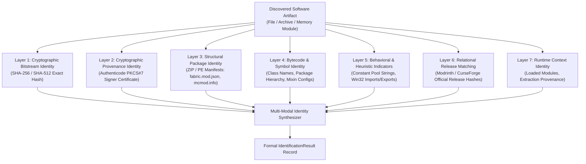
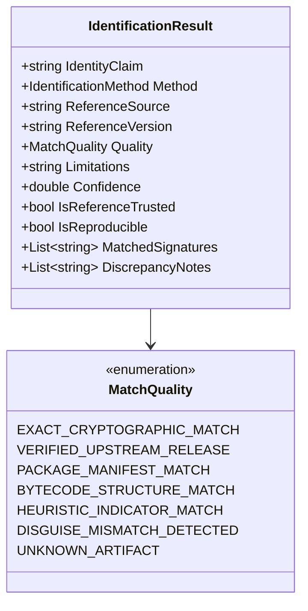
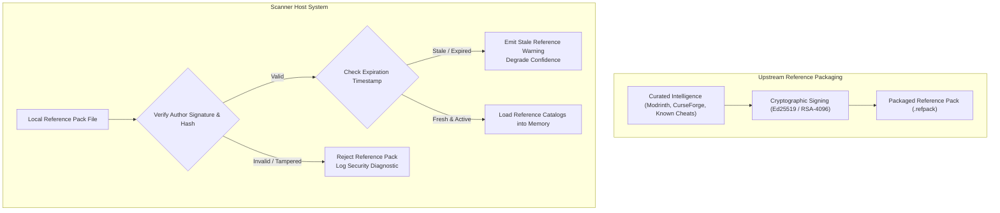

# 07 — Multi-Modal Identification Engine & Reference Data Lifecycle

**Platform Name**: Minecraft SS Forensics  
**Document Status**: Official Architecture Specification  
**Version**: 3.0.0-DRAFT  
**Author**: Principal Security Architect, Threat Intelligence Engineer  
**Classification**: Software Identification & Reference Architecture  

---

## 1. Multi-Modal Identity Architecture

In an adversarial setting, single-attribute identity (such as relying exclusively on a filename or a single SHA-256 hash) is trivially defeated. The next-generation platform employs a **multi-modal identity engine** that evaluates identity across seven layers of abstraction:

> [!IMPORTANT]
> **Core Identity Axioms**:
> 1. **Filename is Not Identity**: A filename is merely a mutable filesystem path property (`path`). Renaming `vape.jar` to `sodium.jar` does not make it Sodium; renaming `optifine.jar` to `cheat.jar` does not make it a cheat. Software identity must be established from intrinsic content, structure, and signatures.
> 2. **Unknown Hash is Not Suspicious**: An unknown or unindexed cryptographic hash indicates an unrecognized software package, not malicious activity. It triggers `POLICY_REVIEW_REQUIRED` or `Informational` classification, never automated guilt.
> 3. **Strict Offline Mode by Default**: All identification operates completely offline by default. No outbound network requests to public repositories, APIs, or cloud hashes occur during standard scanning.
>    - *Current Codebase Flaw (v2.1.0)*: In `ConsentScopeConfig.cs`, `PerformOnlineVerification` currently defaults to `true`.
>    - *Phase 2 Remediation Requirement*: The default MUST be changed to `false`, requiring explicit opt-in, and enforced via a backend network boundary. All reference intelligence for default scans must be resolved exclusively from local, pre-bundled reference data.

---

## 2. Multi-Modal Identity Layers & Evaluation Rules

| Identity Layer | Evaluated Features | What It Establishes | Limitations & Adversarial Evasion |
| :--- | :--- | :--- | :--- |
| **Layer 1: Bitstream Hash** | SHA-256, SHA-512, Murmur2 | Exact bit-for-bit identity against known releases or cheat catalogs. | Defeated by trivial recompilation, adding trailing whitespace, or changing a metadata comment. |
| **Layer 2: Digital Signature**| Authenticode certificate, Root CA chain, Signer Subject. | Legal entity responsible for binary; proves file has not been modified since signing. | Most community Minecraft mods and cheat loaders are completely unsigned. |
| **Layer 3: Package Structure** | `fabric.mod.json`, `mcmod.info`, `plugin.yml`, PE Version Resources. | Declared mod ID, version, author, dependencies, and environment requirements. | Trivial to forge: a cheat client can declare its mod ID as `"sodium"`. Requires Layer 4 & 6 corroboration. |
| **Layer 4: Bytecode & Symbols**| JVM class hierarchies, package namespaces (e.g. `me.vape...`, `net.kmain...`), constant pool. | Internal code organization. Bypasses external filename and manifest spoofing. | Advanced cheats use heavy class obfuscation (ProGuard, Zelix KlassMaster, Allatori). |
| **Layer 5: Behavioral Indicators**| Method references (`Robot.mouseMove`, `VirtualAllocEx`), constant strings (known combat math). | Identifies automated capabilities even when class names are fully randomized. | Must be calibrated carefully to avoid flagging legitimate macro tools or performance mods. |
| **Layer 6: Release Matching** | Upstream release manifests from Modrinth, CurseForge, GitHub Releases. | Confirms whether an unverified mod is an authentic community release or a custom fork. | Requires offline caching or controlled local reference packs. |
| **Layer 7: Runtime Context** | Parent JAR on classpath, module load address, JNA/LWJGL temporary extraction paths. | Distinguishes legitimate runtime native library unpacking from unauthorized DLL injection. | Requires access to target process memory and module list. |

---

## 3. Formal `IdentificationResult` Data Contract

Every identification evaluation produces a structured result containing full provenance and confidence metrics:

### The Unknown Artifact Axiom
`[PROPOSED]` **An unknown artifact is never automatically a cheat.** 
If an artifact yields `MatchQuality.UNKNOWN_ARTIFACT`, the engine assigns:
- `IdentityClaim = "Unknown / Unlisted Mod or Executable"`
- `Severity = Low` (or `Medium` if unsigned in a sensitive folder)
- `AssessmentCategory = POLICY_REVIEW_REQUIRED` (if unapproved by server policy pack)
- `Interpretation = "Software identity is not present in official community repositories or known cheat databases. File requires manual review."`

---

## 4. Reference Data Lifecycle & Offline Integrity

In an offline-first architecture, reference data (cheat catalogs, verified mod hashes, known benign library signatures) must be managed with cryptographic rigor:

### Reference Pack Governance Rules
1. **Source Provenance**: Every entry in the reference catalog must cite its origin (e.g., Modrinth API Release ID, CurseForge File ID, or internal forensic sample hash).
2. **Deterministic Versioning**: Reference packs follow SemVer (`vYYYY.MM.DD.build`). Reports embed the exact reference pack version utilized during the audit.
3. **Cryptographic Signing & Trust Anchors**: Reference packs are digitally signed by an authorized maintainer private key. The scanner and viewer verify this signature against a **pre-configured, embedded public-key trust anchor** (`Ed25519`). Trusting a self-asserted public key embedded within an untrusted pack is explicitly forbidden.
4. **Current Implementation vs Proposed Detached Packs**: In v2.1.0 (`IMPLEMENTED`), reference signatures and benign mod definitions are bundled directly into the compiled application assembly with immutable SHA-256 integrity checks. External detached signed `.refpack` distribution is `PROPOSED` for post-v2.1.0 releases.
5. **Staleness Tracking**: Reference packs carry an expiration threshold (e.g., 90 days). If a scan is performed using an outdated pack, the report flags `ReferenceDataStatus = STALE` to alert reviewers that newly released mods may not be verified.
6. **Conflict Resolution**: If two reference sources present conflicting metadata for the same hash, the engine defaults to the more conservative classification and flags the conflict for human review.
