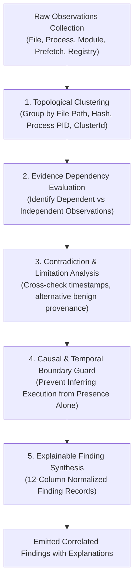

# 08 — Correlation Engine, Anti-Double-Counting & Explainable Reasoning

**Platform Name**: Minecraft SS Forensics  
**Document Status**: Official Architecture Specification  
**Version**: 3.0.0-DRAFT  
**Author**: Principal Security Architect, Reasoning Systems Engineer  
**Classification**: Correlation Modeling & Causal Reasoning  

---

## 1. The Correlated Evidence Fallacy & Anti-Double-Counting

A critical failure in legacy screening tools is the **correlated evidence fallacy** (pseudo-corroboration). 

Consider this concrete scenario:
1. `FileDiscoveryScanner` finds `vape-v4.jar` on disk.
2. `RegistryScanner` finds a `UserAssist` ROT13 execution entry for `vape-v4.jar`.
3. `PrefetchParser` finds a `VAPE-V4.EXE-A1B2C3D4.pf` record with a run count of 3.
4. `CommandLineRedactor` observes `vape-v4.jar` on a historical process command line.

In naive tools, each finding generates an independent "threat point" (e.g. 4 findings $\times$ High = "Critical Threat / 99% probability"). This is scientifically invalid: these are **not four independent proofs of four separate offenses**. They are four observations of a **single underlying artifact** across different operating system logging layers.

`[PROPOSED]` The next-generation Correlation Engine enforces strict **Evidence Clustering (`EvidenceClusterId`)** and dependency-aware aggregation:
- All four observations are linked to the single cluster: `cluster_vape-v4`.
- The cluster aggregates evidence to establish *provenance* (the file exists, and it has historically executed).
- The cluster **does not multiply severity**. It elevates the *evidential strength* of historical execution from `Weak` to `Strong` while keeping the global count of identified prohibited artifacts at **exactly 1**.

---

## 2. Correlation Engine Workflow

The multi-stage reasoning pipeline that transforms raw observations into correlated evidence clusters and explained findings is illustrated below:



---

## 3. Evaluation of Correlation Modeling Paradigms

To select the most robust and defensible correlation architecture, four formal modeling approaches were evaluated:

| Correlation Approach | Mathematical / Logical Mechanism | Key Advantages | Fatal Limitations & Risks | Architectural Verdict |
| :--- | :--- | :--- | :--- | :--- |
| **A. Pure Deterministic Rule Engine** | Fixed `IF-THEN` conditional rule chains. | 100% deterministic, easily auditable, low computational overhead. | Rigid; fails on novel multi-stage evasion techniques; rules explode in complexity. | **Accepted for baseline policy checks.** |
| **B. Bayesian Belief Networks** | Directed Acyclic Graph (DAG) with conditional probability tables: $P(\text{Cheat} \mid E_1, \dots, E_n)$. | Naturally models uncertainty, updates beliefs as new evidence arrives. | **Extreme Calibration Risk**: Requires vast, empirical ground-truth datasets to calibrate prior probabilities $P(\text{Cheat})$ and conditional tables $P(E_i \mid \text{Cheat})$. Inventing numbers produces pseudoscience. | **REJECTED for automated scoring** (until empirical calibration dataset exists). |
| **C. Weighted Heuristic Scoring** | Additive point systems ($\sum w_i x_i$). | Trivial to implement, familiar to security analysts. | Arbitrary thresholds; vulnerable to double-counting correlated telemetry; lacks explainability. | **REJECTED.** |
| **D. Attributed Evidence Graph (Hybrid)** | Graph traversal across entities combined with deterministic causal rules and cluster aggregation. | Natural representation of relationships; prevents double-counting; completely explainable; preserves uncertainty without inventing numbers. | Requires formal graph data modeling and traversal bounds. | **ACCEPTED as Primary Architecture.** |

---

## 4. Formal Graph-Based Correlation Model

The engine operates over the Evidence Graph $\mathcal{G} = (\mathcal{V}, \mathcal{E})$ using four formal correlation operators:

### Operator 1: Equivalence Clustering ($\mathcal{C}$)
Given a set of observations $\mathcal{O}$, observations $o_1, o_2 \in \mathcal{O}$ are assigned to the same cluster $\mathcal{C}_k$ if:
$$\text{NormalizedPath}(o_1) = \text{NormalizedPath}(o_2) \quad \lor \quad \text{Hash}(o_1) = \text{Hash}(o_2) \quad \lor \quad \text{ProcessInstanceId}(o_1) = \text{ProcessInstanceId}(o_2)$$

> [!WARNING]
> Bare Windows Process IDs (`PID`) must **never** be used alone for cross-collector equivalence, because Windows aggressively recycles PIDs across short-lived processes. Clustering must use the stable composite `ProcessInstanceId` (`proc:{HostId}:{PID}:{StartTimeTicks}:{ImageSha256}`).

### Operator 2: Independent Corroboration ($\kappa$)
Two observations $o_1, o_2 \in \mathcal{C}_k$ are deemed **independently corroborating** if and only if their underlying data collection sources derive from independent OS subsystems:
$$\text{Subsystem}(o_1) \neq \text{Subsystem}(o_2)$$
*(Example: A Prefetch record from NTFS file access and a UserAssist record from Explorer registry are independent sources corroborating historical execution).*

### Operator 3: Contradiction Resolution ($\chi$)
If observation $o_1$ asserts state $S$ (e.g., "File deleted via Recycle Bin at 14:10 UTC") and observation $o_2$ asserts state $\neg S$ (e.g., "File actively running as PID 9120 at 14:15 UTC"):
- The engine creates a bidirectional `contradicts` edge between $o_1$ and $o_2$.
- The engine does not crash or pick an arbitrary winner.
- The derived finding explicitly presents both observations in the `Limitations` and `RecommendedReview` columns:
  > *"Contradiction: Recycle Bin index indicates file deletion, but process table records active running instance. Possible anti-forensic recreation or false positive deletion record."*

### Operator 4: Temporal Concurrency Validation ($\tau$)
An observation $o \in \mathcal{O}$ is certified as `ActiveInScanWindow` if and only if:
$$t_{\text{scan\_start}} \le t_{\text{event}}(o) \le t_{\text{scan\_end}}$$
And is certified as `ActiveInMinecraftSession` if and only if:
$$t_{\text{session\_start}} \le t_{\text{event}}(o) \le t_{\text{session\_end}}$$
If $t_{\text{event}}(o) < t_{\text{scan\_start}}$, the observation is formally demoted to `Historical`, and the engine is architecturally blocked from asserting active concurrency. Temporal overlap alone does not prove targeting of the game.

---

## 5. Explainable Reasoning & Lineage Generation

Every finding emitted by the Correlation Engine must include a structured, human-readable **Reasoning Trace**:

```json
{
  "FindingId": "d8e3b1c4-2a7f-4f81-9b1e-3f6a2b8e1a90",
  "EvidenceClusterId": "cluster_vape_loader",
  "ReasoningTrace": {
    "PrimaryHypothesis": "Prohibited cheat client executed historically on host.",
    "CorroboratingEvidence": [
      {
        "Source": "PrefetchParser (C:\\Windows\\Prefetch\\VAPE.EXE-A1B2C3D4.pf)",
        "FactsEstablished": "Executable ran 4 times; last execution at 2026-10-28T16:22:11Z."
      },
      {
        "Source": "RegistryScanner (HKCU\\...\\UserAssist\\{CEBFF5CD-...})",
        "FactsEstablished": "GUI launch recorded via Windows Explorer."
      }
    ],
    "ContradictingEvidence": [],
    "TemporalEvaluation": {
      "IsActiveInScanWindow": false,
      "InspectionWindowStart": "2026-10-30T14:00:00Z",
      "MostRecentExecution": "2026-10-28T16:22:11Z",
      "DeltaHours": 45.6
    },
    "EvidentiaryConclusion": "Execution established 45.6 hours prior to scan. Zero evidence of execution or process concurrency during the current match window."
  }
}
```
