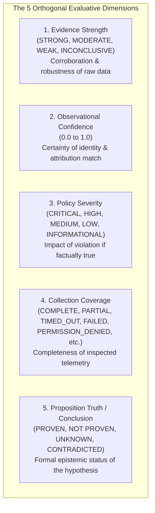
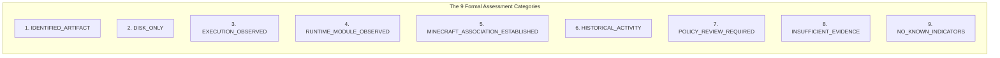
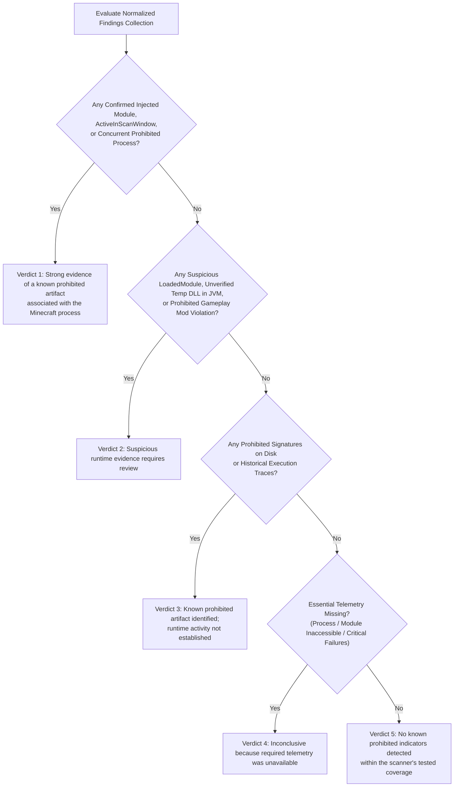

# 09 — Severity, Evidence Strength & Assessment Framework

**Platform Name**: Minecraft SS Forensics  
**Document Status**: Official Architecture Specification  
**Version**: 3.0.0-DRAFT  
**Author**: Principal Security Architect, Adjudication Policy Architect  
**Classification**: Scoring Framework & Verdict Specification  

---

## 1. The Independence of Severity and Confidence

A fundamental flaw in legacy detection systems is coupling severity with confidence into a single aggregate score. This leads to severe errors:
- A high-impact rumor is reported as "High Severity" despite having virtually no evidence (`Weak Strength`).
- A completely verified, authentic open-source mod is reported as "High Severity" simply because the signature match is 100% certain (`Strong Strength`).

`[PROPOSED]` The next-generation architecture enforces complete orthogonality between **Severity (Policy/Security Impact)** and **Evidence Strength (Forensic Certainty)**:

```mermaid
quadrantChart
    title Orthogonal Severity vs Evidence Strength Matrix
    x-axis Low Forensic Certainty --> High Forensic Certainty (Evidence Strength)
    y-axis Low Policy Impact --> High Policy Impact (Severity)
    quadrant-1 Actionable Proof (Immediate Sanction)
    quadrant-2 High Risk / Low Proof (Requires Investigation)
    quadrant-3 Noise / Low Priority
    quadrant-4 Verified Benign / Routine Compliance
    "Unverified Cheat Mention in Temp Log": [0.2, 0.8]
    "Verified Prohibited Injected DLL": [0.95, 0.95]
    "Verified Sodium Mod Release": [0.95, 0.1]
    "Corrupt Index File in Temp": [0.2, 0.2]
```

---

## 2. Formal Severity & Evidence Strength Taxonomies

### 2.1 Severity Levels (Impact on Server Policy)
Severity measures the **potential violation of server rules** assuming the finding is factually true:

| Severity Level | Operational Definition | Concrete Examples |
| :--- | :--- | :--- |
| **`CRITICAL`** | Direct, confirmed compromise of game integrity or server rules during active match play. | Confirmed prohibited DLL injected into `javaw.exe`; active external cheat process running concurrently with Minecraft. |
| **`HIGH`** | Serious violation of rules, but not definitively linked to active in-game tampering. | Confirmed prohibited cheat client executed on host within scan window (external); unverified DLL with malicious symbols mapped into JVM. |
| **`MEDIUM`** | Possession of prohibited software on storage, or unverified modifications requiring staff review. | Prohibited client `.jar` present in `Downloads` (not running); unsigned native DLL in `%TEMP%` loaded by Java without clear provenance. |
| **`LOW`** | Minor policy deviation or peripheral forensic trace. | Browser history entry showing visit to cheat website; stale historical execution trace from 30+ days ago outside scan window. |
| **`INFORMATIONAL`**| Legitimate system configuration, authentic mod verification, or normal operational trace. | Verified upstream Sodium release; JNA native library unpack with verified symbols; normal launcher profile discovery. |

### 2.2 Evidence Strength Levels (Certainty of Observation)
Evidence Strength measures the **forensic robustness and reproducibility of the data**:

| Strength Level | Forensic Definition | Required Evidence Types |
| :--- | :--- | :--- |
| **`STRONG`** | Observation is supported by cryptographic proof or multiple independent corroborating OS subsystems. | Cryptographic hash match (SHA-256); Valid Authenticode certificate; Prefetch + UserAssist dual confirmation. |
| **`MODERATE`** | Observation is corroborated by a single reliable OS subsystem or strong structural heuristics. | PE export table structure match; single Prefetch execution record; ZIP manifest metadata match. |
| **`WEAK`** | Observation relies on heuristic indicators, easily spoofed metadata, or uncorroborated single sources. | Plaintext file name match; uncompressed string in unallocated space; ambiguous registry MRU string. |
| **`INCONCLUSIVE`**| Requisite telemetry was inaccessible, missing, corrupted, or inconclusive. | Permission denied on `OpenProcess`; disabled Prefetch; unreadable encrypted archive. |

### 2.3 The Five Orthogonal Evaluative Dimensions

To prevent semantic conflation, every derived finding and final assessment evaluates five independent orthogonal dimensions:



| Dimension | Question It Answers | What It Depends On | What It NEVER Depends On |
| :--- | :--- | :--- | :--- |
| **1. Evidence Strength** | *How reliable and corroborated is this observation?* | Independent OS subsystems, cryptographic hashes, MFT records. | Server rule severity, community reputation. |
| **2. Observational Confidence** | *How certain are we that this artifact is software X?* | Quality of match (exact hash vs package manifest vs heuristic). | Whether software X is allowed or banned. |
| **3. Policy Severity** | *How serious is this if it actually happened?* | Tournament rulebook, server policy pack tier (`ALLOWED` to `PROHIBITED`). | How much evidence currently exists. |
| **4. Collection Coverage** | *Were all required telemetry sources accessible?* | OS permissions, API error codes, budget timeouts. | Whether cheats were found or not. |
| **5. Proposition Truth** | *Is the specific forensic claim established?* | Logical deduction over verified observations and temporal boundaries. | Unsubstantiated suspicion or missing telemetry. |

---

## 3. The Nine Assessment Categories

Findings are assigned to one of nine mutually exclusive **Assessment Categories**:



| Category Identifier | Formal Criteria | What Reviewer Must Know |
| :--- | :--- | :--- |
| **`IDENTIFIED_ARTIFACT`** | Artifact bitstream matches a known software package in reference database. | Identity is verified; operational state depends on secondary categories. |
| **`DISK_ONLY`** | Artifact exists on storage; **zero** evidence of execution or process mapping. | Only actionable under strict "possession ban" policies; does not prove cheating. |
| **`EXECUTION_OBSERVED`** | Artifact has active OS Process ID or execution timestamp within scan window. | Program ran, but association with Minecraft is not yet established. |
| **`RUNTIME_MODULE_OBSERVED`**| Native library mapped into a process virtual address space. | Native code loaded; inspect provenance to distinguish JNA from injected cheat. |
| **`MINECRAFT_ASSOCIATION_ESTABLISHED`**| Artifact is loaded into `javaw.exe` or actively holds handles to Minecraft. | Direct connection to the game confirmed; highest evidentiary relevance. |
| **`HISTORICAL_ACTIVITY`** | OS execution artifacts show past execution strictly **prior to scan window**. | Telemetry proves past use; does **not** prove current match usage. |
| **`POLICY_REVIEW_REQUIRED`** | Unlisted mod or custom build permitted under general policy but unverified. | Requires human inspection of mod features; not an automated violation. |
| **`INSUFFICIENT_EVIDENCE`**| Blocked telemetry or corrupted files prevent conclusive evaluation. | Adjudicator must request manual elevation or declare audit inconclusive. |
| **`NO_KNOWN_INDICATORS`** | All collectors succeeded; zero prohibited signatures or anomalies detected. | System is clean within the tested coverage scope. |

---

## 4. Final 5-Verdict Decision Flow

The final overall investigation verdict is derived deterministically from the normalized findings collection:



### The 7 Distinctions of the Final Assessment
Every completed investigation report must explicitly answer seven core forensic questions:
1. **What was identified?** (Exact software names, hashes, and match methods).
2. **What was observed at runtime?** (Active processes and memory-mapped modules).
3. **What was associated with Minecraft?** (Direct memory, JVM argument, or handle links).
4. **What occurred within the inspection window?** (Strict temporal separation of match time vs history).
5. **What policy violation may exist?** (Possession ban vs execution ban vs gameplay use ban).
6. **What actual prohibited activity can be supported?** (Actionable proof vs circumstantial indicators).
7. **What cannot be determined?** (Telemetry gaps, unreadable files, and known limitations).
