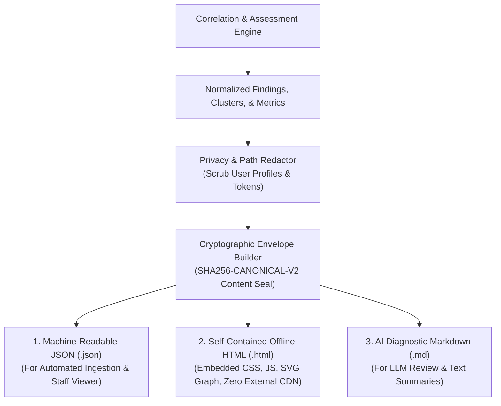

# 10 — Reporting Architecture & Adjudication Experience

**Platform Name**: Minecraft SS Forensics  
**Document Status**: Official Architecture Specification  
**Version**: 3.0.0-DRAFT  
**Author**: Principal Security Architect, UX & Forensic Reporting Lead  
**Classification**: Reporting Specification & UI/UX Architecture  

---

## 1. Dual-Audience Reporting Philosophy

A forensic report must serve two fundamentally different audiences without compromising technical rigor:
1. **The Technical Forensic Investigator**: Needs bit-level hash verification, PE export symbols, P/Invoke return codes, raw timestamps, process IDs, and exact graph relationships.
2. **The Community Server Adjudicator / Staff Member**: Needs clear, unambiguous plain-English summaries, explicit answers to "Was the player cheating during this match?", structured limitations, and transparent policy guidance.

The next-generation reporting architecture achieves this by separating the report into hierarchical layers: an **Executive Assessment Banner**, a **Reconciled Forensic Metrics Panel**, a **Chronological Runtime Timeline**, the **Interactive Evidence Graph Explorer**, and the **12-Column Normalized Findings Tables**.

---

## 2. Report Generation Architecture

The decoupled report generation pipeline is illustrated below:

---

## 3. Comprehensive Report Structure

Every generated report contains the following six formal sections:

### Section 1: Executive Summary & Assessment Banner
- **Inspection Time Window**: Explicit UTC scan start and completion timestamps (`YYYY-MM-DDTHH:MM:SSZ`).
- **Minecraft Session Identification**: Running JVM PID, game version (e.g. `1.20.1`), active mod loader (`Fabric 0.15.11`), and active game directory (`--gameDir`).
- **Final Adjudication Verdict**: One of the 5 standardized verdict strings displayed in an unmistakable status banner:
  - *Color-Coded Status*: Red (Verdict 1 - Prohibited Active), Orange (Verdict 2 - Suspicious Runtime), Yellow (Verdict 3 - Disk/Historical Only), Gray (Verdict 4 - Inconclusive), Green (Verdict 5 - Clean Scan).
- **Collection Completeness**: Percentage of collectors that completed with `COMPLETE` vs `PARTIAL` or `FAILED`.
- **Primary Evidentiary Limitations**: Immediate, prominent disclosure of any inaccessible telemetry (e.g., Prefetch unavailable due to user privilege).

### Section 2: Reconciled Forensic Metrics Panel
A cryptographically verified summary card where all counts are mathematically derived directly from the normalized findings collection:
$$\text{Total Findings} \equiv \text{Critical} + \text{High} + \text{Medium} + \text{Low} + \text{Informational}$$

| Metric | Meaning & Invariant |
| :--- | :--- |
| **`Critical Severity`** | Confirmed runtime code injection or active cheat process concurrent with game. |
| **`High Severity`** | Active unverified executable or severe policy violation within scan window. |
| **`Medium Severity`** | Static file presence on storage, or unverified runtime module without signature. |
| **`Low Severity`** | Peripheral forensic traces (browser history, stale historical records). |
| **`Informational`** | Verified authentic mods, normal system unpacks, and diagnostic logs. |
| **`Confirmed Signatures`** | Count of unique verified prohibited software identities (clustered). |
| **`Runtime Observations`** | Observations from `RunningProcess`, `LoadedModule`, `Injected`, or `ActiveInScanWindow`. |
| **`Disk-Only Observations`**| Observations from `Disk` category with zero runtime or execution activity. |
| **`Incomplete / Failed Checks`** | Count of diagnostic items recording errors or permission denials. |

### Section 3: Chronological Runtime Timeline
A chronological view of system events, preventing temporal confusion between match play and distant history.
- Events are explicitly tagged:
  - `[IN SCAN WINDOW]` (Events occurring during the active Minecraft session).
  - `[HISTORICAL]` (Events occurring prior to the current session).
- **Axiom**: Timestamps are never interpolated or guessed. If an artifact lacks a native timestamp (e.g., an unallocated file fragment), it is listed under an "Undated Artifacts" section.

### Section 4: Interactive Evidence Graph Representation
In the standalone HTML export and the WPF Viewer application, relationships are rendered as an interactive SVG/Canvas node graph:
- **Clicking a Process Node**: Highlights all loaded modules, parent launcher, and memory handles.
- **Clicking a File Node**: Highlights its cryptographic hash, digital certificate, and historical execution records.
- **Red Relationship Lines**: Indicate active associations with `javaw.exe`.
- **Dashed Relationship Lines**: Indicate uncorroborated or historical links.

### Section 5: Standardized 12-Column Severity Tables
Findings are divided into tabbed tables based on severity:
- **Critical Findings Table**
- **High Severity Table**
- **Medium Severity Table**
- **Low Severity Table**
- **Informational & Diagnostic Table**

Each table displays all 12 columns: `Severity`, `Finding`, `Evidence Category`, `Target Process`, `File or Module Path`, `Detection Method`, `Evidence Strength`, `Confidence`, `Timestamp`, `Interpretation`, `Limitations`, and `Recommended Review`.

### Section 6: Structured Adjudicator Conclusion & Dispute Workflow
A dedicated, neutral adjudication section providing:
1. **Factual Summary of Supported Claims**: What the evidence legally supports.
2. **Alternative Benign Explanations**: Known edge cases that could explain the observations (e.g. community repackaged mods, antivirus memory scanning).
3. **Recommended Adjudication Actions**: Explicit options for the server staff member:
   - *Option A*: Issue sanction (if server has an explicit possession ban and file exists).
   - *Option B*: Request manual technical review of specific unverified module.
   - *Option C*: Close ticket as clean (no evidence of match tampering).
