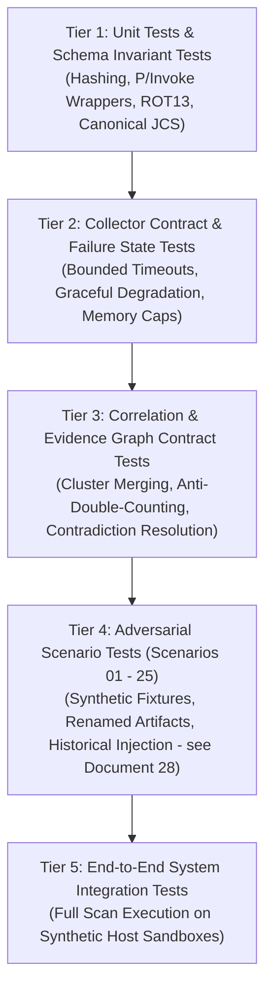

# 11 — Validation, Testing Strategy & Adversarial Validation Framework

**Platform Name**: Minecraft SS Forensics  
**Document Status**: Official Architecture Specification  
**Version**: 3.0.0-DRAFT  
**Author**: Principal QA Architect, Forensic Validation Engineer  
**Classification**: Test Methodology & Verification Engineering  

---

## 1. Test Architecture & Validation Tiers

To prevent regressions, ensure evidentiary soundness, and eliminate false positives, the platform defines a **five-tier testing pyramid**:

---

## 2. Canonical Adversarial Validation Matrix (25 Scenarios)

The authoritative, fully expanded 25-scenario validation matrix is specified in [`28-ADVERSARIAL-VALIDATION-MATRIX.md`](./28-ADVERSARIAL-VALIDATION-MATRIX.md). 

All scenarios strictly utilize **benign, synthetic test fixtures** (never live malware or commercial cheat payloads).

### Summary of the Canonical 25 Scenarios

| # | Scenario | Status | Key Forensic Boundary Tested | Reference |
| :---: | :--- | :---: | :--- | :--- |
| **01** | Standard Legitimate Mod | `VALIDATED` | Authentic Modrinth hash evaluated as `Informational` / `Clean`. | [Doc 28 §2.1](./28-ADVERSARIAL-VALIDATION-MATRIX.md) |
| **02** | Known Prohibited Mod on Disk Only | `VALIDATED` | Possession on disk does not trigger injection or Verdict 1. | [Doc 28 §2.2](./28-ADVERSARIAL-VALIDATION-MATRIX.md) |
| **03** | Renamed Legitimate Mod | `VALIDATED` | Manifest/bytecode match prevents false-positive disguise flag. | [Doc 28 §2.3](./28-ADVERSARIAL-VALIDATION-MATRIX.md) |
| **04** | Renamed Prohibited Mod (Disguise) | `VALIDATED` | Internal bytecode inspection detects cheat despite benign name. | [Doc 28 §2.4](./28-ADVERSARIAL-VALIDATION-MATRIX.md) |
| **05** | Unknown Custom Mod (Unlisted) | `VALIDATED` | Unknown software triggers `POLICY_REVIEW_REQUIRED`, never malware. | [Doc 28 §2.5](./28-ADVERSARIAL-VALIDATION-MATRIX.md) |
| **06** | Java Agent Parameter on Startup | `VALIDATED` | Scans `-javaagent:` command-line argument; redacts credentials. | [Doc 28 §2.6](./28-ADVERSARIAL-VALIDATION-MATRIX.md) |
| **07** | External Unrelated Process Running | `VALIDATED` | Discord/Notepad running concurrently does not correlate with game. | [Doc 28 §2.7](./28-ADVERSARIAL-VALIDATION-MATRIX.md) |
| **08** | Legitimate Native Temp DLL (JNA) | `VALIDATED` | Unsigned `%TEMP%` DLL with JNA symbols evaluated as benign. | [Doc 28 §2.8](./28-ADVERSARIAL-VALIDATION-MATRIX.md) |
| **09** | Unknown Module in External Process | `VALIDATED` | DLL injected into `dummy.exe` produces 0 findings for Minecraft. | [Doc 28 §2.9](./28-ADVERSARIAL-VALIDATION-MATRIX.md) |
| **10** | Known Test Module in Minecraft | `VALIDATED` | Active DLL in `javaw.exe` triggers Verdict 1 (`Strong Evidence`). | [Doc 28 §2.10](./28-ADVERSARIAL-VALIDATION-MATRIX.md) |
| **11** | Historical Artifact Outside Window | `VALIDATED` | Prefetch record from 10 days ago triggers Verdict 3, not active. | [Doc 28 §2.11](./28-ADVERSARIAL-VALIDATION-MATRIX.md) |
| **12** | File Deletion Record Without Run | `VALIDATED` | USN Journal deletion alone does not establish cheat or evasion. | [Doc 28 §2.12](./28-ADVERSARIAL-VALIDATION-MATRIX.md) |
| **13** | Local Proxy Without Traffic Routing | `PROPOSED` | Localhost proxy active, but Minecraft connects directly to server IP. | [Doc 28 §2.13](./28-ADVERSARIAL-VALIDATION-MATRIX.md) |
| **14** | Legitimate Localhost Dev Server | `PROPOSED` | Local dev server binding port does not trigger proxy alert. | [Doc 28 §2.14](./28-ADVERSARIAL-VALIDATION-MATRIX.md) |
| **15** | Commercial Peripheral Driver | `PROPOSED` | Logitech G HUB / Razer Synapse signed binary is benign. | [Doc 28 §2.15](./28-ADVERSARIAL-VALIDATION-MATRIX.md) |
| **16** | Macro Script Targeting Non-Minecraft | `PROPOSED` | AHK script targeting Excel does not trigger gameplay violation. | [Doc 28 §2.16](./28-ADVERSARIAL-VALIDATION-MATRIX.md) |
| **17** | Resource Pack with X-Ray Feature | `PROPOSED` | Evaluated against Server Policy Pack; never labeled malware. | [Doc 28 §2.17](./28-ADVERSARIAL-VALIDATION-MATRIX.md) |
| **18** | Options Config Gamma Override | `PROPOSED` | Fullbright setting isolated to config check; no cheat client claimed. | [Doc 28 §2.18](./28-ADVERSARIAL-VALIDATION-MATRIX.md) |
| **19** | Unsupported Hardware Telemetry (DMA) | `PROPOSED` | Explicit disclaimer that physical PCIe DMA reads are out of scope. | [Doc 28 §2.19](./28-ADVERSARIAL-VALIDATION-MATRIX.md) |
| **20** | Disabled Windows Prefetch | `PROPOSED` | `EnablePrefetcher=0` emitted as diagnostic; user not penalized. | [Doc 28 §2.20](./28-ADVERSARIAL-VALIDATION-MATRIX.md) |
| **21** | Non-Elevated Execution (Standard User) | `PROPOSED` | Access denied triggers graceful degradation / Verdict 4. | [Doc 28 §2.21](./28-ADVERSARIAL-VALIDATION-MATRIX.md) |
| **22** | Duplicate Multi-Source Observations | `PROPOSED` | Disk + Prefetch + UserAssist merged into 1 cluster; count = 1. | [Doc 28 §2.22](./28-ADVERSARIAL-VALIDATION-MATRIX.md) |
| **23** | Conflicting Clocks / Clock Drift | `PROPOSED` | Future timestamp handled gracefully; normalized to UTC. | [Doc 28 §2.23](./28-ADVERSARIAL-VALIDATION-MATRIX.md) |
| **24** | Incomplete Truncated Log | `PROPOSED` | Log termination gap reported neutrally without accusing tampering. | [Doc 28 §2.24](./28-ADVERSARIAL-VALIDATION-MATRIX.md) |
| **25** | Stale Reference Database | `PROPOSED` | Stale pack (>90 days) emits warning; degrades confidence conservatively. | [Doc 28 §2.25](./28-ADVERSARIAL-VALIDATION-MATRIX.md) |

---

## 3. Measurable Acceptance Criteria & Metrics

To ensure strict engineering discipline, every automated test must pass the following verifiable criteria:

1. **Reconciliation Invariant**:
   $$\text{TotalFindings} \equiv \sum_{\text{sev} \in \text{Severities}} \text{Count}(\text{sev}) \equiv \sum_{\text{cat} \in \text{Categories}} \text{Count}(\text{cat})$$
2. **Zero False-Positive Injection Claims**: Under no test condition may a native library loaded from `%TEMP%` bearing verified JNA/LWJGL symbols be classified as `Severity.Critical` or `EvidenceCategory.Injected`.
3. **Execution Separation Invariant**: Under no test condition may a file discovered exclusively on disk without concurrent process or prefetch traces be evaluated to Verdict 1 (`Strong evidence associated with Minecraft`).
4. **Deterministic Digest**: Running the canonical report serializer against the same observation graph must yield the identical SHA-256 byte sequence every single time across distinct runs.
