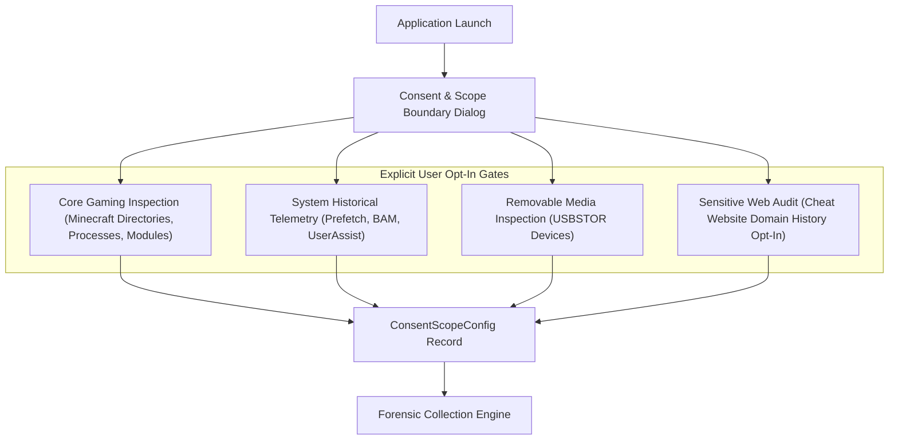
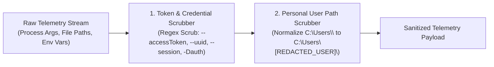
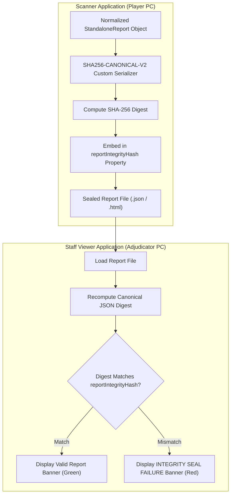

# 12 — Privacy Architecture, Data Minimization & Integrity Engineering

**Platform Name**: Minecraft SS Forensics  
**Document Status**: Official Architecture Specification  
**Version**: 3.0.0-DRAFT  
**Author**: Principal Privacy Architect, Cryptographic Security Engineer  
**Classification**: Privacy by Design & Cryptographic Integrity  

---

## 1. Privacy by Design: The Consent and Scope Boundary

Competitive gaming screening has historically suffered from extreme privacy abuses, with staff running remote desktop tools to browse personal folders, Discord chats, and photo galleries.

`[PROPOSED]` The next-generation platform enforces strict **Privacy by Design** and data minimization:



### Absolute Privacy Guarantees
1. **Offline-First & Zero Network Calls**: The scanner contains zero network transmission logic during scan execution. It opens no listening sockets, initiates no HTTP/WebSocket requests, and contains no third-party telemetry SDKs.
2. **Deterministic Bounded Scope**: The scanner queries only gaming-related directories (`.minecraft`, launchers, `%TEMP%`, `Downloads`, `$Recycle.Bin`). It **never** scans `Documents`, `Pictures`, `Videos`, or unrelated application data.
3. **Sensitive Category Opt-In**: Highly sensitive telemetry (specifically browser history inspection) is **strictly disabled by default** and requires explicit user opt-in via checkbox before collection occurs.

---

## 2. Redaction Architecture: Tokens & Paths

Before any telemetry is written to memory logs, displayed on screen, or serialized to disk, it passes through the `CommandLineRedactor` pipeline (`CommandLineRedactor.Redact` and `CommandLineRedactor.RedactPath`):



### Redaction Rules
- **Authentication Tokens**: Command-line arguments matching `--accessToken\s+[a-zA-Z0-9\._\-]+` are replaced with `--accessToken [REDACTED_ACCESS_TOKEN]`.
- **Player Identification Secrets**: Arguments containing `--uuid`, `--xuid`, `--session`, `--userProperties`, or JVM property secrets (`-Dauth*`) are scrubbed.
- **Personal File Paths**: Windows paths containing user profile directories are sanitized across all output formats via `CommandLineRedactor.RedactPath`:
  - Input: `C:\Users\JohnDoe\AppData\Roaming\.minecraft\mods\test.jar`
  - Output: `C:\Users\[REDACTED_USER]\AppData\Roaming\.minecraft\mods\test.jar`
  - *Evidentiary Value*: Preserves the critical relative path (`.minecraft\mods\test.jar`) while preventing doxxing of the player's real name.

---

## 3. Cryptographic Report Integrity & Tamper Realism

A critical requirement in competitive forensic assessment is ensuring the report submitted to server staff was genuinely generated by the scanner and has not been edited to remove findings.

### 3.1 The Reality of Local Machine Control (Threat Realism)
`[PROPOSED]` **Cryptographic realism**: No software running entirely in user-space on an untrusted host can provide 100% tamper-proof guarantees against a local machine owner with administrative or debugger control. A sophisticated attacker with reverse-engineering tools can patch the binary in memory or modify the local runtime.

However, the architecture can provide **cryptographic verification against post-scan tampering and non-trivial forgery**:



### 3.2 The `SHA256-CANONICAL-V2` Integrity Seal

In the existing v2.1.0 codebase (`IMPLEMENTED` in `StandaloneReport.cs` and `ReportIntegrityValidator.cs`), the seal is stored as a direct root string property:
```json
{
  "reportId": "rep_9f8e7d6c5b4a3210",
  "schemaVersion": "2.0.0",
  "reportIntegrityHash": "c84a545341b18996369650727ff37a994c2e8395e61a7a8e321d24b76243f9e6",
  "scannerVersion": "2.1.0-standalone"
}
```

A structured envelope format (`IntegritySeal` object with detached version metadata) is `PROPOSED` for the v3.0.0 report schema:
```json
{
  "IntegritySeal": {
    "Algorithm": "SHA256-CANONICAL-V2",
    "GeneratedTimestampUtc": "2026-10-30T14:30:50Z",
    "Digest": "c84a545341b18996369650727ff37a994c2e8395e61a7a8e321d24b76243f9e6",
    "Version": "3.0.0"
  }
}
```

### 3.3 Content Digest Consistency vs Asymmetric Digital Signatures

> [!IMPORTANT]
> **Cryptographic Scope and Limitations of the Integrity Seal**:
> - **Content Consistency (`SHA256-CANONICAL-V2`) [IMPLEMENTED]**: The seal is computed using `ReportIntegrityValidator.cs` via a custom recursive property-sorting JSON canonicalizer followed by an unkeyed `SHA-256` cryptographic digest. It provides **internal tamper detection** against manual file edits, post-scan finding deletions, and accidental file corruption. Any modification to a finding, summary count, or timestamp immediately invalidates the digest.
> - **Distinction from RFC 8785 JCS**: The current serializer sorts properties alphabetically, but has not been validated against published RFC 8785 conformance suites. Full RFC 8785 JCS compliance is categorized as `PROPOSED`.
> - **Absence of Secret Key / HMAC**: The engine does **not** use an HMAC with a hidden secret key, because embedding secret cryptographic keys in an open-source, client-side binary running on an untrusted host provides zero real security (keys can be extracted in seconds via decompilation).
> - **Asymmetric Digital Signing is `DEFERRED`**: Proving author authenticity (that the report was genuinely produced by an untampered binary rather than an adversary's Python script) requires hardware-rooted attestation (e.g. TPM / Intel SGX) or a trusted remote signing enclave. Because remote signing requires network connectivity—violating the offline-first mandate—true detached digital signatures are formally categorized as `DEFERRED`.

### 3.4 Verification Invariants
1. **Post-Scan Modification Detection**: If a player opens `report.json` in a text editor and deletes a `Critical` finding, changes a timestamp, or alters summary counts, the recomputed canonical digest will mismatch `reportIntegrityHash`.
2. **Constant-Time Verification**: In `MinecraftSsForensics.Viewer.App`, digest comparisons use `CryptographicOperations.FixedTimeEquals` to prevent timing attacks.
3. **Staff Alerting**: If the seal fails verification, the viewer displays a prominent warning:
   > *"WARNING: Report Integrity Seal Failed! This report has been modified or tampered with since generation. Findings cannot be certified."*
