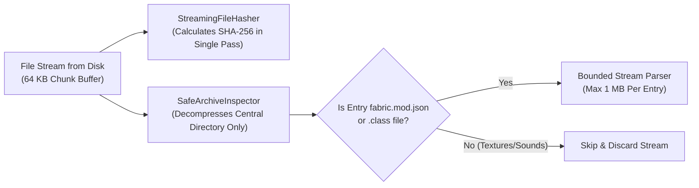
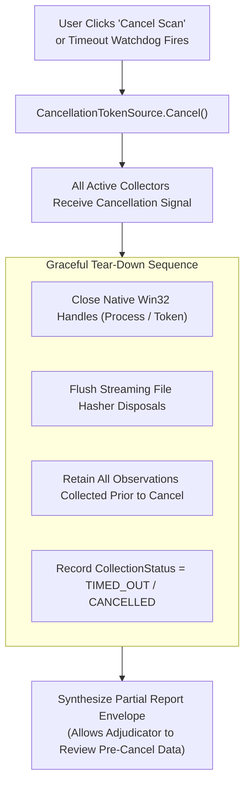

# 13 — Performance Engineering, Resource Budgets & Reliability

**Platform Name**: Minecraft SS Forensics  
**Document Status**: Official Architecture Specification  
**Version**: 3.0.0-DRAFT  
**Author**: Principal Performance Architect, Systems Reliability Engineer  
**Classification**: Performance Engineering & Fault Tolerance  

---

## 1. Operating Environment Realities & Resource Budgets

In real-world competitive inspections, players may run the scanner on diverse hardware: from high-end liquid-cooled gaming rigs to low-end budget laptops with mechanical hard drives (HDDs), fragmented filesystems, tens of thousands of texture files, multiple mod loaders, and hundreds of running background processes.

`[PROPOSED]` The architecture establishes strict, measurable **Resource Budgets** to guarantee system responsiveness and prevent out-of-memory (OOM) crashes:

| Resource Dimension | Strict Architectural Budget | Measurement & Enforcement Mechanism |
| :--- | :--- | :--- |
| **Max Process Memory (RAM)** | $\le 250\text{ MB}$ Working Set | Streaming I/O buffers; zero in-memory full archive caching; aggressive Gen 2 garbage collection on phase transitions. |
| **Max Scan Duration** | $\le 45\text{ seconds}$ total | Per-collector timeout watchdogs (15s max per collector); parallel I/O pipelines where thread-safe. |
| **CPU Core Utilization** | $\le 50\%$ aggregate (Throttled) | Background tasks run at `ThreadPriority.BelowNormal`; thread pool concurrency throttled to $\min(4, \text{LogicalCores})$. |
| **Disk I/O Throughput** | $\le 80\text{ MB/s}$ read rate | Chunked buffer reads (64 KB); skips non-executable media files (PNG textures, OGG audio, JSON models). |
| **Output File Footprint** | $\le 5\text{ MB}$ per report file | Excludes raw binary dumps; stores only cryptographic hashes, metadata, and normalized findings. |

---

## 2. Streaming I/O & Safe Archive Decompression

When auditing `.minecraft` folders containing dozens of large mod archives (some exceeding 50 MB each), naive tools load entire files into byte arrays, quickly exhausting heap memory.

### Zip-Bomb & Decompression Defense Rules
In `SafeArchiveInspector.cs` (`IMPLEMENTED`), archive safety invariants are strictly enforced:
1. **Entry Count Cap**: Archives containing more than `10,000 entries` (`MaxEntries`) are aborted immediately to prevent directory iteration denial-of-service.
2. **Cumulative Decompression Cap**: Total uncompressed bytes across all entries cannot exceed `250 MB` (`MaxTotalUncompressedBytes`).
3. **Expansion Ratio Limit**: If the ratio of cumulative uncompressed size to compressed size exceeds `100:1` (`MaxCompressionRatio`), inspection is halted as a zip-bomb threat.
4. **Metadata Read Cap**: Individual metadata files (`fabric.mod.json`, `mcmod.info`) are streamed with a maximum read limit of `2 MB` (`MaxMetadataReadBytes`).
5. **Zip-Slip Path Traversal Defense**: All entry paths are checked: entries containing `..` or leading slashes (`/` or `\`) are blocked and flagged.

---

## 3. Graceful Cancellation, Timeouts & Fault Recovery

The scanner architecture ensures that a user cancellation request or an unexpected collector timeout never leaves the application in an indeterminate state:

### Reliability Guarantees
- **No Orphaned Native Handles**: Every Win32 P/Invoke call (`OpenProcess`, `CreateToolhelp32Snapshot`, `QueryDosDevice`) is wrapped in a managed `SafeHandle` or standard `using` block ensuring `CloseHandle` is invoked even during thread abortion.
- **Partial Report Retention**: If a scan is cancelled at 85% completion, the engine does not discard the gathered data. It generates a valid report with `CollectionStatus = PARTIAL` and explicitly flags that the scan was interrupted.
