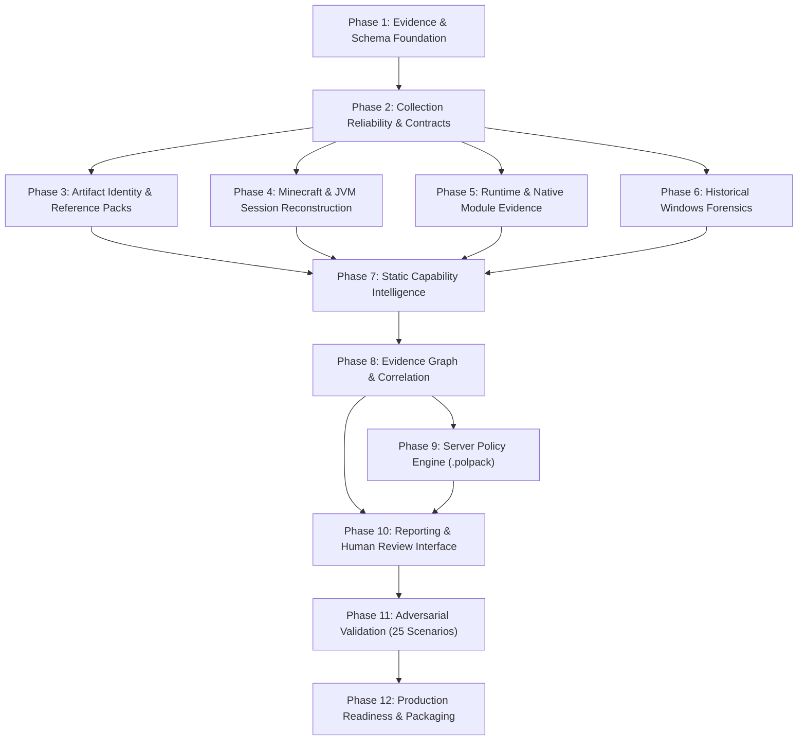

# 15 — Phased Implementation Roadmap & Dependency Sequence (12 Phases)

**Platform Name**: Minecraft SS Forensics  
**Document Status**: Official Architecture Specification (Expansion)  
**Version**: 3.0.0-DRAFT  
**Author**: Principal Software Architect, Engineering Program Lead  
**Classification**: Implementation Strategy & Milestone Governance  

---

## 1. Governance Note: Human Architectural Approval Required

> [!IMPORTANT]
> **MANDATORY HOLD NOTICE**: No code modifications, collector refactoring, or new module implementations may proceed until this architecture specification has undergone formal human review and approval. This roadmap defines the phased implementation sequence to be executed *after* explicit approval is granted.

---

## 2. Master Implementation Dependency Graph

The twelve independently testable implementation phases follow a strict topological sequence:

---

## 3. Specifications for the Twelve Implementation Phases

### Phase 1: Evidence & Schema Foundation
- **Entry Criteria**: Architecture lock approved by human adjudicator.
- **Deliverables**: In-memory Directed Attributed Evidence Graph data structure (`AdjacencyListGraph<TEntity, TRelationship>`); Canonical JSON (`SHA256-CANONICAL-V2`) serializer; 12-column `FindingRecord` schema models; formal `RawObservation` contract.
- **Dependencies**: None.
- **Test Requirements**: Unit tests validating graph operations (node insertion, edge lookup, topological traversal) and canonical JSON serialization vectors.
- **Acceptance Criteria**: Graph operations execute in $< 5\text{ ms}$ for 5,000 entities; canonical JSON serializer produces deterministic byte digests matching test vectors.
- **Risks**: Serializer edge cases with floating point numbers; mitigated by strict decimal representation.
- **Exit Criteria**: All Phase 1 foundation unit tests passing with 100% code coverage.

### Phase 2: Collection Reliability & Observability Contracts
- **Entry Criteria**: Phase 1 foundation complete.
- **Deliverables**: `IForensicCollector` interface with unified `Task<CollectorResult> CollectAsync(CollectorContext ctx)`; `CollectionStatus` state machine (`COMPLETE`, `PARTIAL`, `TIMED_OUT`, `PERMISSION_DENIED`); execution watchdog enforcing 15-second per-collector timeout; streaming 64 KB buffer file reader.
- **Dependencies**: Phase 1 schemas.
- **Test Requirements**: Mock collector tests verifying timeout abortion, cancellation token propagation, and unhandled exception containment.
- **Acceptance Criteria**: A failing or hanging mock collector aborts at exactly 15 seconds without crashing the engine; emits `DiagnosticCheckItem` recording the timeout.
- **Risks**: Thread starvation in managed thread pool; mitigated by configuring dedicated background worker tasks.
- **Exit Criteria**: Standardized collector harness verified across all status states.

### Phase 3: Artifact Identity & Reference Data Packaging
- **Entry Criteria**: Phase 2 collection contracts complete.
- **Deliverables**: Streaming cryptographic file hasher (SHA-256, Murmur2); Ed25519-signed offline reference pack loader (`.refpack`); Lookalike disguise detector (`fabric.mod.json` vs filename vs hash); Authenticode certificate validator via `WinVerifyTrust`.
- **Dependencies**: Phase 2 collectors.
- **Test Requirements**: Synthetic renamed mod fixtures (Scenarios 03 & 04); signature validation tests against signed Microsoft/Java DLLs and unsigned test binaries.
- **Acceptance Criteria**: Reference pack parses and verifies digital signature in $< 50\text{ ms}$; Lookalike detector flags manifest-to-filename mismatches.
- **Risks**: Expired or corrupted reference packs; mitigated by explicit `STALE` status warnings.
- **Exit Criteria**: Reference data subsystem decoupled completely from compiled C# code.

### Phase 4: Minecraft & JVM Session Reconstruction
- **Entry Criteria**: Phase 2 contracts complete.
- **Deliverables**: `InstallationLocator` discovering Vanilla, Prism, MultiMC, Modrinth, Lunar, and Badlion directories; JVM PEB command-line argument parser; `CommandLineRedactor` scrubbing personal tokens (`--accessToken`, `--uuid`, `--xuid`); `LogAuditor` parsing `latest.log`.
- **Dependencies**: Phase 2 contracts.
- **Test Requirements**: Synthetic command line fixtures with embedded session tokens; corrupted and truncated `latest.log` fixtures.
- **Acceptance Criteria**: 100% of sensitive access tokens redacted across all log outputs; custom `--gameDir` resolved accurately.
- **Risks**: Non-standard third-party launchers using custom argument formats; mitigated by generalized regex token scrubbing.
- **Exit Criteria**: Minecraft session identification and game directory resolution verified.

### Phase 5: Runtime & Native Module Evidence
- **Entry Criteria**: Phase 2 contracts complete.
- **Deliverables**: Process inventory collector (`CreateToolhelp32Snapshot`); loaded native module collector (`EnumProcessModulesEx`); PE Export/Import table parser; JNA/LWJGL temporary unpack verifier (distinguishing legitimate native libraries from injected DLLs).
- **Dependencies**: Phase 2 contracts, Phase 3 Authenticode validator.
- **Test Requirements**: Unit tests auditing synthetic JNA temporary DLLs with verified export symbols vs unverified test DLLs.
- **Acceptance Criteria**: Zero false-positive injection claims on standard JNA temporary DLLs; target process association verified.
- **Risks**: Access denied when querying processes in different desktop sessions; mitigated by graceful `PARTIAL` status handling.
- **Exit Criteria**: In-memory module audit verified under both standard user and elevated privileges.

### Phase 6: Historical Windows Forensics
- **Entry Criteria**: Phase 2 contracts complete.
- **Deliverables**: Decompressor and parser for Windows Prefetch SCCA/MAM headers (`RtlDecompressBufferEx`); ROT13 UserAssist registry parser; BAM/DAM registry reader; Program Compatibility Assistant (PCA) store parser; System Event Log (Event 7045) driver service auditor.
- **Dependencies**: Phase 2 contracts.
- **Test Requirements**: Synthetic Prefetch files (Windows 10/11 versions 30 & 31); mock UserAssist binary structures; non-admin permission degradation tests.
- **Acceptance Criteria**: Accurately extracts execution counts and last 8 FILETIME timestamps; gracefully flags `PERMISSION_DENIED` when run un-elevated without crashing.
- **Risks**: Registry format drift across Windows 11 updates; mitigated by defensive length checks and version guards.
- **Exit Criteria**: Historical execution telemetry collector verified across all target Windows versions.

### Phase 7: Static Capability Intelligence
- **Entry Criteria**: Phase 3 (Identity) and Phase 4 (JVM/Mods) complete.
- **Deliverables**: Bytecode constant pool analyzer parsing class structures without JVM execution; AST pattern matcher mapping combat (Reach, AutoClick, Crystal), movement (Fly, NoFall), visual (ESP, X-Ray), and network (Backtrack) capabilities; capability classification engine (`CAPABILITY_CONFIRMED` to `NOT_ESTABLISHED`).
- **Dependencies**: Phase 3 and Phase 4.
- **Test Requirements**: Synthetic test classes with embedded combat math patterns vs legitimate community utility classes.
- **Acceptance Criteria**: Identifies multi-packet crystal placement patterns; zero capability false positives triggered by class/method names alone.
- **Risks**: Heavy bytecode obfuscation hiding string constants; mitigated by structural AST analysis and explicit `INCONCLUSIVE` confidence limits.
- **Exit Criteria**: Capability intelligence pipeline operational and integrated into graph nodes.

### Phase 8: Evidence Graph & Correlation Engine
- **Entry Criteria**: Phases 4, 5, 6, and 7 complete.
- **Deliverables**: Graph ingestion pipeline populating vertices and edges; topological clustering algorithm generating `EvidenceClusterId`; anti-double-counting aggregator; contradiction resolver (handling deleted vs running states); temporal concurrency validator.
- **Dependencies**: Phases 1 through 7.
- **Test Requirements**: Multi-subsystem duplicate observation tests (Scenario 22); clock drift contradiction tests (Scenario 23).
- **Acceptance Criteria**: Multi-source observations of a single file yield exactly one cheat count in summary totals; temporal filter strictly bounds match window events.
- **Risks**: Combinatorial explosion in graph edge creation; mitigated by strict neighbor traversal boundaries.
- **Exit Criteria**: Correlation engine passes all anti-double-counting and reconciliation invariants.

### Phase 9: Server Policy Engine (`.polpack`)
- **Entry Criteria**: Phase 8 correlation complete.
- **Deliverables**: Server Policy Pack loader (`.polpack`); gamemode rule evaluator (`ALLOWED`, `RESTRICTED`, `PROHIBITED_GAMEPLAY_USE`, `PROHIBITED_EXECUTION`, `PROHIBITED_POSSESSION`); Litematica/Freecam policy distinction; possession vs gameplay use boundary enforcement.
- **Dependencies**: Phase 8 correlation.
- **Test Requirements**: Evaluation of identical synthetic mod fixtures across three distinct server policy packs (Tournament vs Factions vs SMP).
- **Acceptance Criteria**: Litematica classified as `RESTRICTED` on Factions and `ALLOWED` on SMP without code modifications; possession ban correctly triggers violation on disk presence.
- **Risks**: Ambiguous server rule definitions; mitigated by strict JSON schema validation for policy packs.
- **Exit Criteria**: Policy engine verified as completely decoupled from binary detection logic.

### Phase 10: Reporting & Human Review Interface
- **Entry Criteria**: Phase 8 (Correlation) and Phase 9 (Policy) complete.
- **Deliverables**: Standalone HTML exporter with embedded CSS/JS and interactive SVG graph explorer; Portable JSON exporter; AI-diagnostic Markdown exporter; WPF Staff Viewer (`MinecraftSsForensics.Viewer.App`) update with severity filters and integrity verification; SHA-256 Report Sealer (`SHA256-CANONICAL-V2`).
- **Dependencies**: Phases 8 and 9.
- **Test Requirements**: Tamper detection tests (modifying report JSON and verifying seal failure); cross-browser offline HTML rendering tests.
- **Acceptance Criteria**: Tampering with a single character in report JSON triggers `INTEGRITY SEAL FAILURE` warning; HTML report renders 100% offline without external CDN calls.
- **Risks**: High memory usage when rendering large SVG graphs in HTML; mitigated by canvas virtualization for $> 500$ nodes.
- **Exit Criteria**: All reporting formats verified and certified tamper-evident.

### Phase 11: Adversarial Validation & Scenario Testing
- **Entry Criteria**: Phase 10 reporting complete.
- **Deliverables**: Automated test suite implementing all 25 controlled scenarios from `28-ADVERSARIAL-VALIDATION-MATRIX.md`; end-to-end sandbox execution pipeline; regression test harness.
- **Dependencies**: Phases 1 through 10.
- **Test Requirements**: Execution of the complete 25-scenario matrix using synthetic benign fixtures.
- **Acceptance Criteria**: 100% of scenarios pass with zero violations of forbidden conclusion rules; zero false-positive injection claims; summary reconciliation verified.
- **Risks**: Flaky tests due to OS environmental differences; mitigated by mocking Win32 P/Invoke layers where environmental consistency is required.
- **Exit Criteria**: All 25 scenarios verified with green test status.

### Phase 12: Production Readiness, Hardening & Packaging
- **Entry Criteria**: Phase 11 validation complete.
- **Deliverables**: Single-file self-contained win-x64 build configuration (`PublishSingleFile=true`); resource budget benchmarking ($\le 250\text{ MB}$ RAM, $\le 45\text{s}$ scan duration); automated GitHub Actions reproducible build pipeline; cryptographic SHA-256 release checksum manifests.
- **Dependencies**: All preceding phases.
- **Test Requirements**: Full multi-terabyte drive scanning benchmark; memory leak detection over consecutive scan iterations.
- **Acceptance Criteria**: Standalone binary executes cleanly on pristine Windows 10/11 machines without requiring .NET runtime installation; memory footprint remains strictly $\le 250\text{ MB}$.
- **Risks**: False positives from Windows Defender on self-extracting single-file binaries; mitigated by submitting binaries for Microsoft Defender Trusted Publisher verification.
- **Exit Criteria**: Release artifacts published with signed checksum manifests; final production sign-off.
