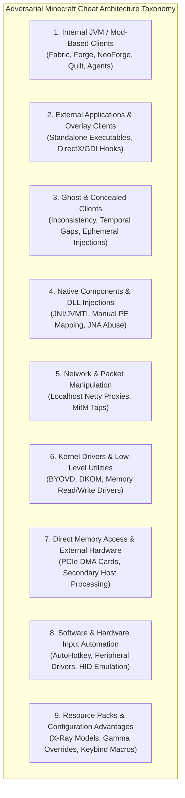
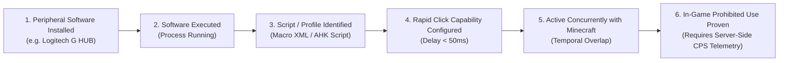

# 18 — Adversarial Minecraft Cheat Architecture Taxonomy

**Platform Name**: Minecraft SS Forensics  
**Document Status**: Official Architecture Specification (Expansion)  
**Version**: 3.0.0-DRAFT  
**Author**: Principal Security Architect, JVM Internals Researcher, Adversarial Threat Analyst  
**Classification**: Threat Taxonomy & Architectural Footprints  

---

## 1. Architectural Philosophy of Cheat Classification

A fundamental deficiency in legacy screening tools is classifying cheat software purely by commercial product names (e.g., "Vape", "Drip", "Doomsday", "Rise") or superficial gameplay features (e.g., "Reach", "AutoClicker", "KillAura"). Product names change rapidly, codebases are forkable within hours, and marketing branding conveys nothing about how a program physically interacts with the operating system or the Java Virtual Machine.

`[PROPOSED]` The next-generation Minecraft SS Forensics Platform classifies cheats based on their **system-level operational architecture**. This architectural taxonomy dictates:
1. The physical and virtual subsystems where the software leaves traces.
2. The specific telemetry collectors capable of observing it.
3. The forensic limitations and potential false positives associated with each execution model.
4. The exact evidentiary standard required to move from identifying an artifact to establishing in-game usage.

---

## 2. Category 1: Internal JVM / Mod-Based Clients

### 2.1 Technical Operational Architecture
Internal clients run entirely inside the target Java Virtual Machine (JVM) process (`javaw.exe`). They operate within the same virtual memory space as Minecraft and directly invoke or hook game methods.
- **Mod Loaders**: Distributed as standard `.jar` files in `.minecraft/mods` or custom instance directories (Fabric Loader, Minecraft Forge, NeoForge, Quilt).
- **Runtime Bytecode Transformation**: Utilize SpongePowered `Mixin` annotations, Fabric Loader transformers, or ASM tree APIs to modify Minecraft classes (e.g., `EntityPlayerSP`, `ClientWorld`, `MinecraftClient`) as they are loaded by the ClassLoader.
- **Java Agents**: Packaged as Java agents using `java.lang.instrument` with a `premain` method (specified via `-javaagent:path.jar` on the JVM startup command line) or dynamically attached post-startup via the HotSpot Attach API (`com.sun.tools.attach.VirtualMachine`).
- **Modified Client Distributions**: Custom launcher installations (e.g., modified Vanilla versions in `.minecraft/versions`) where client JARs have been decompiled, patched, and re-packaged.

### 2.2 Forensic Footprints & Observable Sources
- **Filesystem & Archive**: Mod `.jar` files on disk, central directory entries, `fabric.mod.json`, `mcmod.info`, class file bytecodes, constant pool UTF-8 strings.
- **Minecraft Logs**: `latest.log` and `debug.log` record mod loading events, Mixin application, ClassLoader initialization, and mod ID announcements unless explicitly suppressed by custom loggers.
- **JVM Execution Arguments**: Command lines captured via PEB or WMI reveal `-javaagent:` parameters, modified classpath (`-cp` / `--class-path`), and custom `--gameDir` instances.
- **Crash Logs**: `hs_err_pid.log` or crash reports in `.minecraft/crash-reports` listing active ClassLoaders and loaded jars during a crash.

### 2.3 Strict Evidentiary Separation
`[PROPOSED]` The platform enforces strict separation across the lifecycle of an internal mod:
1. **Mod Installed**: JAR file exists in a mods directory (`EvidenceCategory.Disk`).
2. **Mod Identified**: Mod hashes, manifest ID, or internal class structures match known software (`DetectionMethod.HashMatch` or `BytecodeStructure`).
3. **Mod Loaded**: ClassLoader loaded classes from the JAR into memory during JVM initialization (`EvidenceCategory.LoadedModule`).
4. **Mod Capability**: Static bytecode inspection proves the presence of unauthorized automation or visual bypass methods (`CapabilityModel`).
5. **Capability Activated**: Configuration file or memory state shows the feature was toggled `ON`.
6. **Gameplay Use Established**: Telemetry or server logs prove the capability was used during an official match.

> [!WARNING]
> **Defensive Invariant**: Finding an internal mod JAR on disk does **not** prove it was loaded by the running JVM session. The user may have launched an unmodded vanilla instance.

---

## 3. Category 2: External Applications and Overlay Clients

### 3.1 Technical Operational Architecture
External clients run as independent native Win32 processes outside `javaw.exe`. They do not inject code into Java; instead, they interact with Minecraft through external operating system mechanisms:
- **Visual Overlays**: Render transparent DirectX, OpenGL, or GDI overlay windows over the Minecraft viewport to display ESP, tracers, or player statistics.
- **Virtual Input Automation**: Generate synthesized keyboard and mouse events using Win32 `SendInput`, `mouse_event`, or `PostMessage` directed at the Minecraft window handle (`HWND`).
- **External Memory Reading**: Use `OpenProcess` with `PROCESS_VM_READ` and `ReadProcessMemory` to inspect game state (entity coordinates, health, inventories) without writing to process memory.

### 3.2 Forensic Footprints & Observable Sources
- **Process Enumeration**: Active running processes, process names, PIDs, parent PIDs, start times.
- **Windows Prefetch**: Execution records in `C:\Windows\Prefetch\*.pf` detailing executable name, total run count, and last execution timestamps.
- **Amcache (`Amcache.hve`)**: Windows inventory tracking executable SHA-1 hashes, compilation timestamps, PE header metadata, and installation paths.
- **UserAssist & BAM/DAM**: Explorer execution tracking (ROT13) and background activity moderator timestamps.
- **Window Hierarchy**: Enumeration of top-level windows (`EnumWindows`), checking for transparent, borderless overlay windows with `WS_EX_TOPMOST` and `WS_EX_TRANSPARENT` styles positioned identically to the Minecraft game window.

### 3.3 Critical Forensic Distinctions
`[PROPOSED]` The platform explicitly rejects three common forensic fallacies regarding external tools:
1. **Presence $\neq$ Interaction**: Finding an external utility (e.g., `autoclicker.exe`) on disk or in historical logs does **not** prove it ever interacted with `javaw.exe`.
2. **Temporal Proximity $\neq$ Targeting**: A process running at the same time as Minecraft (e.g., Discord, OBS, an auto-refresh script, or a macro for another game) does **not** prove it targeted the Minecraft process.
3. **Overlay Capability $\neq$ Cheating**: Discord, GeForce Experience, RTSS (RivaTuner), and Steam all use transparent overlays. The platform must inspect process digital signatures, window styles, and executable provenance before flagging an overlay.

---

## 4. Category 3: Ghost and Concealed Clients

### 4.1 Technical Operational Architecture
"Ghost client" is **an adversarial design objective, not a unique implementation architecture**. A ghost client may be implemented as an internal mod, an external process, a native DLL, or an ephemeral injector. Its defining trait is the active minimization of forensic footprints:
- **String Encryption & Dynamic Decryption**: Scrambling constant pool strings in memory; decrypting them only at the moment of execution.
- **In-Memory Injection & Self-Deletion**: An external injector launches, maps code into the JVM, closes its handles, and deletes its binary from disk (`cmd.exe /c del ...`) to evade file scans.
- **Memory Unhooking / "Self-Destruct"**: Prior to a screen share, a hotkey uninjects native hooks, unregisters class transformers, restores original bytecode in memory, and triggers JVM garbage collection.
- **Anti-Forensic File Manipulation**: Timestomping NTFS `$STANDARD_INFORMATION` attributes, clearing USN Journal records, or moving files into `$Recycle.Bin`.

### 4.2 Forensic Footprints: Evidence Inconsistency & Anomalies
While ghost clients attempt to erase artifacts, they frequently create **anomalies of inconsistency**:
- **USN Journal Deletion Records**: Records in `$UsnJrnl` documenting that a `.jar` or `.exe` in `Downloads` or `%TEMP%` was renamed or deleted minutes before the scan.
- **Prefetch Mismatches**: Prefetch records for binaries that no longer exist on disk.
- **Memory Map Anomalies**: Unbacked executable memory pages (`PAGE_EXECUTE_READWRITE`) in `javaw.exe` where native code resides without being mapped to an on-disk DLL.
- **Log Gaps**: Sudden discontinuities in `latest.log` where logging was truncated or disabled mid-game.

### 4.3 Objective Handling of Anti-Forensic Indicators
> [!IMPORTANT]
> **Adversarial Axiom**: Missing files, missing logs, or telemetry gaps must **never** be automatically reported as proof of cheating. An SSD with Prefetch disabled by Windows, a player who routinely empties their Recycle Bin, or a launcher crash that truncated a log are all legitimate benign explanations. The platform records anomalies as `Diagnostic` observations or `INCONCLUSIVE` flags—never as cheat violations.

---

## 5. Category 4: Native Components and DLL-Based Architectures

### 5.1 Technical Operational Architecture
Native cheats rely on compiled C/C++ or Rust dynamic link libraries (`.dll`):
- **JVMTI / JNI Native Agents**: Native agents loaded via `-agentpath:cheat.dll` or attached dynamically. Using the JVM Tool Interface (JVMTI), they can redefine classes (`RedefineClasses`), inspect local variables, and manipulate heap objects directly from native code.
- **Standard Win32 DLL Injection**: Injected into `javaw.exe` using `CreateRemoteThread` + `LoadLibraryA/W` or `SetWindowsHookEx`.
- **Manual PE Mapping (Reflective DLL Injection)**: The DLL is loaded into memory without invoking `LoadLibrary`. The injector allocates memory (`VirtualAllocEx`), copies sections, resolves imports manually, and executes the entry point, bypassing the PEB `InLoadOrderModuleList`.

### 5.2 Legitimate vs Malicious Native Components
Minecraft and its modding ecosystem legitimately load multiple native libraries:
- **JNA (Java Native Access)**: Unpacks `jnidispatch.dll` to `AppData\Local\Temp\jna-*\` to interface with native system libraries.
- **LWJGL (Lightweight Java Game Library)**: Loads `lwjgl.dll`, `glfw.dll`, `OpenAL.dll`, and graphics rendering drivers.
- **Discord / Overlays**: Discord Game SDK unpacks `discord_game_sdk.dll` into temporary directories.

### 5.3 Evidentiary Criteria for Native Modules
The platform establishes clear criteria before any native module finding is generated:
1. **Unsigned Status $\neq$ Malicious**: Thousands of legitimate developer tools and community DLLs are unsigned.
2. **Temporary Directory $\neq$ Malicious**: JNA and Discord unpack legitimately to `%TEMP%`.
3. **Requirement for Injected Finding**: A finding of `EvidenceCategory.Injected` requires:
   - Module mapped in `javaw.exe` memory space, **AND**
   - Cryptographic hash match to known cheat loader, **OR**
   - Verified export/import of unauthorized JVMTI manipulation routines without corresponding modloader provenance.

---

## 6. Category 5: Network and Packet Manipulation

### 6.1 Technical Operational Architecture
Network cheats modify the client-server communication stream rather than rendering or local game state:
- **Internal Netty Pipeline Hooks**: Injecting custom `ChannelHandler` implementations into Minecraft's internal Netty pipeline (`io.netty.channel.ChannelPipeline`) to cancel, duplicate, or alter outbound movement and combat packets (`CPacketPlayer`, `CPacketUseEntity`).
- **Localhost SOCKS/HTTP Proxies**: An external application listens on `127.0.0.1:<port>`. The player configures Minecraft or their OS to route traffic through this local proxy. The proxy acts as a Man-in-the-Middle (MitM), intercepting Minecraft protocol packets, desynchronizing player positions ("backtrack"), or artificially delaying packets ("fake lag").
- **Virtual Network Adapters (TUN/TAP)**: External routing filters that introduce packet loss, choke bandwidth, or burst packets upon hotkey press.

### 6.2 Forensic Footprints & Observable Sources
- **Minecraft Network Configuration**: Inspecting `options.txt` and launcher profiles for proxy definitions (`--proxyHost 127.0.0.1`).
- **Active Network Socket Tables**: Inspecting active TCP connections (`GetExtendedTcpTable`) for `javaw.exe` to verify if the remote endpoint is a public game server IP or `127.0.0.1` / `localhost`.
- **Process Table**: Identifying known proxy binaries (e.g. custom Go/Python/Rust packet interceptors).
- **JVM System Properties**: Arguments such as `-Dhttp.proxyHost=127.0.0.1` or `-DsocksProxyHost=127.0.0.1`.

### 6.3 Evidentiary Boundaries
`[PROPOSED]` The platform enforces strict negative proof rules:
- **Localhost $\neq$ Cheating**: Software developers, students, and users of local VPNs or Fiddler frequently run localhost services.
- **Proxy Software $\neq$ Minecraft Packet Cheating**: Having a general-purpose proxy installed (e.g., Charles, Burp Suite, Shadowsocks) does **not** prove it was used to alter Minecraft game packets. Establishing a violation requires proof that **Minecraft network traffic was actively routed through the proxy during the match**.

---

## 7. Category 6: Kernel Drivers and Low-Level Components

### 7.1 Technical Operational Architecture
Kernel-level cheat architectures utilize Windows kernel-mode drivers (`.sys`) executing in Ring 0:
- **Bring Your Own Vulnerable Driver (BYOVD)**: Loading an authentic, digitally signed but vulnerable legitimate driver (e.g., old anti-cheat, hardware profiler, or motherboard utility drivers like `gdrv.sys`, `mhyprot2.sys`) to obtain read/write access to physical or virtual kernel memory.
- **Direct Kernel Object Manipulation (DKOM)**: Stripping process access rights, unlinking processes from active process lists (`EPROCESS` lists), or hiding open handles to `javaw.exe`.
- **Kernel-Level Memory Copy**: Copying memory directly between `javaw.exe` and a cheat controller via `KeStackAttachProcess` or physical page mapping, completely bypassing user-mode API monitoring.

### 7.2 User-Mode Collection Feasibility & Limitations
The platform operates **strictly in user-mode with zero kernel drivers**. Therefore, direct kernel memory auditing is out of scope. However, user-mode forensic artifacts of driver usage remain:
- **System Event Log (Event ID 7045)**: "A service was installed in the system" records the service name, driver image path (`ImagePath`), and installation timestamp.
- **Windows SetupAPI Logs**: `C:\Windows\INF\setupapi.dev.log` records device driver installations.
- **Code Integrity Logs**: `Microsoft-Windows-CodeIntegrity/Operational` Event ID 3033/3077 records blocked or unsigned driver loads.
- **Service Registry Keys**: `HKEY_LOCAL_MACHINE\SYSTEM\CurrentControlSet\Services\` stores registered kernel drivers.

### 7.3 Evidentiary Guardrail
> [!CAUTION]
> **Defensive Invariant**: A third-party or vulnerable driver installed on a PC does **not** prove Minecraft cheating. Millions of computers have OEM drivers from ASUS, MSI, Razer, or obsolete anti-cheats installed. A driver finding is categorized as `EvidenceCategory.Diagnostic` unless the driver image path explicitly matches a known cheat package located in a temporary/user directory.

---

## 8. Category 7: Direct Memory Access (DMA) and External Hardware

### 8.1 Technical Operational Architecture
Direct Memory Access (DMA) cheats represent the pinnacle of external evasion:
- **Hardware Architecture**: A dedicated PCIe hardware card (e.g., Squirrel, Enigma, LeetDMA) containing an FPGA (Xilinx/Altera) is installed in the gaming PC.
- **Physical Memory Extraction**: The PCIe card accesses physical host RAM directly via DMA over the PCIe bus, bypassing the host CPU, OS kernel, and all running software.
- **Secondary Host Processing**: A high-speed USB/serial connection transfers raw memory bytes to a second computer (laptop or separate PC), which parses the Minecraft world state, extracts player coordinates, and renders a 2D radar / ESP on a separate display.
- **Hardware Input Injection**: Input commands (aim corrections, click automation) are fed back via an external hardware microcontroller (Arduino, Raspberry Pi Pico, Teensy) emulating a USB HID mouse.

### 8.2 Forensic Reality & Host-Side Limits
`[PROPOSED]` **Technical Honesty Axiom**: A purely passive host-side software scanner **cannot detect DMA memory reading**. 
- Because the read operations occur directly across the PCIe bus into physical RAM without CPU execution or OS API involvement, host software leaves zero memory-access logs or thread traces.
- The scanner will **never claim to detect DMA memory reads**.
- The only observable artifacts on the gaming PC are peripheral:
  1. USB device descriptors for known hardware microcontroller boards (Arduino/Teensy) in `SetupAPI` or registry USBSTOR/USB device classes.
  2. PCIe device IDs matching default, unmasked FPGA vendor IDs (if the user failed to flash custom donor firmware).
- These peripheral artifacts can only justify an `INCONCLUSIVE` or `POLICY_REVIEW_REQUIRED` finding; they can **never** independently prove DMA cheat usage.

---

## 9. Category 8: Software and Hardware Macros

### 9.1 Technical Operational Architecture
Macros automate input sequences (e.g., consistent 20 CPS auto-clicking, hotkey slot switching, auto-bridging):
- **Scripting Engines**: AutoHotkey (AHK), Python `pynput`, Lua scripts.
- **OEM Gaming Peripheral Software**: Razer Synapse, Logitech G HUB, Corsair iCUE, SteelSeries GG. These legitimate applications allow users to record multi-key macros and bind rapid clicking to mouse buttons.
- **Custom Native Autoclickers**: Lightweight single-file Win32 programs executing a tight loop calling `mouse_event(MOUSEEVENTF_LEFTDOWN | MOUSEEVENTF_LEFTUP)`.

### 9.2 Evidentiary Breakdown
`[PROPOSED]` Legitimate gaming peripherals and software must not be criminalized. The platform separates macro analysis into six verifiable states:

> [!NOTE]
> Installing Logitech G HUB or Razer Synapse is standard gamer practice. The scanner will **never** flag commercial peripheral utilities as cheats. An alert is only generated if an active script or configuration file contains explicit automation syntax targeting Minecraft window classes with superhuman click intervals ($\le 30\text{ ms}$).

---

## 10. Category 9: Resource Packs and Configuration-Based Advantages

### 10.1 Technical Operational Architecture
Certain gameplay advantages require zero external code execution and are achieved entirely through game assets and configuration files:
- **X-Ray Resource Packs**: Custom resource packs modifying block JSON models (`assets/minecraft/models/block/...`) to make stone, dirt, and netherite ores transparent, revealing underground structures.
- **Fullbright / Gamma Manipulation**: Editing `options.txt` to set `gamma: 1000.0` or using resource packs with unlit block models to eliminate lighting mechanics.
- **Container / Trapped Chest Visual Hacks**: Highlighting trapped chests, tripwires, or invisible entities through modified textures.

### 10.2 Architectural Handling & Policy Decoupling
- **Static Asset Parsing**: The scanner parses `.minecraft/resourcepacks/*.zip` files, inspecting block models and texture maps.
- **Config Auditing**: Reads `options.txt` to extract field values.
- **Strict Server Policy Separation**: 
  - On an **Anarchy Server**, X-ray resource packs and high gamma are 100% permitted.
  - In a **Ranked PvP Tournament**, X-ray packs and modified gammas are strictly prohibited.
  - Therefore, resource pack findings are classified as `AssessmentCategory.POLICY_REVIEW_REQUIRED` and evaluated against the specific loaded **Server Policy Pack**. They are **never** classified as malware or standalone cheat clients.
