# 19 — Comprehensive Forensic Evidence Source Catalog

**Platform Name**: Minecraft SS Forensics  
**Document Status**: Official Architecture Specification (Expansion)  
**Version**: 3.0.0-DRAFT  
**Author**: Principal Windows Forensics Engineer, JVM Telemetry Specialist  
**Classification**: Evidence Catalog & Source Methodology  

---

## 1. Evidence Source Taxonomy & Collector Mapping

To systematically audit a Windows host without relying on forensic folklore, every evidence source utilized by the platform is formally cataloged below.

```mermaid
flowchart TD
    subgraph Evidence_Domains["Forensic Telemetry Sources"]
        subgraph MC_Domain["Minecraft & JVM Domain"]
            M1["Minecraft Launcher Metadata"]
            M2["Minecraft Game Logs (latest.log)"]
            M3["Mod Loader Metadata (fabric.mod.json)"]
            M4["Mod JAR Archives & Bytecode"]
            M5["JVM Startup Arguments & Flags"]
            M6["Java Agent Parameters (-javaagent)"]
            M7["Classpath Metadata (-cp / ClassLoader)"]
            M8["Crash Dumps (hs_err_pid, crash-reports)"]
            M9["Minecraft Game Configuration (options.txt)"]
            M10["Resource Packs & Block Models"]
            M11["Server & Proxy Connection Configs"]
        end

        subgraph WIN_Domain["Windows Operating System Domain"]
            W1["Process Inventory (Active PIDs / Handles)"]
            W2["Process Command Lines (PEB / WMI)"]
            W3["Loaded Native Module Inventory (PEB)"]
            W4["Windows Prefetch (SCCA / MAM Headers)"]
            W5["Windows Amcache (Amcache.hve)"]
            W6["Background Activity Moderator (BAM/DAM)"]
            W7["UserAssist (Explorer ROT13 Registry)"]
            W8["Program Compatibility Assistant (PCA)"]
            W9["NTFS USN Journal ($UsnJrnl)"]
            W10["Windows SetupAPI Device Logs (setupapi.dev.log)"]
            W11["Code Integrity Logs (Event 3033/3077)"]
            W12["System Event Log (Event 7045 - Services)"]
            W13["System Resource Usage Monitor (SRUM)"]
            W14["Authenticode Digital Signatures (PKCS#7)"]
            W15["PE Headers & Import/Export Tables"]
            W16["NTFS Metadata & Timestamps ($MFT)"]
        end
    end

    subgraph Platform_Collectors["Platform Collector Engine"]
        C_Env["1. Minecraft Environment Collector"]
        C_Proc["2. Process Inventory Collector"]
        C_JVM["3. JVM Metadata Collector"]
        C_Mod["4. Runtime Module Collector"]
        C_FS["5. Filesystem & Archive Collector"]
        C_Ident["6. File Identity Collector"]
        C_Sig["7. Digital Signature Collector"]
        C_Hist["8. Historical Evidence Collector"]
    end

    M1 & M9 & M10 & M11 --> C_Env
    M2 & M3 & M4 & M8 --> C_FS
    M5 & M6 & M7 --> C_JVM
    W1 & W2 --> C_Proc
    W3 & W15 --> C_Mod
    W4 & W5 & W6 & W7 & W8 & W9 & W10 & W11 & W12 & W13 --> C_Hist
    W14 --> C_Sig
    M4 & W15 --> C_Ident
```

---

## 2. Common Forensic Myths Debunked

In adversarial screen-sharing, pseudo-forensic myths frequently cause false accusations. The platform codifies the following empirical realities:

1. **Myth 1: "Prefetch proves the program was used during the match."**  
   *Reality*: Windows Prefetch records only the last 8 execution timestamps and a lifetime run count. It does **not** record execution duration, does not record process exit times, and does not record arguments passed. If a program ran at 14:00 and Minecraft ran from 13:00 to 15:00, Prefetch alone cannot establish whether the program was open for 2 seconds or 2 hours.
2. **Myth 2: "Amcache entries prove software was executed."**  
   *Reality*: Amcache tracks application inventory for compatibility. Files can be added to Amcache during Windows search indexing, driver installation, or file copy without ever being executed by the user.
3. **Myth 3: "BAM/DAM timestamps represent program termination or active use."**  
   *Reality*: BAM records the timestamp of the last *power state or execution state change*, which varies across Windows 10 and Windows 11 builds. It is not an active gameplay timer.
4. **Myth 4: "USN Journal deletion records prove anti-forensic concealment."**  
   *Reality*: The USN Journal records raw filesystem state transitions. Temporary files created by browsers, launchers, and Windows updates are routinely created and deleted within seconds. A deletion entry without a corresponding cheat hash proves only that a file was deleted.
5. **Myth 5: "SRUM data proves malicious network data transfer."**  
   *Reality*: The System Resource Usage Monitor aggregates byte transfers across 1-hour intervals per application ID. It does not record destination IP addresses, packet contents, or connection timing.

---

## 3. Minecraft & JVM Evidence Sources

### 3.1 Minecraft Launcher Metadata
- **Evidence Source**: `launcher_profiles.json`, `launcher_settings.json`, and Prism/MultiMC `instance.cfg`.
- **Evidence Type**: Configuration / Static.
- **What It Records**: Configured profile names, last-used version IDs, game directories (`gameDir`), Java runtime paths, and custom JVM arguments.
- **What It Can Establish**: Custom directory configurations; nonstandard Java executables; intentional JVM arguments configured by the user.
- **What It Cannot Establish**: Whether a profile was actually launched during the match window.
- **Availability**: Standard on all official and major third-party launchers.
- **Permissions**: Standard User (read-only in `%APPDATA%`).
- **Retention**: Persistent until overwritten or deleted by user.
- **Reliability**: High for profile configuration; medium for user intent (profiles can be created and never used).
- **Temporal Precision**: File modification timestamp only ($\pm 1\text{ s}$).
- **Tampering Concerns**: Trivial to edit with a text editor.
- **Minecraft Relevance**: Establishes active game instance path and expected arguments.
- **Corroboration**: Corroborates active process command-line arguments.
- **Implementation Status**: `[VERIFIED]` (Currently implemented in `InstallationLocator.cs`).

### 3.2 Minecraft Game Logs (`latest.log`)
- **Evidence Source**: `.minecraft/logs/latest.log` and `.minecraft/logs/*.log.gz`.
- **Evidence Type**: Historical / Runtime Trace.
- **What It Records**: Timestamped text messages from Minecraft, Forge/Fabric loaders, and mod loggers: ClassLoader setup, Mixin registration, server connection IPs, chat messages, and errors.
- **What It Can Establish**: Mods loaded at startup; game version; server connection timestamps; clean shutdowns vs crashes.
- **What It Cannot Establish**: In-memory cheats that actively bypass Log4j or suppress logger output; external processes.
- **Availability**: Standard on all modern Minecraft versions.
- **Permissions**: Standard User.
- **Retention**: `latest.log` is overwritten upon every game launch; older logs are compressed to `.log.gz` and pruned by launcher policy.
- **Reliability**: High for authentic mods; medium in adversarial contexts (malicious mods can suppress logging via Log4j filters).
- **Temporal Precision**: Millisecond-level timestamps (`[HH:mm:ss.SSS]`), but uses host local clock without explicit timezone headers.
- **Tampering Concerns**: Trivial to edit or delete while the game is closed; locked while `javaw.exe` is running.
- **Minecraft Relevance**: Primary historical log of the session.
- **Corroboration**: Corroborates process start time and loaded mod list.
- **Implementation Status**: `[VERIFIED]` (Currently parsed in `LogAuditor.cs`).

### 3.3 Mod Loader Metadata & Manifests
- **Evidence Source**: `fabric.mod.json`, `quilt.mod.json`, `mcmod.info`, `META-INF/mods.toml`.
- **Evidence Type**: Static Metadata.
- **What It Records**: Declared mod ID, version, entrypoints (`main`, `client`), mixin configuration JSON paths, and authors.
- **What It Can Establish**: Mod identity as claimed by the author; declared Mixin injection targets.
- **What It Cannot Establish**: Hidden payloads that run outside declared entrypoints (e.g. in static class initializers `<clinit>`).
- **Availability**: Mandatory for Fabric, Quilt, and Forge/NeoForge mod loading.
- **Permissions**: Standard User.
- **Retention**: Persistent inside `.jar` archive.
- **Reliability**: High for legitimate mods; adversarial mods can spoof metadata to claim legitimate identity (Lookalike attack).
- **Temporal Precision**: Static (ZIP entry timestamp, easily altered).
- **Tampering Concerns**: Can be repackaged with arbitrary text.
- **Minecraft Relevance**: Authoritative manifest parsed by the mod loader.
- **Corroboration**: Corroborated by `LookalikeDetector` comparing declared ID with hash releases.
- **Implementation Status**: `[VERIFIED]` (Parsed by `SafeArchiveInspector.cs`).

### 3.4 Mod JAR Archives & Bytecode
- **Evidence Source**: Compiled `.class` files inside `.jar` archives in mod directories.
- **Evidence Type**: Static Binary Code.
- **What It Records**: Java bytecode instructions, method signatures, constant pool UTF-8 strings, annotation metadata.
- **What It Can Establish**: Software capabilities; presence of known cheat packages; math patterns characteristic of combat automation.
- **What It Cannot Establish**: Whether the capability was toggled on or used during a specific match.
- **Availability**: Always present if internal mod is installed.
- **Permissions**: Standard User.
- **Retention**: Persistent until deleted.
- **Reliability**: Absolute for bytecode instructions; interpretation requires capability modeling.
- **Temporal Precision**: None (static code).
- **Tampering Concerns**: Heavy code obfuscation (Zelix, ProGuard) obscures class and method names.
- **Minecraft Relevance**: The actual executable instructions executing inside the JVM.
- **Corroboration**: Corroborated by static bytecode constant pool analysis.
- **Implementation Status**: `[VERIFIED]` (Audited in `StaticBytecodeAnalyzer.cs`).

### 3.5 JVM Startup Arguments & Flags
- **Evidence Source**: Process Environment Block (PEB) and WMI `CommandLine`.
- **Evidence Type**: Runtime Configuration.
- **What It Records**: Memory allocations (`-Xmx`), garbage collection flags, system properties (`-D`), `-javaagent:` parameters, classpath (`-cp`).
- **What It Can Establish**: Java agents attached at startup; custom libraries on classpath; nonstandard memory settings.
- **What It Cannot Establish**: Agents attached dynamically post-startup via HotSpot Attach API; arguments modified in-memory by malware.
- **Availability**: High for running processes.
- **Permissions**: Standard User (for user's own processes).
- **Retention**: Ephemeral (cleared when process exits).
- **Reliability**: High for standard launchers; can be modified in PEB by sophisticated malware.
- **Temporal Precision**: Exact to process lifetime.
- **Tampering Concerns**: PEB command-line string buffer can be overwritten by native code executing inside the process.
- **Minecraft Relevance**: Direct operational parameters of the active Minecraft JVM.
- **Corroboration**: Corroborated by `launcher_profiles.json` and `latest.log`.
- **Implementation Status**: `[VERIFIED]` (Captured via `ProcessScanner.cs`).

### 3.6 Java Agent Parameters
- **Evidence Source**: `-javaagent:` arguments and loaded `instrument.dll` module.
- **Evidence Type**: Runtime Telemetry.
- **What It Records**: Path to bytecode instrumentation agent loaded at JVM boot.
- **What It Can Establish**: Startup bytecode interception capability.
- **What It Cannot Establish**: Dynamic attach agents loaded without command-line arguments.
- **Availability**: Dependent on startup configuration.
- **Permissions**: Standard User.
- **Retention**: Ephemeral.
- **Reliability**: High when present.
- **Temporal Precision**: Corresponds to process launch time.
- **Tampering Concerns**: Same as command lines.
- **Minecraft Relevance**: Primary injection vector for Java-based ghost clients.
- **Corroboration**: Corroborated by presence of `instrument.dll` in `javaw.exe` loaded modules.
- **Implementation Status**: `[VERIFIED]` (Audited in `StandaloneScannerEngine.cs`).

### 3.7 Minecraft Game Configuration (`options.txt`)
- **Evidence Source**: `.minecraft/options.txt`.
- **Evidence Type**: Configuration.
- **What It Records**: Keybinds, render distance, fov, gamma (`gamma:1.0`), graphics settings.
- **What It Can Establish**: Gamma overrides (Fullbright: `gamma:1000.0`); automated keybind remappings.
- **What It Cannot Establish**: Cheats that override lighting directly in memory without modifying `options.txt`.
- **Availability**: Standard across all Minecraft versions.
- **Permissions**: Standard User.
- **Retention**: Persistent until edited.
- **Reliability**: High for static game settings.
- **Temporal Precision**: File modification timestamp ($\pm 1\text{ s}$).
- **Tampering Concerns**: Trivial to edit.
- **Minecraft Relevance**: Defines client game behavior.
- **Corroboration**: Corroborates visual mod findings.
- **Implementation Status**: `[PROPOSED]` (Targeted for Next-Gen Engine).

### 3.8 Resource Packs
- **Evidence Source**: `.minecraft/resourcepacks/*.zip`.
- **Evidence Type**: Static Asset Data.
- **What It Records**: Texture files, block JSON models, entity models.
- **What It Can Establish**: X-Ray model configurations; transparent texture exploits.
- **What It Cannot Establish**: Whether the resource pack was active on a specific server without checking `options.txt`.
- **Availability**: Standard on all client installations.
- **Permissions**: Standard User.
- **Retention**: Persistent until deleted.
- **Reliability**: High for asset structure.
- **Temporal Precision**: Static.
- **Tampering Concerns**: Low (assets are either transparent or not).
- **Minecraft Relevance**: Visual advantage exploitation.
- **Corroboration**: Corroborated by `resourcePacks` array in `options.txt`.
- **Implementation Status**: `[PROPOSED]` (Targeted for Next-Gen Engine).

---

## 4. Windows Operating System Evidence Sources

### 4.1 Process Inventory
- **Evidence Source**: Win32 Toolhelp32 snapshot (`CreateToolhelp32Snapshot`) and `EnumProcesses`.
- **Evidence Type**: Active Runtime State.
- **What It Records**: Active running process names, Process IDs (PIDs), Parent Process IDs (PPIDs), thread counts.
- **What It Can Establish**: Concurrently executing programs on the host at the moment of scan.
- **What It Cannot Establish**: Ephemeral processes that exited prior to the scan; injected threads without a distinct process.
- **Availability**: Universal across Windows 10 and 11.
- **Permissions**: Standard User (queries own desktop session).
- **Retention**: Real-time only (ephemeral).
- **Reliability**: High for unhooked processes.
- **Temporal Precision**: Exact to sampling millisecond.
- **Tampering Concerns**: Rootkits / DKOM can unlink an `EPROCESS` block from kernel active process lists.
- **Minecraft Relevance**: Identifies `javaw.exe`, launchers, and concurrent external utilities.
- **Corroboration**: Corroborated by process handle enumeration.
- **Implementation Status**: `[VERIFIED]` (Core feature of `ProcessScanner.cs`).

### 4.2 Loaded Native Module Inventory
- **Evidence Source**: `EnumProcessModulesEx` via `psapi.dll`.
- **Evidence Type**: Active Runtime State.
- **What It Records**: List of native PE modules (`.dll`) mapped into target process virtual memory, module base addresses, sizes, image paths.
- **What It Can Establish**: Native DLLs mapped via standard Windows loader; runtime native libraries.
- **What It Cannot Establish**: Reflective DLLs or shellcode manually mapped into memory bypassing the PEB `InLoadOrderModuleList`.
- **Availability**: Universal across Windows.
- **Permissions**: Standard User for own processes; Admin required for cross-session/elevated processes.
- **Retention**: Real-time only.
- **Reliability**: High for standard DLLs.
- **Temporal Precision**: Active at time of scan.
- **Tampering Concerns**: Unlinking module from PEB (`InLoadOrderModuleList`) hides it from `EnumProcessModulesEx`.
- **Minecraft Relevance**: Identifies injected cheat DLLs vs legitimate JNA unpacks.
- **Corroboration**: Corroborated by `AuthenticodeTrustValidator` digital certificate verification.
- **Implementation Status**: `[VERIFIED]` (Implemented in `ProcessScanner.cs`).

### 4.3 Windows Prefetch (`C:\Windows\Prefetch\*.pf`)
- **Evidence Source**: Compressed `MAM` prefetch files in `%SystemRoot%\Prefetch\`.
- **Evidence Type**: Historical Execution Telemetry.
- **What It Records**: Executable name, 8-character path hash, run count, last 8 execution timestamps (64-bit FILETIME), list of loaded DLLs and directories accessed during first 10 seconds of execution.
- **What It Can Establish**: Definitive historical execution of an executable file on the system.
- **What It Cannot Establish**: Complete execution history (max 8 timestamps); execution duration; command-line arguments; user context; process concurrency.
- **Availability**: Enabled by default on Windows Client; often disabled on Windows Server or manually disabled by users on SSDs.
- **Permissions**: Administrator required to read `C:\Windows\Prefetch\`.
- **Retention**: Typically holds ~1,024 files on modern Windows; older entries rolled over by FIFO.
- **Reliability**: Very High (maintained directly by Windows Cache Manager).
- **Temporal Precision**: 100-nanosecond FILETIME precision, but reflects launch time, not run duration.
- **Tampering Concerns**: Can be deleted by administrator; clearing prefetch is an observable system event.
- **Minecraft Relevance**: Proves historical execution of standalone cheat loaders and injectors.
- **Corroboration**: Corroborated by UserAssist, BAM/DAM, and USN Journal.
- **Implementation Status**: `[VERIFIED]` (Fully implemented in `PrefetchParser.cs`).

### 4.4 Windows Amcache (`Amcache.hve`)
- **Evidence Source**: Registry hive file at `C:\Windows\appcompat\Programs\Amcache.hve`.
- **Evidence Type**: Historical Inventory Telemetry.
- **What It Records**: SHA-1 file hashes, file sizes, PE header compilation timestamps, file paths, and publisher metadata for executables.
- **What It Can Establish**: File presence on system; unexecuted installers; compilation date metadata.
- **What It Cannot Establish**: **Definitive proof of execution.** (Amcache indexes files during system maintenance or file movement without execution).
- **Availability**: Windows 8, 10, and 11.
- **Permissions**: Administrator required to read locked hive file via raw volume read.
- **Retention**: Long-term persistent inventory.
- **Reliability**: High for file existence and SHA-1; low for execution timing.
- **Temporal Precision**: Varies; recorded during background inventory scans.
- **Tampering Concerns**: Can be parsed via forensic tools; locked by kernel during runtime.
- **Minecraft Relevance**: Recovers SHA-1 of deleted executables.
- **Corroboration**: Corroborated by Prefetch and BAM.
- **Implementation Status**: `[PROPOSED]` (Targeted for Next-Gen Engine).

### 4.5 Background Activity Moderator (BAM/DAM)
- **Evidence Source**: `SYSTEM\CurrentControlSet\Services\bam\State\UserSettings\<SID>` and `...Services\dam\...`.
- **Evidence Type**: Historical Telemetry.
- **What It Records**: Executable paths and a single 64-bit FILETIME timestamp per executable.
- **What It Can Establish**: Past execution of a binary under a specific user account.
- **What It Cannot Establish**: Historical run counts; previous execution times (stores only the *latest* timestamp); execution duration.
- **Availability**: Windows 10 (Fall Creators Update 1709+) and Windows 11.
- **Permissions**: Administrator required to query the `SYSTEM` hive.
- **Retention**: Persistent until system reinstallation or manual registry clearing.
- **Reliability**: High for latest launch event.
- **Temporal Precision**: FILETIME (UTC).
- **Tampering Concerns**: Modifiable with administrative registry write access.
- **Minecraft Relevance**: Confirms recent execution of external clickers or loaders.
- **Corroboration**: Corroborated by UserAssist and Prefetch.
- **Implementation Status**: `[VERIFIED]` (Queried in `HistoricalEvidenceScanner.cs`).

### 4.6 UserAssist Registry Keys
- **Evidence Source**: `HKEY_CURRENT_USER\Software\Microsoft\Windows\CurrentVersion\Explorer\UserAssist\{GUID}\Count`.
- **Evidence Type**: Historical Execution Telemetry.
- **What It Records**: ROT13-encoded application names/paths, execution count, last execution timestamp (64-bit FILETIME), application focus duration.
- **What It Can Establish**: GUI applications executed via Windows Explorer by the current user.
- **What It Cannot Establish**: Command-line console tools; background services; programs launched via script without Explorer invocation.
- **Availability**: Standard on all desktop Windows versions.
- **Permissions**: Standard User (reads own `HKCU`).
- **Retention**: Persistent in user profile NTUSER.DAT.
- **Reliability**: High for Explorer-launched GUI apps.
- **Temporal Precision**: 100-nanosecond FILETIME (UTC).
- **Tampering Concerns**: Can be disabled by setting `NoUserAssist` in registry; individual values can be cleared by standard user without admin rights.
- **Minecraft Relevance**: Recovers execution traces of cheat loaders executed from desktop or downloads folder.
- **Corroboration**: Corroborated by Prefetch and BAM.
- **Implementation Status**: `[VERIFIED]` (Implemented in `RegistryScanner.cs`).

### 4.7 Program Compatibility Assistant (PCA)
- **Evidence Source**: `HKCU\Software\Microsoft\Windows NT\CurrentVersion\AppCompatFlags\Compatibility Assistant\Store` and PCA log files.
- **Evidence Type**: Historical Telemetry.
- **What It Records**: File path and execution timestamp of executables evaluated by PCA.
- **What It Can Establish**: Past execution of unsigned or non-standard binaries.
- **What It Cannot Establish**: Complete inventory (PCA only logs select executables).
- **Availability**: Windows 10 and 11.
- **Permissions**: Standard User.
- **Retention**: Long-term.
- **Reliability**: High for recorded entries.
- **Temporal Precision**: FILETIME.
- **Tampering Concerns**: Modifiable by user.
- **Minecraft Relevance**: Often captures standalone cheat tools run without administrative rights.
- **Corroboration**: Corroborated by UserAssist.
- **Implementation Status**: `[VERIFIED]` (Implemented in `RegistryScanner.cs`).

### 4.8 NTFS USN Journal (`$UsnJrnl`)
- **Evidence Source**: `$Extend\$UsnJrnl:$J` on NTFS volumes.
- **Evidence Type**: File System Transaction Log.
- **What It Records**: Reason masks (file create, rename, write, delete), 64-bit timestamps, MFT record numbers, filenames.
- **What It Can Establish**: Definitive record that a file was created, modified, renamed, or deleted on the storage volume.
- **What It Cannot Establish**: **Intent or execution.** Does not record process name that performed the change.
- **Availability**: All NTFS volumes with journaling enabled (standard).
- **Permissions**: Administrator required to read raw volume handle.
- **Retention**: Circular buffer; entries overwritten in hours or days depending on disk write activity.
- **Reliability**: Absolute for filesystem operations.
- **Temporal Precision**: 100-nanosecond FILETIME.
- **Tampering Concerns**: Journal can be cleared via `fsutil usn deletejournal` (clearing is an observable event).
- **Minecraft Relevance**: Proves recent deletion or renaming of cheat files prior to scan.
- **Corroboration**: Corroborates Recycle Bin index ($I) records.
- **Implementation Status**: `[PROPOSED]` (Targeted for Next-Gen Engine).

### 4.9 System Event Log (Event ID 7045)
- **Evidence Source**: Windows System Event Log via `System.Diagnostics.EventLog`.
- **Evidence Type**: System Security Log.
- **What It Records**: Service installation events: Service Name, Service Image Path, Service Type (Kernel Driver vs User-Mode Service), Account Name.
- **What It Can Establish**: Kernel driver installation, driver file path, installation timestamp.
- **What It Cannot Establish**: Whether the driver was actively used to modify Minecraft memory.
- **Availability**: Standard on all Windows versions.
- **Permissions**: Standard User (read-only access to System Event Log).
- **Retention**: Governed by Event Log circular size limit (typically months).
- **Reliability**: High (written by Windows Service Control Manager).
- **Temporal Precision**: Event timestamp (UTC).
- **Tampering Concerns**: Event log clearing is logged as Event 1102 / 104.
- **Minecraft Relevance**: Identifies BYOVD vulnerable drivers installed to manipulate memory.
- **Corroboration**: Corroborated by SetupAPI logs.
- **Implementation Status**: `[VERIFIED]` (Implemented in `ServiceAndDriverScanner.cs`).

### 4.10 Authenticode Digital Signatures
- **Evidence Source**: Native PE header PKCS#7 security directory and catalog files via `WinVerifyTrust`.
- **Evidence Type**: Cryptographic Identity.
- **What It Records**: Digital certificate chain, Root CA, Signer Subject, counter-signatures (timestamping authority).
- **What It Can Establish**: Identity of the publishing organization; mathematical proof of binary integrity since signing.
- **What It Cannot Establish**: Proof that an unsigned file is malicious (open-source tools are unsigned).
- **Availability**: Universal for PE binaries.
- **Permissions**: Standard User.
- **Retention**: Static (embedded in binary or system catalog).
- **Reliability**: Cryptographically absolute.
- **Temporal Precision**: Authenticode timestamping certificate timestamp.
- **Tampering Concerns**: Leaked or stolen certificates can be used to sign malware (rare in Minecraft cheats).
- **Minecraft Relevance**: Distinguishes authentic Microsoft/Java libraries from unverified third-party code.
- **Corroboration**: Corroborates module inventory.
- **Implementation Status**: `[VERIFIED]` (Implemented in `AuthenticodeTrustValidator.cs`).
