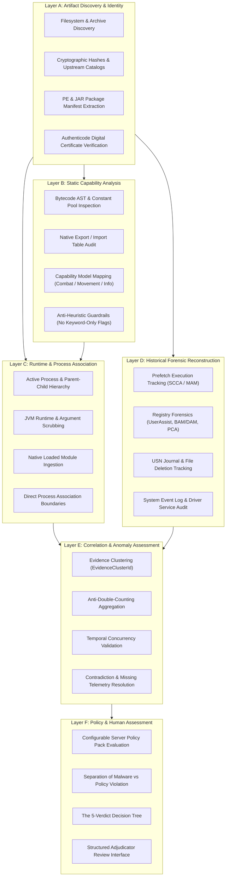

# 20 — Layered Forensic Detection & Capability Architecture

**Platform Name**: Minecraft SS Forensics  
**Document Status**: Official Architecture Specification (Expansion)  
**Version**: 3.0.0-DRAFT  
**Author**: Principal Security Architect, Detection Systems Engineer  
**Classification**: Detection Pipeline & Layered Systems Architecture  

---

## 1. The Six Conceptual Detection Layers

Rather than attempting to make a binary decision in a single monolithic scan pass, the next-generation engine organizes detection into **six decoupled, hierarchical abstraction layers**. Each layer receives inputs from previous layers, evaluates specific forensic hypotheses, and produces strongly typed evidence entities:

---

## 2. Layer A: Artifact Discovery & Identity

### 2.1 Operational Purpose
Layer A answers the foundational forensic question: **"What physical and virtual software components exist within the accessible storage and staging environments of this host?"**

### 2.2 Forensic Pipeline
1. **Scope-Bounded Traversal**: Scans configured game directories, standard launchers (Prism, Modrinth, Lunar, Badlion), system staging folders (`%TEMP%`, `%APPDATA%`, `Downloads`), and multi-volume Recycle Bins (`$Recycle.Bin`).
2. **Cryptographic Identity**: Streams discovered files through SHA-256 and Murmur2 hashing pipelines, comparing hashes against signed reference catalogs (`.refpack`).
3. **Packaging Structure**: Evaluates internal archive structures (`fabric.mod.json`, `mcmod.info`, PE version resources), checking for manifest-to-filename mismatches (`LookalikeDetector`).
4. **Authenticode Verification**: Queries Windows Trust Provider (`WinVerifyTrust`) to validate digital signatures.

### 2.3 Layer A Invariants
- `[PROPOSED]` **Discovery $\neq$ Guilt**: An artifact discovered in Layer A proves only file presence (`EvidenceCategory.Disk`).
- **No Early Termination**: Discovering a known cheat hash in `Downloads` does not bypass subsequent layers. The engine must proceed to determine whether execution or runtime association occurred.

---

## 3. Layer B: Static Capability Analysis

### 3.1 Operational Purpose
Layer B moves beyond naming conventions to understand **"What is this software architecturally capable of doing if executed?"**

### 3.2 Analysis Pipeline
1. **Bytecode Structure Auditing**: Parses Java `.class` files directly from ZIP streams without invoking the JVM ClassLoader. Analyzes class inheritance, interfaces implemented, and constant pool string references.
2. **Native Dependency Mapping**: Inspects PE Import/Export tables and native libraries embedded inside JARs (`/META-INF/natives/`).
3. **Capability Mapping**: Maps observed bytecode patterns to the formal **Capability Taxonomy** (Combat, Movement, Visual Information, Network Interception).

### 3.3 Anti-Heuristic Guardrails (Preventing Keyword False Positives)
> [!CAUTION]
> **Defensive Rule**: Under no circumstance may a single class name, method name, or text string independently trigger a cheat finding.
- A class named `AutoClicker` in an open-source development project or an educational tutorial is **not** proof of a cheat.
- The string `reach` or `killaura` appears in anti-cheat plugins, commentary text, and diagnostic mods.
- Layer B requires **structural corroboration**: e.g., an unauthorized mixin targeting `MinecraftClient.doAttack` combined with synthetic `Input` invocation and unlisted mod identity.

---

## 4. Layer C: Runtime & Process Association

### 4.1 Operational Purpose
Layer C answers: **"Which software components were actively executing and associated with Minecraft during the inspection?"**

### 4.2 Non-Privileged Observational Scope
Operating strictly in user-mode without kernel drivers, Layer C observes:
1. **Target JVM Identification**: Discovers running `javaw.exe` instances, resolves parent launcher PIDs, extracts `--gameDir`, and identifies game versions.
2. **Argument Auditing**: Parses JVM command-line flags, scrubbing personal tokens and checking for unauthorized `-javaagent:` flags.
3. **Module Address Mapping**: Queries `EnumProcessModulesEx` to list all native PE modules loaded into the Minecraft process.
4. **Process Concurrency**: Identifies active external helper processes running simultaneously on the host.

### 4.3 Association Boundaries
`[PROPOSED]` An artifact is classified as `MINECRAFT_ASSOCIATION_ESTABLISHED` if and only if:
- It is a module mapped directly into `javaw.exe` virtual memory, **OR**
- It is a Java agent specified on the JVM command line, **OR**
- It holds an active, open Win32 process handle to `javaw.exe` with `PROCESS_VM_READ` or `PROCESS_VM_WRITE` rights.

---

## 5. Layer D: Historical Forensic Reconstruction

### 5.1 Operational Purpose
Layer D reconstructs events that occurred prior to the scan: **"What relevant software was executed on this host in the past, and how does it relate temporally to the game session?"**

### 5.2 Multi-Subsystem Correlation
Layer D cross-examines independent operating system logging mechanisms:
- **Windows Prefetch**: Last 8 execution timestamps and lifetime run counts.
- **UserAssist & BAM/DAM**: Explorer launches and power management execution timestamps.
- **NTFS USN Journal**: Deletion and renaming records revealing files destroyed before the scan.
- **Service & Driver Logs**: Event 7045 records showing kernel driver installations.

### 5.3 Reliability & Temporal Boundaries
- Layer D tags all events with explicit temporal markers: `[IN SCAN WINDOW]` vs `[HISTORICAL]`.
- Events occurring prior to the session start are bounded to `EvidenceCategory.Historical`.

---

## 6. Layer E: Correlation & Anomaly Assessment

### 6.1 Operational Purpose
Layer E synthesizes raw observations into **explainable, clustered forensic findings**:
1. **Topological Clustering**: Binds related observations (disk file, Prefetch record, UserAssist entry) to a single `EvidenceClusterId`.
2. **Anti-Double-Counting**: Enforces that one physical artifact equals one identified software count in summary totals.
3. **Contradiction Resolution**: Detects and documents conflicting evidence (e.g. file marked deleted in Recycle Bin but actively running in process table).
4. **Negative Evidence Accounting**: If a collector returned `PERMISSION_DENIED` or `TIMED_OUT`, Layer E ensures the report records `INCONCLUSIVE` coverage rather than claiming a clean state.

---

## 7. Layer F: Policy & Human Assessment

### 7.1 Operational Purpose
Layer F bridges the gap between technical forensic facts and server community rules: **"Does this technical finding constitute a violation of the specific server's rulebook?"**

### 7.2 Core Decoupling Principles
- **Malware $\neq$ Policy Violation**: A commercial cheat is prohibited on all servers. A mod like Litematica (schematic projection) or Freecam may be permitted on an SMP server but banned in a competitive tournament.
- **Independent Policy Packs**: Server rules (`Standard PvP`, `Competitive Tournament`, `Vanilla Anarchy`) are decoupled into versioned configuration packs.
- **The Human Adjudicator**: The system generates the **5 Standardized Forensic Verdicts** and produces structured recommendations, but **never automatically bans a player**. Adjudication remains a human responsibility.
