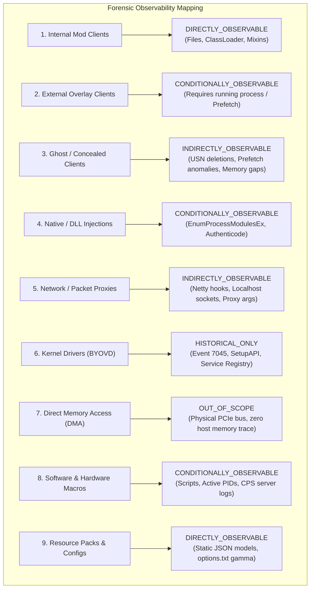

# 21 — Cheat-to-Evidence Forensic Coverage Matrix

**Platform Name**: Minecraft SS Forensics  
**Document Status**: Official Architecture Specification (Expansion)  
**Version**: 3.0.0-DRAFT  
**Author**: Principal Security Architect, Threat Intelligence Researcher  
**Classification**: Evidentiary Coverage & Observability Engineering  

---

## 1. Observability State Definitions

To eliminate simplistic and misleading claims (e.g., "99% detection rate"), the platform classifies forensic coverage across six strictly defined **Observability States**:

| Observability State | Formal Engineering Definition |
| :--- | :--- |
| **`DIRECTLY_OBSERVABLE`** | Primary telemetry can be collected directly from standard user-mode Win32 or JVM interfaces without elevation or special conditions. |
| **`CONDITIONALLY_OBSERVABLE`** | Telemetry is observable only if specific conditions are met (e.g., process is still running, UAC elevation is granted, or logging is enabled). |
| **`INDIRECTLY_OBSERVABLE`** | The cheat itself is concealed, but secondary operational artifacts (e.g., Prefetch, USN journal deletions, or temporary file unpacks) are observable. |
| **`HISTORICAL_ONLY`** | Observable only after execution has occurred via historical logs; real-time interaction cannot be captured post-mortem. |
| **`NOT_RELIABLY_OBSERVABLE`**| Telemetry leaves negligible host-side traces; passive software scanning cannot reliably establish facts without unacceptably high false-positive rates. |
| **`OUT_OF_SCOPE`** | Physical hardware or kernel mechanisms that user-mode software cannot inspect by architectural design (e.g. DMA PCIe hardware). |

---

## 2. Detailed Architectural Coverage Matrix

The matrix below provides the exhaustive forensic breakdown for all nine cheat architecture categories:

### 2.1 Category 1: Internal JVM / Mod-Based Clients
- **Primary Evidence Sources**: `.minecraft/mods/*.jar`, `latest.log`, JVM ClassLoader.
- **Secondary Evidence Sources**: Launcher configuration (`launcher_profiles.json`), crash dumps.
- **Static Analysis Opportunities**: ZIP central directory parsing, `fabric.mod.json`, bytecode constant pool scanning, Mixin configuration JSON parsing.
- **Runtime Analysis Opportunities**: Enumeration of loaded classes, active ClassLoaders, JVM startup command line.
- **Historical Analysis Opportunities**: Historical mod load logs in `.minecraft/logs/*.log.gz`.
- **Minecraft Association**: `DIRECTLY_OBSERVABLE` (Code executes inside `javaw.exe`).
- **Evidence Strength Limitations**: Static presence in mods folder does not prove the specific cheat feature was enabled in game.
- **False-Positive Risks**: Renamed community optimization mods, private development builds, or mod forks.
- **Collection Requirements**: Standard User file read access to game directory.
- **Unsupported Conclusions**: Cannot claim a mod altered gameplay without in-game telemetry.
- **Test Scenarios**: Scenario 01, 02, 03, 04, 08.

### 2.2 Category 2: External Applications and Overlay Clients
- **Primary Evidence Sources**: Active process table (`CreateToolhelp32Snapshot`), window styles (`WS_EX_TOPMOST`, `WS_EX_TRANSPARENT`).
- **Secondary Evidence Sources**: Windows Prefetch (`.pf`), UserAssist registry, BAM/DAM.
- **Static Analysis Opportunities**: Hashes and PE metadata of discovered external executable files.
- **Runtime Analysis Opportunities**: Enumerating top-level windows; checking if overlay rect matches Minecraft client viewport.
- **Historical Analysis Opportunities**: Prefetch execution run count and last launch timestamps.
- **Minecraft Association**: `INDIRECTLY_OBSERVABLE` (Requires matching window coordinates or open handle).
- **Evidence Strength Limitations**: Proving an external tool was running does not prove it sent input to Minecraft.
- **False-Positive Risks**: Discord overlay, GeForce Experience, OBS Game Capture, RTSS.
- **Collection Requirements**: Standard User process enumeration; Administrator for Prefetch.
- **Unsupported Conclusions**: Running an autoclicker during the same hour as Minecraft does not establish it targeted the game.
- **Test Scenarios**: Scenario 05, 06, 09.

### 2.3 Category 3: Ghost and Concealed Clients
- **Primary Evidence Sources**: USN Journal deletion records, Prefetch unbacked execution entries, memory map gaps.
- **Secondary Evidence Sources**: Recycle Bin (`$Recycle.Bin`) index files, Windows RecentDocs MRU lists.
- **Static Analysis Opportunities**: Carving deleted files from Recycle Bin; inspecting string-scrambled class files.
- **Runtime Analysis Opportunities**: Identifying unbacked executable pages (`PAGE_EXECUTE_READWRITE`) in `javaw.exe`.
- **Historical Analysis Opportunities**: USN Journal file rename/delete timestamps; Prefetch run counts for deleted executables.
- **Minecraft Association**: `CONDITIONALLY_OBSERVABLE` (Dependent on residual memory or prefetch traces).
- **Evidence Strength Limitations**: Deleted files prove deletion, not guilt. Gaps in logs can result from normal crashes.
- **False-Positive Risks**: Routine disk cleanups, CCleaner, launcher crash truncations.
- **Collection Requirements**: Administrator for raw USN Journal and Prefetch access.
- **Unsupported Conclusions**: Cannot declare someone guilty purely because files were deleted prior to the scan.
- **Test Scenarios**: Scenario 11, 16, 18.

### 2.4 Category 4: Native Components and DLL-Based Injections
- **Primary Evidence Sources**: `EnumProcessModulesEx` on `javaw.exe`, Authenticode digital signatures.
- **Secondary Evidence Sources**: Memory mapped files, temporary directory staging logs.
- **Static Analysis Opportunities**: PE Export/Import table parsing, checking for JVMTI function references (`jvmtiEnv`).
- **Runtime Analysis Opportunities**: Base address verification; checking whether DLL image resides on disk.
- **Historical Analysis Opportunities**: Historical DLL load lists recorded in Windows Prefetch headers.
- **Minecraft Association**: `DIRECTLY_OBSERVABLE` (Module is physically mapped inside `javaw.exe`).
- **Evidence Strength Limitations**: Manual PE mapping (reflective injection) bypasses standard module lists.
- **False-Positive Risks**: Legitimate JNA unpacks (`jnidispatch.dll`), LWJGL binaries, graphics driver overlays.
- **Collection Requirements**: Standard User for own processes; Administrator for elevated instances.
- **Unsupported Conclusions**: An unsigned DLL in `%TEMP%` is not an injection unless proven unlinked from legitimate modloaders.
- **Test Scenarios**: Scenario 08, 10.

### 2.5 Category 5: Network and Packet Manipulation
- **Primary Evidence Sources**: Active TCP connection tables (`GetExtendedTcpTable`), Minecraft proxy arguments.
- **Secondary Evidence Sources**: Minecraft log network disconnect reasons, Netty pipeline transformers.
- **Static Analysis Opportunities**: Bytecode analysis of custom Netty `ChannelHandler` implementations.
- **Runtime Analysis Opportunities**: Checking if `javaw.exe` TCP socket connects to `127.0.0.1` instead of remote server IP.
- **Historical Analysis Opportunities**: Windows network history, proxy arguments in launcher profiles.
- **Minecraft Association**: `CONDITIONALLY_OBSERVABLE` (Requires active network connection sampling during match).
- **Evidence Strength Limitations**: Cannot inspect encrypted TLS/Minecraft protocol packets without invasive MitM root certs.
- **False-Positive Risks**: Local VPN tunnels, development proxies (Fiddler), school network proxies.
- **Collection Requirements**: Standard User network table access.
- **Unsupported Conclusions**: Running a local proxy does not prove packet manipulation unless Minecraft traffic routed through it.
- **Test Scenarios**: Scenario 14, 15.

### 2.6 Category 6: Kernel Drivers and Low-Level Components
- **Primary Evidence Sources**: System Event Log (Event ID 7045), Windows SetupAPI logs (`setupapi.dev.log`).
- **Secondary Evidence Sources**: Service registry keys (`HKLM\SYSTEM\CurrentControlSet\Services`).
- **Static Analysis Opportunities**: Driver PE header analysis, Authenticode signatures, known vulnerable driver hashes (LOLDrivers).
- **Runtime Analysis Opportunities**: None (Scanner runs in user-mode; cannot query Ring 0 memory).
- **Historical Analysis Opportunities**: Event 7045 driver service installation timestamps.
- **Minecraft Association**: `NOT_RELIABLY_OBSERVABLE` (Kernel drivers manipulate memory without user-mode traces).
- **Evidence Strength Limitations**: Drivers operate below user-mode security boundaries.
- **False-Positive Risks**: Antivirus drivers, motherboard overclocking utilities, commercial anti-cheats (Vanguard, EAC).
- **Collection Requirements**: Standard User reads Event 7045; Administrator reads driver files.
- **Unsupported Conclusions**: An old or vulnerable driver on the system does not prove Minecraft cheat usage.
- **Test Scenarios**: Scenario 21 (from audit).

### 2.7 Category 7: Direct Memory Access (DMA) and External Hardware
- **Primary Evidence Sources**: None on host system.
- **Secondary Evidence Sources**: USB device enumeration (`SetupAPI` records for Arduino/Teensy HID boards), default PCIe FPGA hardware IDs.
- **Static Analysis Opportunities**: None.
- **Runtime Analysis Opportunities**: None (Hardware memory reads occur across physical PCIe bus).
- **Historical Analysis Opportunities**: Historical USB device connection timestamps in registry `USBSTOR`.
- **Minecraft Association**: `OUT_OF_SCOPE` / `NOT_RELIABLY_OBSERVABLE`.
- **Evidence Strength Limitations**: Host cannot inspect physical bus memory transfers.
- **False-Positive Risks**: Legitimate maker boards (Arduino programming), custom mechanical keyboards using Raspberry Pi Pico.
- **Collection Requirements**: Standard User can read USB registry keys.
- **Unsupported Conclusions**: **STRICT PROHIBITION**: The scanner will **never** claim to detect DMA memory reads.
- **Test Scenarios**: Scenario 19.

### 2.8 Category 8: Software and Hardware Macros
- **Primary Evidence Sources**: Process table (AutoHotkey.exe, Logitech G HUB, Razer Synapse), active script files (`.ahk`).
- **Secondary Evidence Sources**: UserAssist execution tracking, Windows task scheduler entries.
- **Static Analysis Opportunities**: Parsing script text for click loops, sleep intervals, and targeting directives (`ahk_class GLFW30`).
- **Runtime Analysis Opportunities**: Identifying active macro processes running concurrently with Minecraft.
- **Historical Analysis Opportunities**: Prefetch execution run counts for macro utilities.
- **Minecraft Association**: `CONDITIONALLY_OBSERVABLE` (Observable if script explicitly targets Minecraft window class).
- **Evidence Strength Limitations**: Cannot distinguish legitimate peripheral macros from combat macros without script content analysis.
- **False-Positive Risks**: Logitech G HUB, Razer Synapse, Elgato Stream Deck software, accessibility tools.
- **Collection Requirements**: Standard User.
- **Unsupported Conclusions**: Having mouse software installed does not prove auto-clicking; requires server-side CPS consistency metrics.
- **Test Scenarios**: Scenario 07, 17.

### 2.9 Category 9: Resource Packs and Configuration Advantages
- **Primary Evidence Sources**: `.minecraft/resourcepacks/*.zip`, `.minecraft/options.txt`.
- **Secondary Evidence Sources**: Server-specific configuration overrides, shaderpack files.
- **Static Analysis Opportunities**: Inspecting block JSON model files for transparency overrides (`cullface`, `ambientocclusion: false`), reading `gamma` values in `options.txt`.
- **Runtime Analysis Opportunities**: Checking active resource packs loaded in memory.
- **Historical Analysis Opportunities**: Historical options backup files (`options.txt.old`).
- **Minecraft Association**: `DIRECTLY_OBSERVABLE` (Native game assets).
- **Evidence Strength Limitations**: An X-ray pack in the folder does not prove it was enabled during a specific match.
- **False-Positive Risks**: Legitimate clear glass packs, PvP texture packs, performance optimization packs.
- **Collection Requirements**: Standard User.
- **Unsupported Conclusions**: Visual advantage packs depend entirely on server policy; not inherently malware.
- **Test Scenarios**: Scenario 02, 13.
