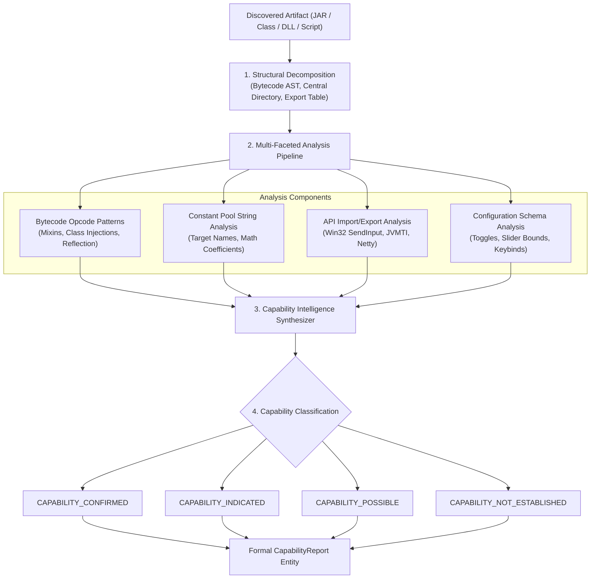

# 22 — Capability Intelligence Modeling & Feature Analysis

**Platform Name**: Minecraft SS Forensics  
**Document Status**: Official Architecture Specification (Expansion)  
**Version**: 3.0.0-DRAFT  
**Author**: Principal Security Architect, Bytecode Engineering Specialist  
**Classification**: Capability Modeling & Static/Runtime Dissection  

---

## 1. The Capability Intelligence Philosophy

In conventional screening, software is treated as a black box: an investigator flags a mod simply because someone labeled it "suspicious." This approach fails when players use private custom builds, fork open-source mods, or use legitimate utilities with controversial features.

`[PROPOSED]` The **Capability Intelligence Subsystem** shifts the analysis from *identity* to *functional capability*. It determines what an artifact is technically designed to execute, independent of its marketing name or author branding.

---

## 2. Capability Classifications

To maintain scientific precision, the engine classifies observed capabilities into five distinct certainty states:

| Classification Enum | Evidentiary Definition & Criteria |
| :--- | :--- |
| **`CAPABILITY_CONFIRMED`** | The artifact contains unambiguous, decompiled structural logic directly executing the unauthorized feature (e.g. verified Mixin redirecting `getReachDistance()` to a constant $> 3.0\text{ blocks}$). |
| **`CAPABILITY_INDICATED`** | Strong structural corroboration exists (e.g. constant pool strings, config toggles, and targeting math), but core implementation is obfuscated or externalized. |
| **`CAPABILITY_POSSIBLE`** | Generic automation primitives are present (e.g. reflection into private player fields or Win32 mouse synthesis), but Minecraft-specific targeting logic is unverified. |
| **`CAPABILITY_NOT_ESTABLISHED`**| Analysis evaluated the artifact; zero structural, bytecode, or heuristic capability indicators were found. |
| **`NOT_APPLICABLE`** | The artifact is a non-executable asset file (texture, sound, language file) incapable of code execution. |

> [!IMPORTANT]
> **Axiom**: Capability classifications measure the **functional potential of the software**, explicitly **not whether the player cheated in a match**.

---

## 3. Comprehensive Capability Taxonomy

### 3.1 Combat Capabilities

#### 3.1.1 Reach Modification (`CAP-COMBAT-REACH`)
- **Description**: Extends player attack reach beyond the standard vanilla limit ($3.0\text{ blocks}$ in survival).
- **Architecture Types**: Internal Mod, JVMTI Native Agent, Dynamic Bytecode Transformer.
- **Static Indicators**: Mixins targeting `GameRenderer.getCrosshairTarget` or `ClientPlayerInteractionManager.getReachDistance`; bytecode multiplying the vector distance constant.
- **Runtime Indicators**: In-memory class modifications to `ClientPlayerInteractionManager`.
- **Required Corroboration**: Bytecode hook corroborated by constant pool references to raycasting or entity vector calculations.
- **False-Positive Scenarios**: Creative mode flight extensions; legitimate spectator tools; server administration moderation tools.
- **Policy Mapping**: Strictly prohibited on all PvP servers; permitted in singleplayer/creative.
- **Can Passive Scan Prove Active In-Game Use?**: **NO.** Proves capability; proving active in-game use requires server-side hit-distance logging.

#### 3.1.2 Attack Timing Automation / AutoClicker (`CAP-COMBAT-AUTOCLICK`)
- **Description**: Synthesizes rapid attack clicks at fixed or randomized intervals (e.g., 14–20 CPS) to optimize hit registration.
- **Architecture Types**: External Executable, Win32 Mouse Hook, Internal JVM Mod, Macro Script (AHK).
- **Static Indicators**: Loops invoking `mouse_event(MOUSEEVENTF_LEFTDOWN | MOUSEEVENTF_LEFTUP)`, `SendInput`, or internal `MinecraftClient.doAttack()` at scheduled delays.
- **Runtime Indicators**: High-frequency mouse events without corresponding physical hardware interrupt jitter; active external clicker process running.
- **Required Corroboration**: Script targeting Minecraft window class combined with running process.
- **False-Positive Scenarios**: Accessibility software for players with motor disabilities; development test automation tools.
- **Policy Mapping**: Prohibited on competitive servers; restricted to specific CPS caps on others.
- **Can Passive Scan Prove Active In-Game Use?**: **NO.** Requires server-side click consistency statistical analysis (entropy / standard deviation).

#### 3.1.3 Crystal Automation (`CAP-COMBAT-CRYSTAL`)
- **Description**: Automates End Crystal placement and detonation sequence (placing obsidian, placing crystal, switching to weapon/empty hand, attacking crystal) in a single game tick.
- **Architecture Types**: Internal Mod, Netty Packet Transformer.
- **Static Indicators**: Method calls sequencing `CPacketPlayerTryUseItemOnBlock` followed immediately by `CPacketUseEntity` targeting `EndCrystalEntity`.
- **Runtime Indicators**: Outbound packet sequences with zero-tick delays.
- **Required Corroboration**: Bytecode structure matching multi-packet sequencing.
- **False-Positive Scenarios**: Very rare in standard mods; occasionally present in PvP training/practice mods.
- **Policy Mapping**: Strictly prohibited across PvP servers.
- **Can Passive Scan Prove Active In-Game Use?**: **NO.** Proves capability in JAR; server packet logs required to prove match execution.

---

### 3.2 Movement Capabilities

#### 3.2.1 Flight & Motion Manipulation (`CAP-MOVE-FLY`)
- **Description**: Overrides client-side gravity and vertical velocity checks, allowing sustained flight in survival mode.
- **Architecture Types**: Internal Mod, Bytecode Injection.
- **Static Indicators**: Hooks modifying `PlayerEntity.getVelocity()`, setting `abilities.flying = true`, or canceling `onGround` packet updates.
- **Runtime Indicators**: None passive (unless memory freeze occurs).
- **Required Corroboration**: Direct bytecode hook into motion vectors.
- **False-Positive Scenarios**: Legitimate Elytra flight enhancement mods, creative mode utility mods.
- **Policy Mapping**: Prohibited in competitive play; permitted in modded survival.
- **Can Passive Scan Prove Active In-Game Use?**: **NO.** Readily detected server-side; client scan establishes only software capability.

#### 3.2.2 NoFall (`CAP-MOVE-NOFALL`)
- **Description**: Suppresses fall damage by forging client packets to falsely report `onGround = true` when landing.
- **Architecture Types**: Internal Mod, Netty Packet Transformer.
- **Static Indicators**: Bytecode intercepting `PlayerMoveC2SPacket` and forcibly setting `onGround` field to true regardless of player altitude.
- **Runtime Indicators**: Network packet tampering.
- **Required Corroboration**: Packet modification logic.
- **False-Positive Scenarios**: None in standard vanilla play.
- **Policy Mapping**: Universally prohibited.
- **Can Passive Scan Prove Active In-Game Use?**: **NO.** Server movement logs required.

---

### 3.3 Visual & Information Advantages

#### 3.3.1 ESP & Entity Tracers (`CAP-INFO-ESP`)
- **Description**: Renders bounding boxes, glowing outlines, or 3D tracer lines through solid terrain to display player and entity positions.
- **Architecture Types**: Internal Mod, External DirectX/GDI Overlay.
- **Static Indicators**: OpenGL/DirectX rendering calls (`glBegin(GL_LINES)`, `glDisable(GL_DEPTH_TEST)`) inside `WorldRenderer.renderEntities` hooks.
- **Runtime Indicators**: Transparent overlay window pinned over Minecraft viewport.
- **Required Corroboration**: Depth test disabling logic combined with entity iteration.
- **False-Positive Scenarios**: Legitimate glowing outlines (Vanilla Spectral Arrows), team color glowing effects, replay mods.
- **Policy Mapping**: Strictly prohibited on all competitive servers.
- **Can Passive Scan Prove Active In-Game Use?**: **NO.** Proves rendering capability; cannot prove player looked at screen during match.

#### 3.3.2 X-Ray (`CAP-INFO-XRAY`)
- **Description**: Makes common terrain blocks (stone, dirt) invisible or unlit to reveal valuable ores and underground bases.
- **Architecture Types**: Resource Pack, Internal Mod, Shaderpack.
- **Static Indicators**: Block model JSONs specifying transparent faces or `ambientocclusion: false`; mod hooks canceling `Block.shouldDrawSide()`.
- **Runtime Indicators**: Memory modifications to chunk render caches.
- **Required Corroboration**: Model JSON inspection or chunk mesh rendering hooks.
- **False-Positive Scenarios**: Clear glass resource packs; mapmaker utility packs.
- **Policy Mapping**: Server-policy dependent (Anarchy = Allowed; Tournament = Banned).
- **Can Passive Scan Prove Active In-Game Use?**: **NO.** Proves resource pack presence; requires checking active resource pack list in options.

---

### 3.4 Networking Capabilities

#### 3.4.1 Artificial Lag / Backtrack (`CAP-NET-BACKTRACK`)
- **Description**: Delays incoming entity position packets or delays outbound hit packets to hit players where they were located hundreds of milliseconds earlier.
- **Architecture Types**: Localhost SOCKS Proxy, Internal Netty Channel Pipeline Hook.
- **Static Indicators**: Netty `ChannelInboundHandler` queueing `PlayerMoveC2SPacket` in a ring buffer with configurable millisecond delay thresholds.
- **Runtime Indicators**: Localhost proxy socket active on port `127.0.0.1:<port>`.
- **Required Corroboration**: Queueing logic targeting player movement packets.
- **False-Positive Scenarios**: Network debugging proxies (Wireshark, Fiddler), slow network simulation tools used by developers.
- **Policy Mapping**: Universally prohibited in competitive PvP.
- **Can Passive Scan Prove Active In-Game Use?**: **NO.** Proves software capability; server packet timing correlation required.

---

### 3.5 Policy-Sensitive Utilities

#### 3.5.1 Litematica / Schematic Placement (`CAP-UTIL-SCHEMATIC`)
- **Description**: Displays 3D holographic blueprints of structures and optionally automates block placement from inventory ("Easy Place").
- **Architecture Types**: Legitimate Fabric/Forge Community Mod.
- **Static Indicators**: Verified Modrinth package `id: litematica`, official upstream release hash.
- **Policy Mapping**: Highly server-dependent:
  - *Survival SMP*: Fully allowed (blueprint projection).
  - *Factions / Tournament*: "Easy Place" automation mode strictly prohibited.
- **Classification**: `AssessmentCategory.POLICY_REVIEW_REQUIRED`.
- **Architectural Requirement**: Scanner reports mod identity and warns staff to verify whether restricted sub-features were toggled on.
