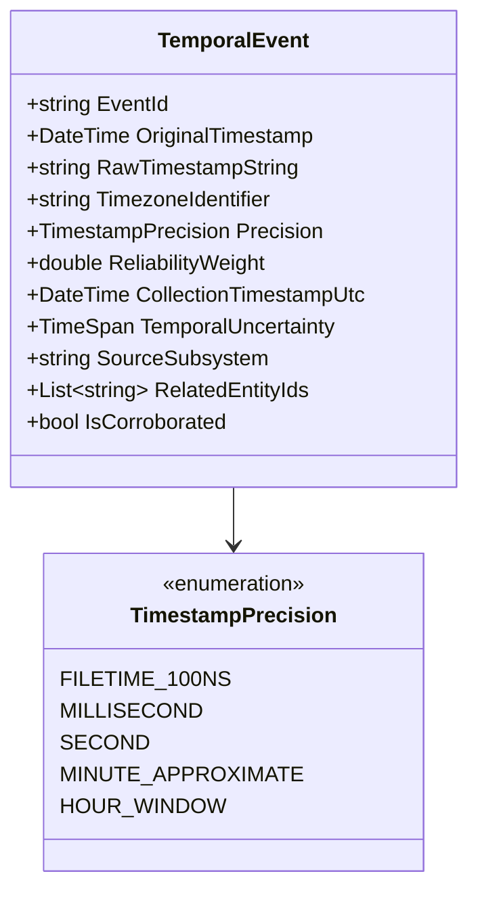

# 23 — Temporal Correlation, Timeline Engineering & Session Reconstruction

**Platform Name**: Minecraft SS Forensics  
**Document Status**: Official Architecture Specification (Expansion)  
**Version**: 3.0.0-DRAFT  
**Author**: Principal Windows Forensics Engineer, Temporal Systems Architect  
**Classification**: Temporal Modeling & Chronological Forensics  

---

## 1. The Multi-Timeline Architecture

A major source of flawed forensic conclusions is the flattening of disparate timestamps into a single misleading chronology. Operating systems, file systems, and user applications record timestamps using different clocks, varying precision, distinct timezones, and fundamentally different physical semantics.

`[PROPOSED]` The platform models temporal evidence as **nine concurrent timelines**, unified within a formal **Session Reconstruction Model**:

```mermaid
timeline
    title Multi-Timeline Forensic Session Reconstruction
    section 1. File Lifecycle
        12:00 : File Downloaded (NTFS $MFT / Chrome WebKit)
        12:05 : File Moved / Renamed (USN Journal)
        14:35 : File Deleted ($Recycle.Bin / USN Journal)
    section 2. Windows Historical Execution
        12:10 : Executable Launched (UserAssist Explorer ROT13)
        12:10 : Prefetch SCCA Run Recorded (Prefetch Header)
        12:10 : BAM Power State Recorded (BAM Registry)
    section 3. Minecraft Launcher & JVM
        13:00 : Launcher Initiated (launcher_profiles.json)
        13:02 : JVM Process Forked (javaw.exe PID 8412)
        13:02 : Java Agents Bound (-javaagent:path.jar)
    section 4. Game Session Logs
        13:03 : Mixin Applied to Client (latest.log)
        13:05 : Connected to Server (latest.log)
        14:30 : Disconnected from Server (latest.log)
    section 5. Inspection Window
        13:00 : Match Start Time (Server Schedule)
        14:30 : Match End Time (Server Schedule)
        14:40 : Forensic Scanner Executed (Scan Start UTC)
```

---

## 2. The Nine Specialized Forensics Timelines

| Timeline # | Timeline Name | Data Sources | Underlying Clock & Precision | Physical Semantics |
| :---: | :--- | :--- | :--- | :--- |
| **TL-1** | **File Lifecycle** | NTFS `$MFT` (`$SI`, `$FN`), USN Journal, Browser History. | Hardware RTC via NTFS Driver ($100\text{ ns}$ FILETIME). | File bitstream creation, metadata update, directory move, or deletion. |
| **TL-2** | **Artifact Discovery** | Scanner File Collector. | Scanner Host System Clock ($1\text{ ms}$ UTC). | Exact moment the scanner enumerated the file on storage. |
| **TL-3** | **Historical Execution** | Windows Prefetch, UserAssist, BAM/DAM, PCA. | OS Kernel / Registry ($100\text{ ns}$ to $1\text{ s}$ FILETIME). | Executable launch initiated by user or background service. |
| **TL-4** | **Minecraft Launcher** | `launcher_profiles.json`, MultiMC `instance.cfg`. | File Modification Timestamp ($1\text{ s}$ precision). | Last update of launcher configuration profile. |
| **TL-5** | **Minecraft Process** | Win32 `GetProcessTimes` on `javaw.exe`. | Windows Kernel Process Manager ($100\text{ ns}$ FILETIME). | Kernel process creation, user CPU time, kernel CPU time. |
| **TL-6** | **JVM Runtime** | `latest.log`, `hs_err_pid.log`. | JVM System Clock (`System.currentTimeMillis()`). | Initialization of ClassLoaders, Mixin application, thread state. |
| **TL-7** | **Loaded Module** | Win32 `EnumProcessModulesEx`. | Real-time sampling clock ($1\text{ ms}$). | Presence of PE binary in virtual address space during sampling. |
| **TL-8** | **Configuration Change**| `.minecraft/options.txt`, mod configs. | NTFS File Modification Time ($1\text{ s}$). | Last time player changed in-game settings or keybinds. |
| **TL-9** | **Server Event Bridge** | Server-side logs, AC telemetry (imported). | Authoritative Server Clock (NTP Synchronized). | Match start/end, server-side flags, player join/quit. |

---

## 3. Formal Temporal Event Data Schema

Every timestamped event in the timeline is represented by a strongly typed `TemporalEvent` record:



### Schema Attributes & Semantics
- **`OriginalTimestamp`** (`DateTime`): Normalized UTC representation of the event.
- **`RawTimestampString`** (`string`): The exact, unedited raw timestamp string as found in the source artifact (e.g., `"2026-10-30 14:15:22.412"` or hex FILETIME `"0x01DB2ABC12345678"`).
- **`TimezoneIdentifier`** (`string`): The explicit timezone of the source artifact (e.g. `UTC`, `LocalSystemZone`, or `UnknownLocal`).
- **`Precision`** (`enum`): Explicit notation of the clock granularity.
- **`TemporalUncertainty`** (`TimeSpan`): The maximum error margin of the timestamp (e.g., $\pm 1\text{ s}$ for FAT32 filesystems, $\pm 1\text{ hr}$ for SRUM hourly aggregates).
- **`ReliabilityWeight`** (`double [0.0 - 1.0]`): Resistance to user manipulation (NTFS kernel journal is 0.95; user-editable text log is 0.40).

---

## 4. Architectural Rules for Temporal Reasoning

To prevent timeline misinterpretation, the engine enforces five strict temporal rules:

### Rule 1: Zero Silent Timezone Conversions
Local log timestamps (e.g. `latest.log` entries recorded as `[14:22:10]`) lack timezone offset headers. The engine **never assumes local logs match UTC**. It queries `TimeZoneInfo.Local` on the host, records the active daylight saving offset, and explicitly prints both the raw local time and calculated UTC equivalent in findings.

### Rule 2: Interval vs Instant Semantics
Certain Windows artifacts record intervals, not instants:
- **SRUM**: Aggregates network data across 60-minute windows.
- **UserAssist**: Records last launch time, but focus duration is cumulative across all launches.
- **Rule**: The engine will **never convert an interval into a pinpoint execution instant**. An SRUM record from 14:00–15:00 proves only that network bytes were transferred sometime during that 60-minute span.

### Rule 3: Anti-Causal Proximity Guard
> [!CAUTION]
> **Defensive Invariant**: Temporal proximity $\neq$ Causation.
- Finding that `autoclicker.exe` was launched at 14:10 and Minecraft was running between 14:00 and 15:00 proves **temporal overlap**.
- It does **not** prove the clicker was used on Minecraft (it may have been used on a secondary screen, in another game, or idle).
- Overlapping timelines justify `AssessmentCategory.EXECUTION_OBSERVED` combined with `HISTORICAL_ACTIVITY`, but **never** `MINECRAFT_ASSOCIATION_ESTABLISHED` without direct handle or memory proof.

### Rule 4: Handling Conflicting Clocks (Clock Drift)
If the host system clock was manually changed (e.g., player rolled back Windows time by 2 hours), timeline contradictions occur:
- An NTFS file creation time in USN Journal may appear *after* a Prefetch execution time.
- The engine identifies negative deltas ($t_{\text{execution}} < t_{\text{creation}}$) as a **Temporal Inconsistency Anomaly** (`Anomaly.ClockDriftDetected`), alerting the adjudicator that system clocks were desynchronized or manipulated.

### Rule 5: Session Window Bounding
Given an authoritative match window $[t_{\text{start}}, t_{\text{end}}]$:
- An artifact is certified `IsInScanWindow = true` if and only if:
  $$t_{\text{start}} \le t_{\text{event}} \le t_{\text{end}}$$
- If $t_{\text{event}} < t_{\text{start}}$, it is certified `IsInScanWindow = false` and assigned to `EvidenceCategory.Historical`.
