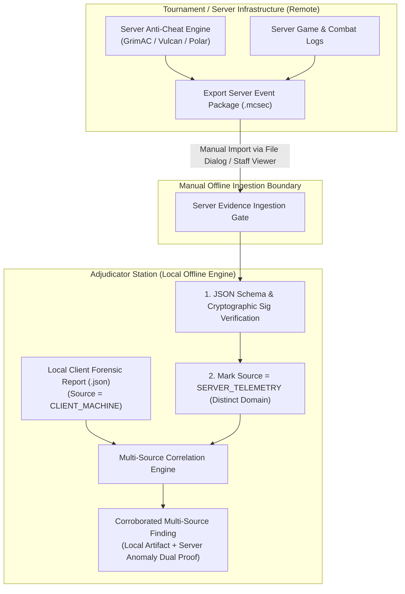
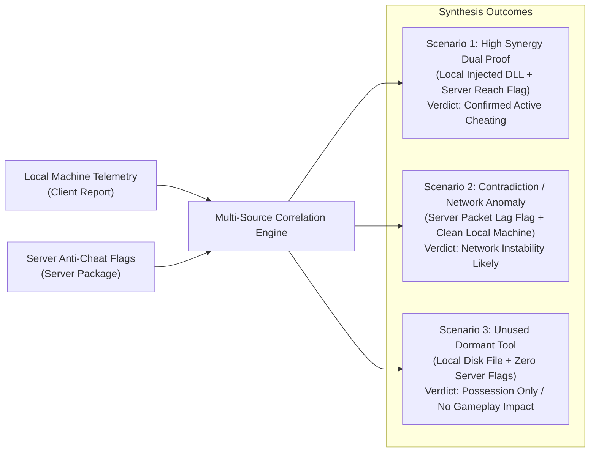

# 24 — Server-Side Evidence Bridge & Multi-Source Correlation

**Platform Name**: Minecraft SS Forensics  
**Document Status**: Official Architecture Specification (Expansion)  
**Version**: 3.0.0-DRAFT  
**Author**: Principal Security Architect, Distributed Systems Forensic Lead  
**Classification**: Multi-Source Telemetry & Server Bridge Architecture  

---

## 1. The Asymmetric Forensic Boundary

A purely client-side software scanner suffers from an inherent physical limitation: **it cannot independently prove in-game gameplay impact**.
- The client scanner can prove a cheat file was on disk (`Disk`).
- It can prove an executable was run (`Historical`).
- It can prove a DLL was mapped into memory (`LoadedModule`).
- But **it cannot prove that a hit landed from 3.8 blocks away** or that a player took zero knockback during a specific duel without server-side ground truth.

Conversely, a server-side anti-cheat (e.g., GrimAC, Vulcan, Polar, Karhu) observes anomalous packet timings and impossible reach angles, but **cannot see local host state** (whether the anomaly was caused by network jitter, an unverified mod, or a commercial cheat client).

`[PROPOSED]` The next-generation platform bridges this asymmetry through the **Server-Side Evidence Bridge**: an optional, decoupled, manually imported evidence interface.



---

## 2. Absolute Architectural Guardrails

To preserve player trust, data protection compliance, and system integrity, the bridge adheres to five absolute constraints:

1. **Strict Offline-First Ingestion**: The client scanner application **never connects to a remote server**. There are no network ports opened, no HTTP endpoints queried, and no cloud uploads.
2. **Manual File Import Only**: Server evidence is ingested exclusively as a static file (`.mcsec` / `.json`) loaded manually by the adjudicator inside `MinecraftSsForensics.Viewer.exe`.
3. **Cryptographic Provenance Verification & Trust Anchors**: Server evidence files must be signed by the server organization's private key (Ed25519). The viewer verifies the signature strictly against **pre-configured local trust anchors** (public key fingerprints configured by staff/tournament organizers). Trusting a public key embedded in the imported package itself is rejected as completely circular and insecure.
4. **Strict Domain Separation**: Server-side evidence is never merged silently into local machine observations. In the report, server observations carry a distinct visual badge (`[SERVER-OBSERVED]`) to prevent confusion.
5. **No Causal Transmutation**: A server-side reach flag plus a local unverified mod equals a **corroborated anomaly requiring review**; it does not constitute automated cryptographic proof of guilt.

---

## 3. Server Evidence Data Schema (`.mcsec`)

The imported server package conforms to the following formal JSON Schema:

```json
{
  "$schema": "https://json-schema.org/draft/2020-12/schema",
  "$id": "https://minecraft-ss-forensics.org/schemas/v3/server-evidence.json",
  "title": "ServerEvidencePackage",
  "type": "object",
  "required": [
    "PackageId",
    "ServerIdentifier",
    "ServerSoftware",
    "MatchSessionId",
    "PlayerUuid",
    "MatchWindowStartUtc",
    "MatchWindowEndUtc",
    "ServerNtpTimestampUtc",
    "TelemetryEvents",
    "Signature"
  ],
  "properties": {
    "PackageId": { "type": "string", "format": "uuid" },
    "ServerIdentifier": { "type": "string" },
    "ServerSoftware": { "type": "string" },
    "MatchSessionId": { "type": "string" },
    "PlayerUuid": { "type": "string" },
    "MatchWindowStartUtc": { "type": "string", "format": "date-time" },
    "MatchWindowEndUtc": { "type": "string", "format": "date-time" },
    "ServerNtpTimestampUtc": { "type": "string", "format": "date-time" },
    "TelemetryEvents": {
      "type": "array",
      "items": {
        "type": "object",
        "required": [
          "EventId",
          "TimestampUtc",
          "CheckCategory",
          "CheckName",
          "Severity",
          "ObservedValue",
          "ThresholdValue",
          "Details"
        ],
        "properties": {
          "EventId": { "type": "string", "format": "uuid" },
          "TimestampUtc": { "type": "string", "format": "date-time" },
          "CheckCategory": {
            "type": "string",
            "enum": ["Combat", "Movement", "PacketTiming", "Inventory", "Chat"]
          },
          "CheckName": { "type": "string" },
          "Severity": { "type": "string", "enum": ["Critical", "High", "Medium", "Low"] },
          "ObservedValue": { "type": "number" },
          "ThresholdValue": { "type": "number" },
          "Details": { "type": "string" }
        }
      }
    },
    "Signature": {
      "type": "object",
      "required": ["Algorithm", "KeyIdentifier", "SignatureHex"],
      "properties": {
        "Algorithm": { "type": "string", "enum": ["Ed25519", "RSA-SHA256"] },
        "KeyIdentifier": { "type": "string", "description": "Key identifier or fingerprint matching a pre-configured trust anchor" },
        "SignatureHex": { "type": "string" }
      }
    }
  }
}
```

---

## 4. Multi-Source Evidence Synthesis & Corroboration

When both a Local Client Report and an Authoritative Server Evidence Package are loaded into the Viewer, the correlation engine executes **Cross-Domain Synthesis**:



### Synthesis Evaluation Scenarios
1. **High-Synergy Dual Proof (Actionable Violation)**:
   - *Local Observation*: Native module `vape_loader.dll` mapped into `javaw.exe` at 14:15 UTC (`EvidenceCategory.Injected`).
   - *Server Observation*: GrimAC records 12 Reach violations averaging $3.6\text{ blocks}$ between 14:15 and 14:25 UTC.
   - *Correlation Conclusion*: High confidence. The technical capability observed on the client directly explains and corroborates the anomaly observed on the server.
2. **Network Lag Discrepancy (Exoneration / Inconclusive)**:
   - *Local Observation*: Zero cheat signatures, zero unverified modules, vanilla Minecraft installation.
   - *Server Observation*: Vulcan flags player for "Timer / FastClick".
   - *Local Telemetry Corroboration*: Local logs show severe packet loss and high thread contention (`hs_err` GC pause).
   - *Correlation Conclusion*: Contradiction identified. Server flag is consistent with local hardware/network stuttering rather than malicious software.
3. **Dormant Tool (Possession Capped)**:
   - *Local Observation*: Cheat archive present in `Downloads` folder (`EvidenceCategory.Disk`).
   - *Server Observation*: Zero server-side flags across entire 45-minute match.
   - *Correlation Conclusion*: Confirms that static presence on disk did **not** produce observable gameplay manipulation during the inspected match.
