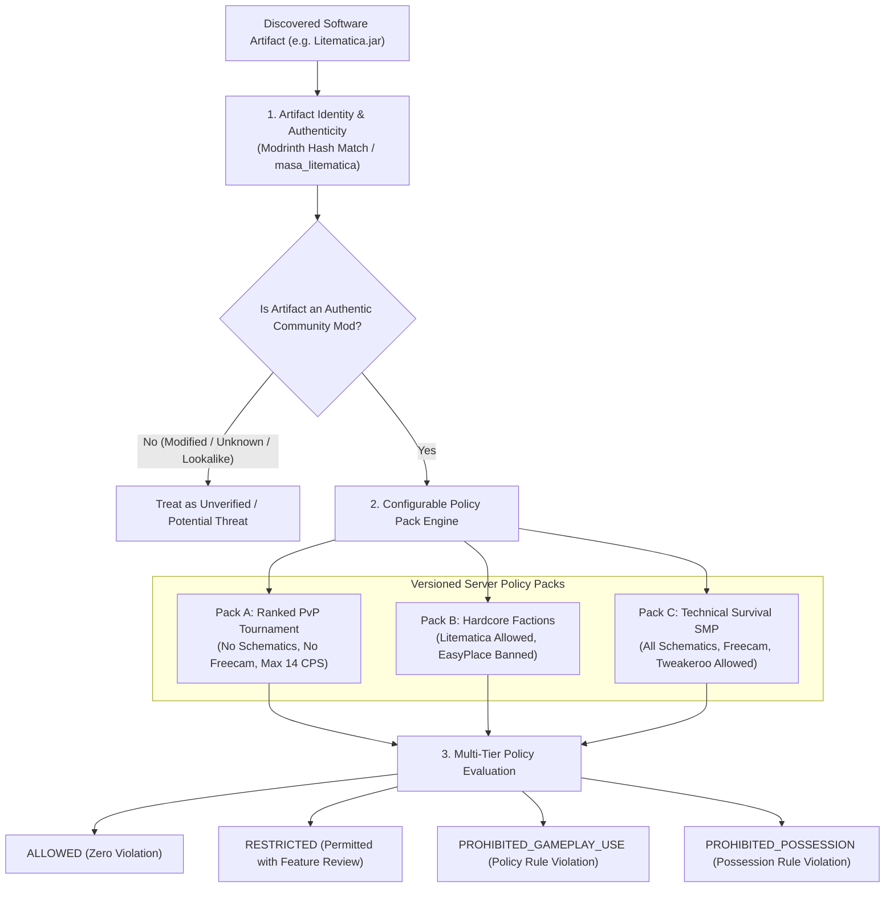

# 25 — Policy-Sensitive Software & Policy Pack Intelligence

**Platform Name**: Minecraft SS Forensics  
**Document Status**: Official Architecture Specification (Expansion)  
**Version**: 3.0.0-DRAFT  
**Author**: Principal Security Architect, Adjudication Policy Engineer  
**Classification**: Policy Engine & Compliance Architecture  

---

## 1. The Policy Decoupling Axiom

A major point of confusion in competitive Minecraft adjudication is treating **legitimate community utilities** as "malware" or "cheats" because a specific server forbids them.

For example:
- **Litematica**: An authentic, widely respected client-side schematic visualization tool created by Masa. On a creative or survival SMP server, it is celebrated. On a competitive Factions or Skyblock server, its "Easy Place" auto-printing mode may be forbidden.
- **Freecam**: A utility that detaches the client camera from the player model. Essential for content creators and camera operators; prohibited in competitive PvP where it allows spying on hidden bases.
- **Auto-Bridging / Macro Keys**: Legitimate keyboard macro software (Razer Synapse) bound to place blocks.

`[PROPOSED]` The platform enforces the **Policy Decoupling Axiom**:
$$\text{Software Identity} \neq \text{Software Authenticity} \neq \text{Server Policy Compliance}$$

An authentic, digitally signed or hash-verified open-source mod is **never classified as malware or a cheat**. If a server bans it, it is classified as a **Policy-Restricted Utility (`AssessmentCategory.POLICY_REVIEW_REQUIRED`)**, requiring human confirmation of which features were active.



---

## 2. The Five Policy Rule Tiers

Every rule within a Server Policy Pack evaluates software under five strictly separated governance tiers:

| Policy Tier Enum | Operational Meaning | Action Required by Staff |
| :--- | :--- | :--- |
| **`ALLOWED`** | Software and all its capabilities are fully permitted on the server under the active game mode. | Zero action required; findings categorized as `Informational`. |
| **`RESTRICTED`** | Software is permitted for specific utilities, but specific sub-features are forbidden (e.g. Litematica without EasyPlace). | Staff must inspect mod configuration file (`.minecraft/config/...`) to verify prohibited sub-features were disabled. |
| **`PROHIBITED_GAMEPLAY_USE`** | Software may be installed on disk, but running it concurrently with Minecraft during an official match is forbidden. | Violation occurs only if runtime or process concurrency is established. |
| **`PROHIBITED_EXECUTION`** | Executing the binary on the computer at any time is forbidden, regardless of whether it targeted Minecraft. | Violation established by historical execution traces (Prefetch / UserAssist). |
| **`PROHIBITED_POSSESSION`** | Mere existence of the file on the computer storage is a server rule violation. | Violation established by static disk presence alone (`EvidenceCategory.Disk`). |

---

## 3. Server Policy Pack Schema (`.polpack`)

Policy packs are decoupled into versioned JSON files (`.polpack`) allowing tournament organizers to define custom rulebooks without altering the scanner binary.

> [!NOTE]
> **Implementation Status & Trust Anchors**:
> - In v2.1.0 (`IMPLEMENTED`), baseline mod rules (`AllowedMods`, `RestrictedMods`, `ProhibitedMods`) are built directly into `ModPolicyEngine.cs` with pre-compiled Modrinth hashes.
> - The external `.polpack` schema is `PROPOSED`. Detached `.polpack` files must be signed by tournament administrators and verified against pre-configured local trust anchors in the Viewer. Relying on an embedded public key in an untrusted pack is explicitly rejected.

```json
{
  "$schema": "https://json-schema.org/draft/2020-12/schema",
  "$id": "https://minecraft-ss-forensics.org/schemas/v3/policy-pack.json",
  "title": "ServerGamemodePolicyPack",
  "type": "object",
  "required": [
    "PolicyPackId",
    "ServerName",
    "Gamemode",
    "Version",
    "EffectiveDateUtc",
    "Rules"
  ],
  "properties": {
    "PolicyPackId": { "type": "string" },
    "ServerName": { "type": "string" },
    "Gamemode": { "type": "string" },
    "Version": { "type": "string" },
    "EffectiveDateUtc": { "type": "string", "format": "date-time" },
    "PossessionBanEnforced": { "type": "boolean" },
    "MaxAllowedCps": { "type": "integer", "default": 20 },
    "Rules": {
      "type": "array",
      "items": {
        "type": "object",
        "required": ["RuleId", "TargetSoftwareId", "AllowedPolicyTier", "RestrictedCapabilities"],
        "properties": {
          "RuleId": { "type": "string" },
          "TargetSoftwareId": { "type": "string" },
          "AllowedPolicyTier": {
            "type": "string",
            "enum": [
              "ALLOWED",
              "RESTRICTED",
              "PROHIBITED_GAMEPLAY_USE",
              "PROHIBITED_EXECUTION",
              "PROHIBITED_POSSESSION"
            ]
          },
          "RestrictedCapabilities": {
            "type": "array",
            "items": { "type": "string" }
          },
          "ConfigFileAuditPath": { "type": "string" },
          "Notes": { "type": "string" }
        }
      }
    }
  }
}
```

---

## 4. Policy Evaluation Matrix for Common Ambiguous Tools

| Software Utility | Authenticity Status | SMP Server Policy | Competitive PvP Policy | Hardcore Factions Policy | Required Review Action |
| :--- | :--- | :--- | :--- | :--- | :--- |
| **Litematica** | Verified Modrinth Release | `ALLOWED` | `PROHIBITED_GAMEPLAY_USE` | `RESTRICTED` (Audit `easyPlaceMode = false`) | Inspect `config/litematica.json` for `easyPlaceMode`. |
| **Freecam (Mod)** | Verified Modrinth Release | `ALLOWED` | `PROHIBITED_GAMEPLAY_USE` | `PROHIBITED_GAMEPLAY_USE` | Check if mod was active in mod list during match. |
| **Razer Synapse / G HUB**| Authenticode Signed OEM | `ALLOWED` | `RESTRICTED` (CPS $\le 16$) | `RESTRICTED` (No block auto-bridging) | Inspect active macro profiles for repeat delays $< 50\text{ ms}$. |
| **Tweakeroo** | Verified Modrinth Release | `ALLOWED` | `PROHIBITED_GAMEPLAY_USE` | `RESTRICTED` (Fast block placement banned) | Inspect `config/tweakeroo.json`. |
| **Fullbright Mod / Pack** | Verified Texture / Mod | `ALLOWED` | `PROHIBITED_GAMEPLAY_USE` | `ALLOWED` | Check if server rule prohibits gamma modifications. |
| **AutoHotkey (AHK)** | Authenticode Signed Script | `ALLOWED` | `PROHIBITED_GAMEPLAY_USE` | `PROHIBITED_GAMEPLAY_USE` | Check running scripts for Minecraft window targeting. |
