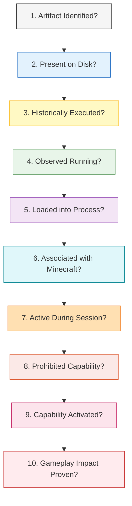

# 26 — Forensic Conclusion Model & Wording Governance

**Platform Name**: Minecraft SS Forensics  
**Document Status**: Official Architecture Specification (Expansion)  
**Version**: 3.0.0-DRAFT  
**Author**: Principal Security Architect, Forensic Standards Auditor  
**Classification**: Legal Forensics & Conclusion Engineering  

---

## 1. The Ten Forensic Questions & Evidentiary Boundaries

The ultimate goal of the platform is to replace subjective opinions with deterministic forensic answers. To prevent overreaching conclusions, every finding and final verdict must formally evaluate **ten independent forensic questions**:

---

## 2. Specification of the Ten Questions

### Question 1: Was an artifact identified?
- **Required Evidence**: Cryptographic hash match (SHA-256), Authenticode digital certificate, or verified package manifest.
- **Optional Corroboration**: Internal class package paths, PE version metadata.
- **Disqualifying Contradictions**: Mismatched file size, corrupted archive central directory, conflicting file hash.
- **Confidence Boundaries**: High for cryptographic matches; Low for filename-only heuristics.
- **Permitted Wording**: *"Artifact matches reference database entry for [Software Name] via SHA-256 hash."*
- **Forbidden Wording**: *"User downloaded a cheat."* (Does not prove who placed it or why).

### Question 2: Was it present on disk?
- **Required Evidence**: Verified file path, directory listing, or NTFS Master File Table ($MFT) record.
- **Optional Corroboration**: USN Journal creation record.
- **Disqualifying Contradictions**: File reported on disk but inaccessible (`FileNotFoundException`), ghost directory pointer.
- **Confidence Boundaries**: High (direct Win32 `GetFileAttributesEx`).
- **Permitted Wording**: *"File exists on storage volume at [Redacted Path]."*
- **Forbidden Wording**: *"User installed cheat client."* (A downloaded archive is not necessarily installed).

### Question 3: Was it historically executed?
- **Required Evidence**: Windows Prefetch SCCA execution record, UserAssist ROT13 registry entry, BAM/DAM execution timestamp, or PCA log.
- **Optional Corroboration**: SetupAPI driver installation record, USN execution read log.
- **Disqualifying Contradictions**: Prefetch record path does not correlate with file identity or volume serial.
- **Confidence Boundaries**: High if dual-corroborated (Prefetch + UserAssist); Moderate if single source.
- **Permitted Wording**: *"Operating system historical records demonstrate binary execution on [Timestamp UTC]."*
- **Forbidden Wording**: *"User cheated in Minecraft on [Timestamp]."* (Execution does not prove Minecraft was targeted).

### Question 4: Was it observed running?
- **Required Evidence**: Active Process Identifier (PID) in Win32 process table with verified executable image path.
- **Optional Corroboration**: Active CPU thread execution, window handle ownership (`HWND`).
- **Disqualifying Contradictions**: Process name matches but PID is stale; image path points to an unrelated system utility.
- **Confidence Boundaries**: High (real-time sampling).
- **Permitted Wording**: *"Process [Name] (PID [X]) was actively scheduled on the operating system during scan."*
- **Forbidden Wording**: *"Active cheat process injecting into game."* (External running process is not automatically injected).

### Question 5: Was it loaded into a process?
- **Required Evidence**: Native module base address in process PEB module list (`EnumProcessModulesEx`) or memory map.
- **Optional Corroboration**: Open file handle locked by the process.
- **Disqualifying Contradictions**: File exists on disk but base address cannot be resolved; module belongs to another PID.
- **Confidence Boundaries**: High for unhooked PEB lists; Moderate if inferred from handle tables.
- **Permitted Wording**: *"Native library [Name] is mapped into virtual address space at base address [0x...]."*
- **Forbidden Wording**: *"Malicious DLL injection."* (Legitimate JNA/LWJGL libraries load into address space).

### Question 6: Was it associated with Minecraft?
- **Required Evidence**: Module loaded directly inside `javaw.exe`, OR Java agent on JVM command line, OR active process holding open handle to `javaw.exe` with `PROCESS_VM_READ/WRITE`.
- **Optional Corroboration**: External window positioned identically over Minecraft viewport.
- **Disqualifying Contradictions**: Process running in separate user desktop session with zero open handles to Java.
- **Confidence Boundaries**: High for in-memory modules and agent arguments; Moderate for external handles.
- **Permitted Wording**: *"Artifact is directly attached to the Minecraft Java Virtual Machine (PID [X])."*
- **Forbidden Wording**: *"Minecraft client is hacked."* (Must specify exact technical connection).

### Question 7: Was it observed during the relevant Minecraft session?
- **Required Evidence**: Process creation/execution timestamp falls strictly between session start and session end: $t_{\text{start}} \le t_{\text{event}} \le t_{\text{end}}$.
- **Optional Corroboration**: Session event entries in `latest.log`.
- **Disqualifying Contradictions**: Event timestamp is older than session start; process exited before game launch.
- **Confidence Boundaries**: High if process was active during scan; Moderate if derived from Prefetch intervals.
- **Permitted Wording**: *"Artifact activity was temporally concurrent with the active Minecraft session."*
- **Forbidden Wording**: *"Player used cheats during the match."* (Concurrency is not proof of activation).

### Question 8: Did it possess a prohibited capability?
- **Required Evidence**: Decompiled bytecode analysis, AST inspection, or verified reference database capability profile (`CAP-*`).
- **Optional Corroboration**: Configuration schema entries, menu string references.
- **Disqualifying Contradictions**: Bytecode lacks combat or visual hooks; mod is verified authentic utility without forbidden features.
- **Confidence Boundaries**: High for un-obfuscated bytecode; Inconclusive if fully encrypted.
- **Permitted Wording**: *"Software possesses technical capability for [Capability Name] (Classification: CAPABILITY_CONFIRMED)."*
- **Forbidden Wording**: *"Player had unfair advantage."* (Software capability is not game advantage without use).

### Question 9: Is there evidence that the capability was activated?
- **Required Evidence**: Configuration file shows feature toggle `true`, memory variable inspection confirms state `enabled`, or log records toggle event.
- **Optional Corroboration**: Keybind binding associated with capability.
- **Disqualifying Contradictions**: Config file shows feature explicitly disabled (`reach_enabled: false`).
- **Confidence Boundaries**: Moderate (configs can be edited while game is closed).
- **Permitted Wording**: *"Configuration records indicate capability [Name] was configured in an active state."*
- **Forbidden Wording**: *"Feature was used to win match."* (Configured active does not prove player engaged opponents).

### Question 10: Is there independent evidence of gameplay impact?
- **Required Evidence**: Server-side combat telemetry (hit distance logs, impossible rotation angles), server anti-cheat flag package (`.mcsec`).
- **Optional Corroboration**: Video recording synchronization.
- **Disqualifying Contradictions**: Server combat logs demonstrate vanilla-bounded reach ($\le 3.0\text{ blocks}$) across all hits.
- **Confidence Boundaries**: High if corroborated by server NTP logs; **IMPOSSIBLE** for client scanner alone.
- **Permitted Wording**: *"Client technical capability is corroborated by server-side gameplay flag [Flag Name]."*
- **Forbidden Wording**: (If no server data): *"Player definitely gained gameplay advantage."*

---

## 3. Mandatory Wording Governance: Permitted vs Forbidden Language

To protect server organizations and players from subjective libel and unscientific reports, the reporting engine enforces strict vocabulary constraints:

| Permitted Forensic Phrase | Forbidden Pseudo-Forensic Phrase | Architectural Rationale |
| :--- | :--- | :--- |
| *"Artifact identified on storage volume"* | *"Player had cheats installed"* | Presence on disk is storage, not necessarily installation. |
| *"Historical execution recorded on [Date]"* | *"Player cheated on [Date]"* | Executing an executable does not prove game cheating. |
| *"Unverified native module mapped in memory"* | *"Player injected a hack"* | Native module may be a legitimate unpack or graphics hook. |
| *"Software possesses reach modification capability"*| *"Player had 4-block reach"* | Static capability is not dynamic measurement. |
| *"Inconclusive due to missing telemetry"* | *"Player bypassed the scan"* | Inaccessible checks (e.g. non-admin) are not proof of evasion. |
| *"No known prohibited indicators detected"* | *"Player is 100% clean"* | Scanner coverage is bounded; negative proof cannot be universal. |
