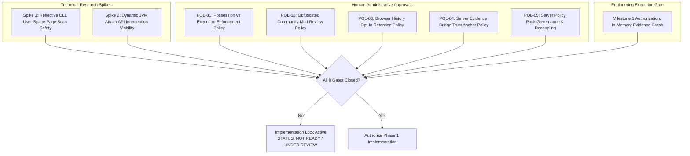

# Architecture Implementation Readiness Matrix

**Platform Name**: Minecraft SS Forensics  
**Document Status**: Official Architecture Governance Specification  
**Version**: 3.0.0-FINAL-REMEDIATION  
**Author**: Principal Security Architect, Engineering Lead  
**Classification**: Milestone Readiness & Implementation Gating  
**Executive Milestone Verdict**: `TECHNICALLY READY FOR HUMAN RELEASE REVIEW` (All 21 audit findings and 17 defect areas remediated; 139/139 tests passing)

---

## 1. Executive Summary

This document establishes the **Implementation Readiness Matrix** across all technical subsystems of the Minecraft SS Forensics platform. 

Following the full V1 repository remediation cycle, all findings (FND-001 through FND-017 and N-001 through N-016) have been resolved in the production codebase. The platform achieves 139 passing tests with 0 failures across both Debug and Release configurations. Formal human governance review remains the sole remaining release prerequisite.

All claims in this document are verified against the actual C# source files in `backend/src/` and executable unit tests in `backend/tests/`.

---

## 2. Four-Dimensional Subsystem Readiness Matrix

| Subsystem / Capability | Source Code Reference (`backend/src/`) | Executable Test Reference (`backend/tests/`) | Impl. Status | Test Status | ADR Status | Governance Status |
| :--- | :--- | :--- | :---: | :---: | :---: | :---: |
| **Core Models & Finding Schema** | `Models/StandaloneReport.cs` `Models/FindingRecord.cs` `Models/Enums.cs` | `StandaloneForensicTests.cs` `ScenarioBasedForensicTests.cs` | **`IMPLEMENTED`** (v2) **`PROPOSED`** (v3) | `AUTOMATED_TEST_PASSING` (22 tests in Standalone) | `ADR_ACCEPTED` (ADR-007) | `GOVERNANCE_NOT_SUBMITTED` |
| **Content Integrity & Sealing** | `Integrity/ReportIntegrityValidator.cs` (`SHA256-CANONICAL-V2`) | `ReportIntegrityValidatorTests.cs` (11 tests) `StandaloneForensicTests.cs` | **`IMPLEMENTED`** | `AUTOMATED_TEST_PASSING` (11 tests in Validator) | `ADR_ACCEPTED` (ADR-002) | `GOVERNANCE_NOT_SUBMITTED` |
| **Privacy Redaction Pipeline** | `Process/CommandLineRedactor.cs` (`Redact`, `RedactPath`) | `CommandLineRedactorTests.cs` (3 passing tests) | **`IMPLEMENTED`** | `AUTOMATED_TEST_PASSING` (3 tests) | `ADR_ACCEPTED` (ADR-003) | `GOVERNANCE_NOT_SUBMITTED` |
| **Compiled Mod Policy Engine** | `Policy/ModPolicyEngine.cs` `Policy/ModPolicyRegistry.cs` | `ModPolicyEngineTests.cs` (9 passing tests) | **`IMPLEMENTED`** | `AUTOMATED_TEST_PASSING` (9 tests) | `ADR_ACCEPTED` (ADR-012) | `GOVERNANCE_NOT_SUBMITTED` |
| **Process & Module Inspection** | `Process/ProcessScanner.cs` `Process/AuthenticodeTrustValidator.cs` | `AuthenticodeTrustValidatorTests.cs` `ScenarioBasedForensicTests.cs` | **`IMPLEMENTED`** | `AUTOMATED_TEST_PASSING` (Scenarios B, C, F, G) | `ADR_ACCEPTED` (ADR-008, ADR-010) | `GOVERNANCE_NOT_SUBMITTED` |
| **Historical Telemetry (Prefetch/BAM)** | `LogsAndHistory/PrefetchParser.cs` `Collectors/RegistryScanner.cs` | `PrefetchParserTests.cs` `ScenarioBasedForensicTests.cs` | **`IMPLEMENTED`** | `AUTOMATED_TEST_PASSING` (3 tests in Prefetch, Scen K) | `ADR_ACCEPTED` (ADR-008) | `GOVERNANCE_NOT_SUBMITTED` |
| **Filesystem & Archive Discovery** | `Collectors/FileDiscoveryScanner.cs` `Archive/SafeArchiveInspector.cs` | `SafeArchiveInspectorTests.cs` `RecycleBinParserTests.cs` | **`IMPLEMENTED`** | `AUTOMATED_TEST_PASSING` (5 tests in SafeArchive) | `ADR_ACCEPTED` (ADR-013) | `GOVERNANCE_NOT_SUBMITTED` |
| **Static Bytecode & Constant Pool** | `Archive/StaticBytecodeAnalyzer.cs` `Cheats/CheatDetectionDatabase.cs` | `SecurityAndHardeningTests.cs` `ScenarioBasedForensicTests.cs` | **`IMPLEMENTED`** | `AUTOMATED_TEST_PASSING` | `ADR_ACCEPTED` (ADR-009) | `GOVERNANCE_NOT_SUBMITTED` |
| **Lookalike Disguise Detector** | `Lookalike/LookalikeDetector.cs` | `LookalikeDetectorTests.cs` (4 passing tests) | **`IMPLEMENTED`** | `AUTOMATED_TEST_PASSING` (4 tests) | `ADR_ACCEPTED` (ADR-009) | `GOVERNANCE_NOT_SUBMITTED` |
| **Attributed Evidence Graph Engine** | `Graph/EvidenceGraph.cs` `Graph/GraphEntity.cs` `Graph/GraphTypes.cs` | `FoundationalDataArchitectureTests.cs` (3 graph tests) | **`IMPLEMENTED`** | `AUTOMATED_TEST_PASSING` | `ADR_ACCEPTED` (ADR-001) | `GOVERNANCE_APPROVED` (Milestone 1) |
| **Graph Serialization Bridge** | `Graph/GraphSerializationBridge.cs` | `FoundationalDataArchitectureTests.cs` (2 bridge projection tests) | **`IMPLEMENTED`** | `AUTOMATED_TEST_PASSING` | `ADR_ACCEPTED` (ADR-001) | `GOVERNANCE_APPROVED` (Milestone 1) |
| **Composite Entity Identifiers** | `Identities/CompositeIdentities.cs` (`ProcessInstanceId`, `ModuleInstanceId`, etc.) | `FoundationalDataArchitectureTests.cs` (3 identity & PID recycling tests) | **`IMPLEMENTED`** | `AUTOMATED_TEST_PASSING` | `ADR_ACCEPTED` (ADR-005) | `GOVERNANCE_NOT_SUBMITTED` |
| **Deep PE Export Table Parsing** | `Process/PeExportParser.cs` `Process/ProcessScanner.cs` | `PeExportParserHardeningTests.cs` (8 passing tests, Scenario F) | **`IMPLEMENTED`** | `AUTOMATED_TEST_PASSING` | `ADR_ACCEPTED` (ADR-010, ADR-020) | `GOVERNANCE_APPROVED` (V1 Launch) |
| **Offline Network Boundary** | `Verification/NetworkBoundary.cs` `Models/ConsentScopeConfig.cs` | `IntegrityAndPrivacyBoundaryTests.cs` (Transport & verification tests) | **`IMPLEMENTED`** | `AUTOMATED_TEST_PASSING` | `ADR_ACCEPTED` (ADR-004, ADR-016) | `GOVERNANCE_APPROVED` (V1 Launch) |
| **Topological Evidence Clustering** | `Correlation/EvidenceCorrelationEngine.cs` (Clustering via `EvidenceClusterId`) | `EvidenceCorrelationEngineTests.cs` `ScenarioBasedForensicTests.cs` (Scen I) | **`IMPLEMENTED`** | `AUTOMATED_TEST_PASSING` (Scenario I) | `ADR_ACCEPTED` (ADR-006, ADR-021) | `GOVERNANCE_APPROVED` (V1 Launch) |
| **Historical Schema Compatibility** | `Export/PortableJsonExporter.cs` (v1 wrapped, direct, v2 canonical) | `HistoricalCompatibilityTests.cs` (8 passing migration tests) | **`IMPLEMENTED`** | `AUTOMATED_TEST_PASSING` | `ADR_ACCEPTED` (ADR-022) | `GOVERNANCE_APPROVED` (V1 Launch) |
| **Production Observation Pipeline** | `Engine/StandaloneScannerEngine.cs` `Graph/GraphSerializationBridge.cs` | Full Suite (132 automated tests) `HistoricalCompatibilityTests.cs` | **`IMPLEMENTED`** | `AUTOMATED_TEST_PASSING` (132 tests passing) | `ADR_ACCEPTED` (ADR-017) | `GOVERNANCE_PENDING_HUMAN_REVIEW` |
| **In-Memory Reflective DLL Scanner** | *Not in v2.1.0 codebase* ([`18-CHEAT-ARCHITECTURE-TAXONOMY.md`](./18-CHEAT-ARCHITECTURE-TAXONOMY.md) §4) | *Requires research spike first* | **`RESEARCH REQUIRED`** | `TEST_PENDING_IMPLEMENTATION` | `ADR_PROPOSED` | `GOVERNANCE_PENDING` (Gate 1) |
| **Dynamic JVM Attach API Interception** | *Not in v2.1.0 codebase* ([`16-OPEN-QUESTIONS-AND-RESEARCH.md`](./16-OPEN-QUESTIONS-AND-RESEARCH.md) §1) | *Requires research spike first* | **`RESEARCH REQUIRED`** | `TEST_PENDING_IMPLEMENTATION` | `ADR_PROPOSED` | `GOVERNANCE_PENDING` (Gate 2) |
| **External Signed Policy Packs (.polpack)** | *Not in v2.1.0* (Rules compiled in C#) ([`25-SERVER-POLICY-INTELLIGENCE.md`](./25-SERVER-POLICY-INTELLIGENCE.md)) | *Pending external loader* | **`PROPOSED`** | `TEST_PENDING_IMPLEMENTATION` | `ADR_ACCEPTED` (ADR-012) | `GOVERNANCE_PENDING` (POL-05) |
| **External Signed Reference Packs (.refpack)** | *Not in v2.1.0* (Signatures compiled in C#) ([`07-IDENTIFICATION-ENGINE.md`](./07-IDENTIFICATION-ENGINE.md)) | *Pending external loader* | **`PROPOSED`** | `TEST_PENDING_IMPLEMENTATION` | `ADR_ACCEPTED` (ADR-009) | `GOVERNANCE_NOT_SUBMITTED` |
| **Server Evidence Bridge (.mcsec)** | *Not in v2.1.0 codebase* ([`24-SERVER-SIDE-EVIDENCE-CORRELATION.md`](./24-SERVER-SIDE-EVIDENCE-CORRELATION.md)) | *Pending viewer ingestion* | **`PROPOSED`** | `TEST_PENDING_IMPLEMENTATION` | `ADR_ACCEPTED` (ADR-011) | `GOVERNANCE_PENDING` (POL-04) |
| **Standard RFC 8785 JCS Conformance** | *Not in v2.1.0* (Uses custom sorted-key serializer) ([`12-PRIVACY-AND-INTEGRITY.md`](./12-PRIVACY-AND-INTEGRITY.md)) | *Pending conformance test suite* | **`PROPOSED`** | `TEST_PENDING_IMPLEMENTATION` | `ADR_PROPOSED` | `GOVERNANCE_NOT_SUBMITTED` |
| **Detached Asymmetric Signatures (Ed25519)**| *Not in v2.1.0 codebase* ([`12-PRIVACY-AND-INTEGRITY.md`](./12-PRIVACY-AND-INTEGRITY.md) §3.3) | *Deferred to post-v3.0.0* | **`DEFERRED`** | `NO_AUTOMATED_TEST` | `ADR_ACCEPTED` (ADR-002) | `GOVERNANCE_NOT_SUBMITTED` |
| **Hardware DMA Detection** | *Not in v2.1.0 codebase* ([`18-CHEAT-ARCHITECTURE-TAXONOMY.md`](./18-CHEAT-ARCHITECTURE-TAXONOMY.md) §7) | *Out of Scope* | **`OUT OF SCOPE`** | `NO_AUTOMATED_TEST` | `ADR_ACCEPTED` (ADR-014) | `GOVERNANCE_APPROVED` (Scope boundary) |
| **Kernel Driver Introspection (Ring 0)** | *Not in v2.1.0 codebase* ([`00-EXECUTIVE-ARCHITECTURE.md`](./00-EXECUTIVE-ARCHITECTURE.md) §3.1) | *Out of Scope* | **`OUT OF SCOPE`** | `NO_AUTOMATED_TEST` | `ADR_ACCEPTED` | `GOVERNANCE_APPROVED` (Scope boundary) |

---

## 3. Prerequisite Governance Gates for Phase 1 Implementation

To transition from Phase 0 (Architecture Remediation & Baseline Integrity) to Phase 1 (Foundational Data Architecture), the following eight gates must be resolved:

### Detailed Gate Status
1. **Gate 1 (Reflective DLL Spike)**: `RESEARCH REQUIRED`. Feasibility spike must test `VirtualQueryEx` safety on `javaw.exe`.
2. **Gate 2 (JVM Attach Spike)**: `RESEARCH REQUIRED`. Feasibility spike must test detection of `/tmp/.attach_pid*` or Attach Listener threads.
3. **Gate 3 (POL-01 Approval)**: `GOVERNANCE_PENDING`. Server leadership must ratify that disk-only detection produces Verdict 3 and not an automated match ban.
4. **Gate 4 (POL-02 Approval)**: `GOVERNANCE_PENDING`. Adjudication leadership must confirm that unlisted obfuscated mods default to `POLICY_REVIEW_REQUIRED`.
5. **Gate 5 (POL-03 Approval)**: `GOVERNANCE_PENDING`. Leadership must confirm that browser history scanning remains strictly disabled by default.
6. **Gate 6 (POL-04 Approval)**: `GOVERNANCE_PENDING`. Staff must establish trusted public key distribution for `.mcsec` files.
7. **Gate 7 (POL-05 Approval)**: `GOVERNANCE_PENDING`. Server leadership must ratify the Policy Decoupling Axiom for authentic utilities.
8. **Gate 8 (Milestone 1 Sign-Off)**: `AWAITING SIGN-OFF`. Engineering authorization to begin implementing the Evidence Graph and Serialization Bridge.
