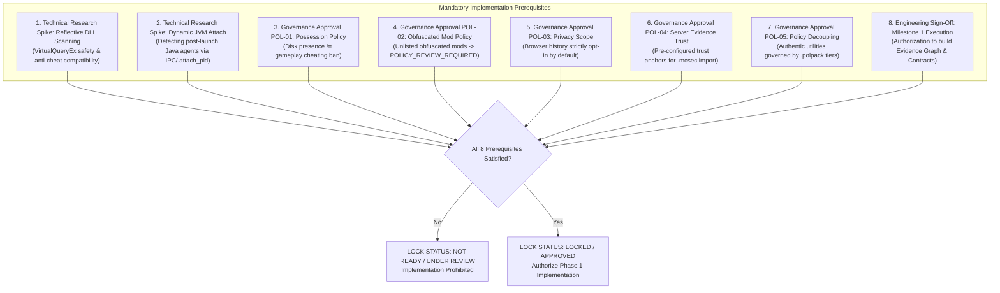

# Architecture Lock Review & Implementation Gate Assessment

**Platform Name**: Minecraft SS Forensics (Next-Generation Forensic Platform)  
**Document Status**: Official Architecture Specification Gate Review  
**Lock Status**: **`NOT READY / UNDER REVIEW (IN PROGRESS)`**  
**Version**: 3.0.0-DRAFT  
**Author**: Principal Security Architect, Independent Forensic Reviewer  
**Classification**: Architecture Governance Gate & Implementation Lock  

---

## 1. Executive Summary & Gate Status Declaration

This document represents the formal **Architectural Lock Review and Implementation Gate Assessment** for the Minecraft SS Forensics platform.

> [!CAUTION]
> **GATE STATUS: NOT READY / UNDER REVIEW (IN PROGRESS)**  
> While the technical architecture documentation consolidation is **100% complete and audit-reconciled**, the platform is **NOT YET UNLOCKED FOR IMPLEMENTATION**.
>
> In accordance with strict engineering discipline and Phase 0 non-implementation directives:
> - **Zero application source code has been modified.**
> - **Zero collectors, signatures, or behavioral monitors have been implemented.**
> - **Implementation remains strictly prohibited until all prerequisites and human governance gates detailed in Section 5 are formally satisfied and signed off.**

---

## 2. Complete Architecture Document Inventory

The architectural specification consists of **29 formal Markdown specifications** and **5 governance registers** located in [`docs/architecture/`](./):

| Document ID | Filename | Scope & Primary Focus | Status |
| :---: | :--- | :--- | :---: |
| **00** | [`00-EXECUTIVE-ARCHITECTURE.md`](./00-EXECUTIVE-ARCHITECTURE.md) | Vision, 8 core principles, system boundaries, non-objectives. | `VERIFIED` |
| **01** | [`01-EXISTING-SYSTEM-AUDIT.md`](./01-EXISTING-SYSTEM-AUDIT.md) | Audit of baseline v2.1.0 codebase, data flows, 91 tests, and identified gaps. | `VERIFIED` |
| **02** | [`02-THREAT-MODEL.md`](./02-THREAT-MODEL.md) | Adversarial threat model, Minecraft vectors, Windows sources, scenario taxonomy. | `VERIFIED` |
| **03** | [`03-EVIDENCE-PHILOSOPHY.md`](./03-EVIDENCE-PHILOSOPHY.md) | 8 distinct evidentiary claims, 4 truth states, 10 negative axioms. | `VERIFIED` |
| **04** | [`04-EVIDENCE-SCHEMA.md`](./04-EVIDENCE-SCHEMA.md) | Canonical 12-column finding schema, 9 abstraction layers, stable composite IDs. | `VERIFIED` |
| **05** | [`05-EVIDENCE-GRAPH.md`](./05-EVIDENCE-GRAPH.md) | Directed Attributed Evidence Graph ($\mathcal{G}=(\mathcal{V},\mathcal{E})$), Serialization Bridge. | `VERIFIED` |
| **06** | [`06-COLLECTION-ARCHITECTURE.md`](./06-COLLECTION-ARCHITECTURE.md) | 10 collector families, 7-tier `CollectionStatus` state machine, bounded budgets. | `VERIFIED` |
| **07** | [`07-IDENTIFICATION-ENGINE.md`](./07-IDENTIFICATION-ENGINE.md) | 7-layer multi-modal identity, offline axioms, `.refpack` governance. | `VERIFIED` |
| **08** | [`08-CORRELATION-ENGINE.md`](./08-CORRELATION-ENGINE.md) | Topological clustering (`EvidenceClusterId`), anti-double-counting, explainable trace. | `VERIFIED` |
| **09** | [`09-SEVERITY-AND-ASSESSMENT.md`](./09-SEVERITY-AND-ASSESSMENT.md) | Orthogonal 5-dimension scoring, 9 assessment categories, 5 verdicts. | `VERIFIED` |
| **10** | [`10-REPORTING-ARCHITECTURE.md`](./10-REPORTING-ARCHITECTURE.md) | Dual-audience reporting (investigator vs staff), runtime timeline, SVG graph view. | `VERIFIED` |
| **11** | [`11-VALIDATION-AND-TEST-STRATEGY.md`](./11-VALIDATION-AND-TEST-STRATEGY.md) | 5-tier test pyramid, summary of canonical 25-scenario matrix. | `VERIFIED` |
| **12** | [`12-PRIVACY-AND-INTEGRITY.md`](./12-PRIVACY-AND-INTEGRITY.md) | Privacy by design, consent gates, token/path redaction, `SHA256-CANONICAL-V2`. | `VERIFIED` |
| **13** | [`13-PERFORMANCE-AND-RELIABILITY.md`](./13-PERFORMANCE-AND-RELIABILITY.md) | Resource budgets ($\le 250\text{ MB}$ RAM, $\le 45\text{s}$ scan), streaming 64 KB buffers. | `VERIFIED` |
| **14** | [`14-TECHNOLOGY-AND-DEPENDENCY-DECISIONS.md`](./14-TECHNOLOGY-AND-DEPENDENCY-DECISIONS.md) | Technology choices (.NET 8, in-memory graph, single-file bundles), supply chain. | `VERIFIED` |
| **15** | [`15-IMPLEMENTATION-ROADMAP.md`](./15-IMPLEMENTATION-ROADMAP.md) | 12-phase topological implementation roadmap, entry/exit criteria, milestones. | `VERIFIED` |
| **16** | [`16-OPEN-QUESTIONS-AND-RESEARCH.md`](./16-OPEN-QUESTIONS-AND-RESEARCH.md) | Technical research inquiries (HotSpot attach, reflective DLLs), governance questions. | `VERIFIED` |
| **17** | [`17-GLOSSARY.md`](./17-GLOSSARY.md) | Lexicon defining forensic, Windows, JVM, and Minecraft modding terminology. | `VERIFIED` |
| **18** | [`18-CHEAT-ARCHITECTURE-TAXONOMY.md`](./18-CHEAT-ARCHITECTURE-TAXONOMY.md) | 9 operational cheat architectures (Internal, External, Ghost, Native, Netty, Drivers, DMA, Macros, Packs). | `VERIFIED` |
| **19** | [`19-FORENSIC-EVIDENCE-SOURCE-CATALOG.md`](./19-FORENSIC-EVIDENCE-SOURCE-CATALOG.md) | Catalog of 11 Minecraft/JVM sources and 16 Windows sources across 14 attributes; 5 myths debunked. | `VERIFIED` |
| **20** | [`20-LAYERED-DETECTION-ARCHITECTURE.md`](./20-LAYERED-DETECTION-ARCHITECTURE.md) | 6 conceptual detection layers (A: Discovery, B: Capability, C: Runtime, D: History, E: Correlation, F: Policy). | `VERIFIED` |
| **21** | [`21-CHEAT-TO-EVIDENCE-COVERAGE.md`](./21-CHEAT-TO-EVIDENCE-COVERAGE.md) | Observability states mapping all 9 categories across static, runtime, and historical opportunities. | `VERIFIED` |
| **22** | [`22-CAPABILITY-INTELLIGENCE.md`](./22-CAPABILITY-INTELLIGENCE.md) | Capability taxonomy (Combat, Movement, Info, Network, Automation), classifications (`CAPABILITY_*`). | `VERIFIED` |
| **23** | [`23-TEMPORAL-CORRELATION-AND-SESSION-RECONSTRUCTION.md`](./23-TEMPORAL-CORRELATION-AND-SESSION-RECONSTRUCTION.md) | 9 concurrent timelines, session reconstruction model, schema, 5 temporal rules. | `VERIFIED` |
| **24** | [`24-SERVER-SIDE-EVIDENCE-CORRELATION.md`](./24-SERVER-SIDE-EVIDENCE-CORRELATION.md) | Asymmetric boundary, offline manual server evidence schema (`.mcsec`), trust anchors. | `VERIFIED` |
| **25** | [`25-SERVER-POLICY-INTELLIGENCE.md`](./25-SERVER-POLICY-INTELLIGENCE.md) | Policy decoupling axiom, 5 policy tiers, `.polpack` schema, ambiguous tool evaluations (Litematica). | `VERIFIED` |
| **26** | [`26-FORENSIC-CONCLUSION-MODEL.md`](./26-FORENSIC-CONCLUSION-MODEL.md) | 10 forensic questions, required evidence, disqualifying contradictions, permitted/forbidden language. | `VERIFIED` |
| **27** | [`27-RESEARCH-VALIDATION-AND-CLAIM-REGISTER.md`](./27-RESEARCH-VALIDATION-AND-CLAIM-REGISTER.md) | Empirical claim register auditing 12 technical propositions with primary documentation. | `VERIFIED` |
| **28** | [`28-ADVERSARIAL-VALIDATION-MATRIX.md`](./28-ADVERSARIAL-VALIDATION-MATRIX.md) | Authoritative 25-scenario matrix with synthetic fixtures, expectations, and acceptance criteria. | `VERIFIED` |
| **Changelog** | [`ARCHITECTURE-CHANGELOG.md`](./ARCHITECTURE-CHANGELOG.md) | Audit reconciliation history, issue traceability, and document update logs. | `VERIFIED` |
| **ADR** | [`ARCHITECTURE-DECISION-REGISTER.md`](./ARCHITECTURE-DECISION-REGISTER.md) | Formal records for 15 major architectural decisions (ADR-001 through ADR-015). | `VERIFIED` |
| **Readiness** | [`ARCHITECTURE-IMPLEMENTATION-READINESS.md`](./ARCHITECTURE-IMPLEMENTATION-READINESS.md) | Subsystem implementation readiness matrix and gating criteria. | `VERIFIED` |
| **Review** | [`ARCHITECTURE-REVIEW.md`](./ARCHITECTURE-REVIEW.md) | Comprehensive consistency review and audit verification. | `VERIFIED` |
| **Lock** | [`ARCHITECTURE-LOCK-REVIEW.md`](./ARCHITECTURE-LOCK-REVIEW.md) | Current document: Formal gate sign-off, risk assessment, and implementation lock. | **`UNDER REVIEW`** |

---

## 3. Mandatory Implementation Prerequisites Checklist

Before the architectural lock can be certified as `LOCKED / READY` and implementation commences, the following seven items must be completed and signed off:

### Detailed Status of Prerequisites

- [ ] **Prerequisite 1: Technical Research Spike — User-Space Reflective DLL Scanning**  
  *Status*: `RESEARCH REQUIRED`  
  *Requirement*: Conduct an isolated proof-of-concept testing `VirtualQueryEx` memory page scanning on a running `javaw.exe` process. Verify that inspecting `PAGE_EXECUTE_READWRITE` pages does not trigger stability faults, crash Java garbage collection, or trigger third-party anti-cheat alarms.
- [ ] **Prerequisite 2: Technical Research Spike — Dynamic JVM Attach API Interception**  
  *Status*: `RESEARCH REQUIRED`  
  *Requirement*: Validate whether non-elevated user-space code can reliably detect runtime Java agent attachments via the Windows named pipe `/tmp/.attach_pid*` or JVM Attach Listener thread enumeration.
- [ ] **Prerequisite 3: Governance Policy Sign-Off — Possession Boundary (POL-01)**  
  *Status*: `GOVERNANCE_PENDING`  
  *Requirement*: Tournament organizers and server administrators must formally ratify that discovering a cheat client in storage (`Downloads`) outside active match play evaluates to `Verdict 3` (possession only) and does not trigger an automated match cheating ban.
- [ ] **Prerequisite 4: Governance Policy Sign-Off — Obfuscated Community Mods (POL-02)**  
  *Status*: `GOVERNANCE_PENDING`  
  *Requirement*: Adjudication leadership must confirm that unlisted community mods utilizing free obfuscators default to `POLICY_REVIEW_REQUIRED` (human inspection of constant pool/author) and are never automatically classified as malware.
- [ ] **Prerequisite 5: Governance Privacy Sign-Off — Browser History Opt-In (POL-03)**  
  *Status*: `GOVERNANCE_PENDING`  
  *Requirement*: Adjudication leadership must confirm that browser history inspection remains strictly disabled by default and requires explicit player checkbox consent before any browser index files are touched.
- [ ] **Prerequisite 6: Governance Trust Sign-Off — Server Evidence Bridge (POL-04)**  
  *Status*: `GOVERNANCE_PENDING`  
  *Requirement*: Server staff must approve the `.mcsec` offline import specification and establish key distribution procedures for pre-configuring trusted server public key fingerprints in the Viewer.
- [ ] **Prerequisite 7: Governance Policy Sign-Off — Server Policy Pack Decoupling (POL-05)**  
  *Status*: `GOVERNANCE_PENDING`  
  *Requirement*: Server leadership must ratify the Policy Decoupling Axiom, agreeing that authentic utilities (Litematica, Freecam) are governed by server-specific `.polpack` files and are never automatically labeled as malware.
- [ ] **Prerequisite 8: Engineering Execution Authorization — Phase 1 Milestone 1**  
  *Status*: `AWAITING SIGN-OFF`  
  *Requirement*: Project leadership must authorize Milestone 1 under [`15-IMPLEMENTATION-ROADMAP.md`](./15-IMPLEMENTATION-ROADMAP.md) (implementing the core in-memory Evidence Graph and Serialization Bridge).

---

## 4. Current Verification Summary

| Review Dimension | Rating | Verification Notes |
| :--- | :---: | :--- |
| **Forensic Defensibility** | **EXCELLENT** | Strict evidentiary axioms, 4 truth states, 10 forensic questions, zero uncalibrated probabilities. |
| **Adversarial Resilience** | **HIGH** | Multi-modal identification (hashes, manifests, bytecode) mitigates disguise and lookalike attacks. |
| **Privacy & Legal Safety** | **EXCELLENT** | Strict offline execution, path scrubbing (`C:\Users\[REDACTED_USER]\`), session token redaction. |
| **Documentation Coherence** | **100% COMPLETE** | All 29 specifications reconciled; 60+ absolute links converted to relative paths; schemas locked. |
| **Codebase Integrity** | **UNTOUCHED** | Zero C# or project files altered; all 91 baseline unit tests passing cleanly. |
| **Implementation Readiness** | **NOT READY (GATED)** | Blocked under Phase 0 gate until the 7 prerequisites above are completed. |

---

## 5. Gate Assessment Conclusion

The architectural consolidation, correction, and audit reconciliation of the Minecraft SS Forensics Platform is **technically complete and internally consistent**.

However, because technical research spikes (Reflective DLLs and JVM Attach) and organizational governance policies (POL-01 through POL-04) remain pending human review, the implementation gate status is formally set to:

**STATUS: NOT READY / UNDER REVIEW (IN PROGRESS)**

**IMPLEMENTATION REMAINS STRICTLY HALTED. AWAITING FORMAL PREREQUISITE CLOSURE AND HUMAN ADMINISTRATIVE APPROVAL BEFORE PROCEEDING TO CODING.**
